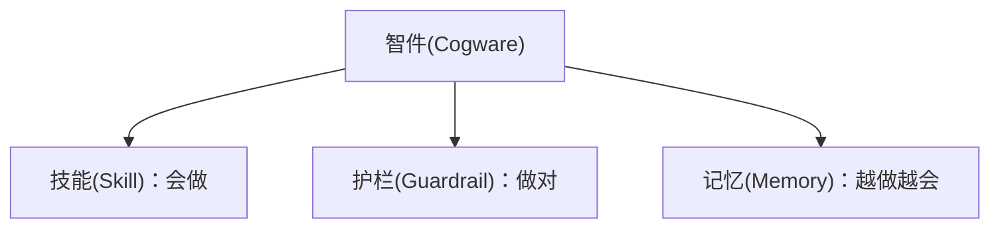
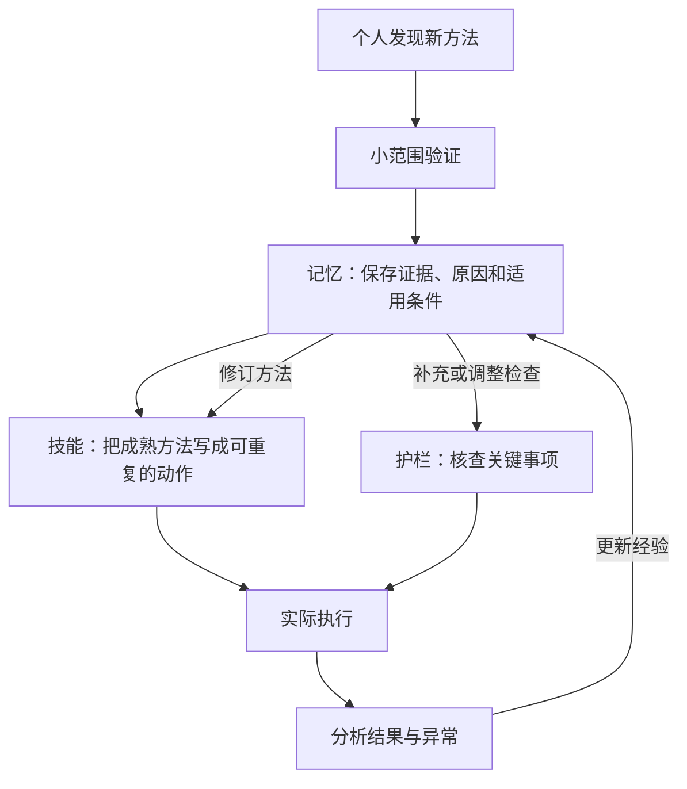

> 本文沿用原文的解释层次：先定义智件，再理解技能、护栏和记忆，随后解释三者如何形成闭环，最后联系组织经营、软件工程与 AI 协作。
>
> 原文解读是主体。标为“开发案例”和“AI 延伸”的内容是应用示例，不描述实际团队的经历；外部资料用于校准概念与补充依据。术语在定义处采用“中文(English)”，部分英文为解释性译名。

## 一、组织为什么需要智件

团队里有聪明人、有责任心，也有规章制度，为什么工作仍然可能混乱？

原文给出的解释是：让大家愿意协作，与让大家知道如何把工作稳定做好，是两件需要分别解决的事。

**制度(Organizational Rules and Incentives)** 在本文语境中，是围绕权责利、激励和约束形成的组织安排。它说明谁负责、如何分配利益、哪些行为不能发生，帮助个人努力与组织目标保持一致。

但即使职责划分清楚，也仍然可能出现这些问题：新人不知道如何接手；同一件事每个人做法不同；跨部门交接时反复遗漏信息；一到关键节点，就必须找某个资深同学救火。

这些现象提示我们，组织还需要积累自己的做事能力。文章把承载这种能力的东西称为“智件”。

对经营者和组织负责人而言，问题可以具体化为：**一个人成功解决过的问题，怎样变成其他人也能处理的问题？一次付过代价的失误，怎样让后续工作少付一次同样的代价？**

## 二、先理解整体：什么是智件

### 2.1 智件的定义

**智件(Cogware)**，按照原文的用法，是沉淀在组织中的方法、标准和经验。它使组织能够保存、调用并改进做事的能力，让个人积累的聪明在人员变化后仍能继续发挥作用。

这里的关键在于“沉淀在组织中”：方法能够传递给其他人，标准能在实际工作中执行，经验能影响下一次行动。

一位工程师知道怎样发布服务，是个人能力；团队把发布方法教给其他人，在关键位置设置检查，并不断吸收发布成败的经验，才逐渐形成组织的智件。

“智件”是本文采用的组织管理概念。它可以由文档、模板、培训、代码和自动化工具承载，其价值体现在实际工作中。本文不把它视为某种必须采购的软件或统一技术标准。

### 2.2 智件由什么组成

整体概念明确之后，才能进一步区分三个组成部分：

| 组成部分 | 在智件中的定义 | 主要回答的问题 |
|---|---|---|
| **技能(Skill)** | 组织可重复使用的做事方法 | 事情来了，应该怎么做？ |
| **护栏(Guardrail)** | 保证质量、防止关键错误的标准与检查机制 | 怎样确认做对了？哪些地方必须防错？ |
| **记忆(Memory)** | 被保存下来、可供后续工作利用的经验 | 过去的成败，能让下一次学到什么？ |

这张图只表达组成关系。流程、清单、经验库各属于哪一部分，下面逐层说明。

## 三、第一部分：技能——把做事方法留下来

### 3.1 技能是什么

**技能(Skill)** 是组织在一类任务到来时，可以反复调用的方法。它把“想取得什么结果”转化为“由谁、按什么顺序、完成哪些动作”。

原文强调的重点是稳定：工作不必每次从零组织，也不必完全依靠某个人临场发挥。

进一步说，一项技能包含组织对因果关系的假设：在一定条件下，由这些角色按相应顺序、在必要检查点执行这些动作，能够取得预期结果。后续执行既是在使用方法，也是在检验这项假设。

文章还借用了**组织惯例(Organizational Routine)** 的概念，说明企业会通过重复使用的行动模式保存能力。这里的重复并不意味着永不改变；方法可以先稳定使用，再根据结果修订。

### 3.2 流程、SOP、Playbook：技能的不同表现形式

在技能这一层内部，原文列出了几种常见形式。它们都在说明“怎么做”，关注的范围不同。

| 形式 | 定义 | 关注重点 |
|---|---|---|
| **流程(Process)** | 规定一件事如何在部门或角色之间流转 | 谁接下一步，怎样完成交接 |
| **标准作业程序(Standard Operating Procedure, SOP)** | 规定某个岗位或具体任务怎样操作 | 一项工作具体如何完成 |
| **场景打法(Playbook)** | 面对一类场景时采用的策略与行动方法 | 遇到这种情况，怎样应对 |

例如，需求评审完成后如何进入开发、测试和发布，属于流程；如何完成一次数据库迁移演练，属于 SOP；遇到线上响应变慢时，如何选择排查方向，属于场景打法。

无需为了名称划出绝对边界。一份实际工作指南可能同时涉及协作、操作和应对策略。理解它帮助团队完成什么，比把文件归入哪个名称更重要。

### 3.3 原文案例：华为为什么要引入 IPD

原文用华为引入**集成产品开发(Integrated Product Development, IPD)** 的案例，解释规模扩大后为什么需要稳定的方法：产品从需求到交付，涉及多个角色，个人拼命很难持续填补所有协作缺口。

这一案例的重点，是将跨角色的产品开发活动组织成可以反复执行的方法。原文提到的“先僵化，后优化，再固化”，也应放在这一变革背景中理解：先认真掌握方法，再基于实践调整，把验证有效的做法保留下来。

### 3.4 开发案例：给订单接口增加一个字段

假设团队要给订单接口增加一个可选字段。只说“开发完交给测试”，很多工作仍然隐含在个人经验里。

把技能写清楚，可以从一条简单路径开始：确认字段含义和兼容要求，修改接口与实现，补充相关测试，完成联调，然后进入发布。

流程说明产品、开发、测试之间怎样交接；具体操作指南说明如何更新接口文档、生成客户端或运行测试；如果涉及特殊客户的兼容问题，再补充相应的处理打法。

到这里，我们解决的是工作如何推进。工作推进到下一步之前，是否已经具备必要条件，还需要护栏来确认。

## 四、第二部分：护栏——在关键位置防止做错

### 4.1 护栏是什么

**护栏(Guardrail)** 回答两个问题：怎样判断工作符合要求，以及哪些错误必须在发生前拦住。

原文把清单、质量标准、验收条件、风险红线和评审门槛都放在这一部分。它们承担的作用有所不同：标准提供判断依据，验收条件说明交付何时可接受，红线划定边界，评审门槛规定进入下一阶段的条件。

原文特别强调，重要或不可逆的动作之前，需要先暂停，观察并确认事实。护栏应当放在可能发生关键错误的位置。

下面重点理解其中最容易与 SOP 混淆的清单。

### 4.2 清单是什么，为什么不等同于 SOP

**核查清单(Checklist)** 是帮助执行者确认关键事项没有遗漏的工具。它面向的是“本来知道怎么做，但仍可能忘记或误以为别人做过”的情况。

SOP 组织完整操作；清单集中核查那些容易遗漏、遗漏后果又比较重要的事项。

例如，部署指南说明如何构建和发布服务；发布清单确认本次测试通过的版本是否就是待发布版本、目标环境是否正确、出现异常时能否停止扩大影响。

原文强调，清单还承担团队同步的作用：关键参与者在同一个时点确认事实，减少“我以为你已经查过”的误解。

### 4.3 原文案例：手术团队为什么也需要清单

原文引用的 2009 年研究，在八家医院引入包含 19 项内容的手术安全清单。研究观察到，实施前后死亡率由 1.5% 下降至 0.8%，住院并发症发生率由 11% 下降至 7%。研究将这些变化表述为与清单实施相关联；它帮助说明，训练有素的团队也会受益于关键事项核查。[研究原文摘要](https://pubmed.ncbi.nlm.nih.gov/19144931/)

背后的一个解释是**认知卸载(Cognitive Offloading)**：通过外部动作或环境改变任务的信息处理要求，降低内部认知负担。清单替人承担部分记忆和核查任务，让注意力可以更多用于专业判断。[Risko 与 Gilbert 的研究综述](https://pubmed.ncbi.nlm.nih.gov/27542527/)

### 4.4 开发案例：怎样写一份有用的发布清单

继续前面的接口变更。以下是核查项的示例，需要按团队实际风险调整：

- 待发布的提交或制品，是否与本次验证通过的版本一致？
- 本次字段变更，是否已经验证旧客户端仍可正常工作？
- 发布目标，是否确认为本次计划的服务和环境？
- 出现异常时，是否有明确的停止条件和处置办法？

与“已经认真检查”相比，这些问题都有可核对的事实。

原文对好清单的要求可以保留为三个词：**短、硬、可确认**。先覆盖关键风险；能够可靠自动检查的内容，可以交给工具执行；需要专业判断的事项，应给判断者提供必要证据。

**金丝雀发布(Canary Release)** 是一个工程上的例子：先让新版本影响一小部分流量，观察后决定是否继续扩大。Google SRE 将它用于发布风险控制；具体观察指标和停止条件仍须按服务设计。[Google SRE：发布工程与金丝雀发布](https://sre.google/workbook/canarying-releases/)

## 五、第三部分：记忆——让经验能够继续发挥作用

### 5.1 记忆是什么

**记忆(Memory)** 在原文中指前人经验的积累。它帮助后来者理解过去为什么成功、为什么失败，以及在什么条件下可以借鉴。

技能偏向告诉我们怎样行动；记忆还保存方法背后的原因、前提和边界。具备这些信息，团队才能在环境变化后作出合理调整。

### 5.2 先看经验内容，再看经验怎样形成和保存

在记忆这一部分，也需要区分层次。

首先是经验内容。**最佳实践(Best Practice)** 是在特定情境下被验证有效的做法；失败案例记录失误发生的过程、条件和教训；实验记录保存尝试的方法、条件和结果。它们都是组织可以积累的经验。

其次是形成经验的活动。**复盘(Retrospective)** 是对已经发生的工作进行回顾、分析并提出改进的活动。在故障场景中，**事故复盘(Postmortem)** 通常会记录影响、处置、原因和后续措施。复盘活动产生记录，记录经过整理后才能成为后续工作可利用的记忆。[Google SRE：事故复盘文化](https://sre.google/sre-book/postmortem-culture/)

最后是保存载体。**知识库(Knowledge Base)** 是组织和检索知识的载体；其中用于积累工作经验的部分，可以称为经验库。它可以承载记忆，但内容被保存下来之后，还需要在相应工作中被找到和使用。

### 5.3 为什么别人的最佳实践不能直接照搬

一个团队的有效方法，可能依赖它的客户类型、人员能力、技术条件和协作方式。把动作照搬过来，未必同时带来了这些条件。

原文引用的**内部黏性(Internal Stickiness)**，描述的是知识和实践在组织内部迁移时遇到的困难。相关研究指出，接收方的吸收能力、对成功原因的不清楚，以及双方关系等因素，会妨碍迁移。[Szulanski：组织内部最佳实践迁移研究](https://onlinelibrary.wiley.com/doi/10.1002/smj.4250171105)

借鉴经验时，至少应理解三件事：它解决了什么问题、为什么有效、当前组织是否具备相应条件。原文主张迁移经验中的机制和前提，再根据本地条件调整具体做法。

例如，另一个团队能频繁发布，可能同时具备自动化验证、兼容策略、观测和恢复能力。只增加发布次数，还没有完整学到它的方法。

### 5.4 原文案例：让失败完成“归零”

原文用中国航天的**归零(Closed-Loop Problem Solving)** 说明，失败经验怎样推动系统更新，并归纳了五个要求：

1. **定位准确**：找到问题发生的位置。
2. **机理清楚**：解释问题为什么发生。
3. **问题复现**：验证对问题的理解。
4. **措施有效**：证明修正措施能够发挥作用。
5. **举一反三**：检查同类环节，将改进扩展出去。

ISO 18238:2015 的官方摘要确认，这项航天标准涉及产品质量问题的闭环处理，包括影响缓解、根因识别、问题控制和经验教训。上述五项的中文概括沿用原文。[ISO 18238:2015 官方说明](https://www.iso.org/standard/61847.html)

用于软件工程时，“问题复现”应按风险和条件理解：可以在隔离环境中重现；无法完整重现时，应保留不确定性，并寻找足够的证据验证原因，避免在生产环境重复制造故障。

### 5.5 开发案例：旧客户端为什么再次被影响

假设接口字段变更上线后，某个旧客户端出现了解析错误。修复代码解决了当次问题；把事情写进周报，则只完成了记录。

要形成可用的记忆，还需要说明：受影响客户端有什么特征、已有测试为什么没覆盖、兼容要求在哪里交接遗漏。随后，将相关样例加入测试，在接口变更指南中补充适用要求，并检查其他相似接口。

下一次同类变更时，这段经验就能通过测试、指南和检查项参与工作。过去的失败由此成为组织能力的一部分。

## 六、三部分讲清楚之后，再理解它们怎样形成闭环

技能、护栏和记忆各有职责，在使用过程中相互更新。

原文用一个销售方法说明这个过程：有人发现，面对某类客户时，先帮助客户算清收益，再演示产品，效果更好。这时组织应继续验证和沉淀，让方法有机会被更多人掌握。

这个过程可以分为五步：

1. **先实验**：换个人、换些客户试一试，分清方法效果和个人能力。
2. **写入记忆**：记录有效的原因、条件和边界。
3. **形成技能**：将反复有效的部分写成步骤、话术、模板和培训材料。最佳实践保存经过验证的经验，SOP 则将其中成熟的做法编码成可执行的动作。
4. **设置护栏**：针对执行中常见的重要错误，增加必要核查。
5. **根据结果回写**：用后续成败修订经验，再调整方法和检查。

原文由此把创新与流程放进同一个演化过程：新的尝试提供候选方法，实验帮助筛选，流程保存有效做法，现实结果继续推动修订。

对开发团队来说，上一节的兼容性故障就走过了这样的闭环：失败得到解释，经验被保存，测试与变更指南得到修改，后续执行再验证改进是否有效。

**闭环的完成标志，是下一次行动已经受到这次经验的影响。**

## 七、回到组织：围绕业务运转，持续改进方法

### 7.1 为什么要沿着价值流建设智件

**价值流(Value Stream)** 是围绕客户价值形成的一连串活动。原文从客户进入、需求诊断、报价，一直讲到交付、验收、收款和续约，强调组织需要关注整条链如何运转。

经营者可以沿着这条链检查角色接口：上一步交付什么，下一步凭什么接手，结果怎样回到方法和标准的维护者。组织结构中的职责需要在实际业务流转中落到具体动作。

对开发团队，可以观察从需求到用户使用的一条路径：

这是一张简化示意图。它的用途，是帮助团队找到工作交接和反馈发生的位置。DORA 对软件交付的价值流分析，也强调观察从想法到生产的工作流动，识别等待、瓶颈和改进机会。[DORA：软件交付价值流分析](https://dora.dev/guides/value-stream-management/)

沿着这条路径，逐步检查：重要工作有没有清楚的方法，关键动作前有没有必要核查，成败有没有进入下一次工作。

### 7.2 从人治组织走向学习型组织

原文提出了三种组织状态。

**人治组织(Person-Dependent Organization)** 的能力主要依附于老板和少数能人。事情依赖他们推动，经验也容易随他们离开。这里的英文是解释性译名。

**流程组织(Process-Based Organization)** 已经把方法和检查固定下来，工作更稳定、更容易复制。它面临的问题是：流程可能逐渐被当成最终答案，大家只求按规定完成，缺少改进。

**学习型组织(Learning Organization)** 把流程视为当前可用的版本。异常和例外会被看见、解释，再决定是否进入下一版方法；复盘产生的经验，能够持续改变技能和护栏。

这三种状态的区别，在于组织能否保存能力，以及保存下来的能力能否继续被现实修正。

### 7.3 人在系统中的价值

原文最后把人的作用放在判断例外、发现异常、处理价值冲突、更新经验以及为结果负责上。智件承担可重复、可传递的部分，人继续面对规则尚未覆盖的问题。

文章还以科学方法和《天工开物》的知识传承作对照，强调让知识持续积累所需要的机制：经验能够被保存，也能够被检验、传播和继续发展。

对团队而言，一个人的贡献既包括完成当次工作，也包括让后续同学能够更好地完成工作。

## 八、AI 延伸：用同样的思路理解 AI 编码工作

以下是工程延伸。AI 技术的引入不改变前面三部分的定义；我们只是用它们检查，AI 怎样参与真实工作。

**AI 智能体(AI Agent)** 在本文采用的工程语境中，是利用模型判断下一步行动、调用工具并根据结果继续推进任务的系统。不同产品的实现各有差异。Anthropic 将这种由模型动态决定行动的方式，与按预定义路径组织模型和工具的工作流作了区分。[Anthropic：构建有效的智能体](https://www.anthropic.com/engineering/building-effective-agents)

下面仍用“给订单接口增加一个可选字段”作为示例。

### 8.1 技能：让 AI 掌握团队的方法

AI 可以根据通用知识生成代码，但它还需要知道本项目怎样组织接口、保持兼容、运行验证和提交结果。

**工具(Tool)** 是智能体可以调用的具体功能，例如搜索代码、读取文件、运行测试。工具提供动作能力；前面定义的技能则说明，在某类任务中怎样组织这些动作。

**智能体技能(Agent Skill)** 是将特定任务的指导和相关资源打包、供智能体使用的一种形式。Agent Skills 开放格式使用 `SKILL.md` 保存说明和元数据，并允许附带脚本、参考资料与模板。[Agent Skills 官方概述](https://agentskills.io/home)

对应到这个例子，可以把团队的接口变更方法写成一份技能：先查已有约定，再修改实现，补充兼容性验证，最后给出修改说明与验证结果。具体测试命令可以由脚本承载。

这里的联系是：原文的“技能”是更广的组织做事方法；智能体技能是这种方法在 AI 工具链中的一种承载方式。文件写出来之后，仍需验证它能否帮助不同任务稳定完成。

### 8.2 护栏：把关键要求落实到检查和权限

在 AI 编码场景中，护栏同样回答：这次行动是否符合要求，哪些错误必须阻止。

对于接口字段变更，兼容性测试可以检查旧客户端行为；代码评审可以检查实现与需求是否一致；工具权限可以限定智能体能够修改或执行的范围；涉及发布时，再按团队既定授权和发布要求处理。

“要求 AI 遵守规则”是一种指导。需要可靠执行的边界，还应由测试、权限和运行时检查承担。OpenAI 官方文档分别讨论了输入、输出、工具调用检查与人工审批，并强调将检查放到相应工具执行的边界附近。[OpenAI：护栏与人工审核](https://developers.openai.com/api/docs/guides/agents/guardrails-approvals)

因此，AI 声称测试通过之后，团队仍应能看到实际执行的命令、对应版本和结果。护栏需要核查事实。

### 8.3 记忆：让 AI 使用团队已经积累的经验

假设团队已经经历过旧客户端兼容性故障。AI 在下一次类似修改中，应有机会找到相应记录，理解适用条件，并调用已经更新的测试和方法。

这里有两个需要区分的概念。

**上下文(Context)** 是模型在当前推理时能够使用的信息，例如任务说明、代码片段、工具结果和相关经验。它是当前工作的输入范围。组织记忆则可以长期保存在外部，在任务需要时被选入上下文。如何选择和维护这些信息，是上下文工程关注的问题。[Anthropic：有效的上下文工程](https://www.anthropic.com/engineering/effective-context-engineering-for-ai-agents)

**检索增强生成(Retrieval-Augmented Generation, RAG)** 是结合检索所得外部信息进行生成的方法。相关原始研究将模型中的参数化知识与外部可检索信息结合起来。[Lewis 等：检索增强生成研究](https://arxiv.org/abs/2005.11401)

在团队应用中，检索可以帮助 AI 找到历史故障和接口约定；是否找对记录、记录是否仍有效、是否适用于当前版本，仍需要检查。经验能被检索到，是复用的条件之一。

把经验写入知识库或技能文件，更新的是外部资料和执行指导；这与训练模型参数是不同的事情。团队可以先把自己的方法和经验维护好，再选择合适的使用方式。

### 8.4 闭环：验证 AI 是否真正从系统更新中受益

**评估(Evaluation)** 是根据明确标准和代表性任务，检验系统表现的活动。用于这个例子，可以检查 AI 是否保持接口兼容、是否运行必要测试、是否如实报告结果。

OpenAI 的评估资料强调，用可重复的数据集和评估运行比较变更效果。对团队而言，可以把经过整理的历史问题作为部分评估样例，观察修改技能、工具或上下文后，相关行为是否改善，同时检查有没有引入新的问题。[OpenAI：智能体工作流评估](https://developers.openai.com/api/docs/guides/agent-evals)

这样，AI 场景也形成了同样的闭环：实际任务暴露问题，团队解释原因，更新记忆、技能或护栏，再通过后续验证判断更新是否有效。

## 九、组织可以怎样开始

先选择一件经常发生、协作较多或容易出错的核心工作，例如客户交付、新产品开发，或工程团队的接口变更、数据库迁移与服务发布。

第一步，把已经在使用的方法说清楚。说明工作从哪里开始，由谁接手，怎样完成；用实际任务检查新人能否理解和执行。

第二步，在关键位置补上必要核查。从过去确实发生过、后果较大的遗漏入手，让检查项具体、简短、有证据。

第三步，整理最近一次有代表性的成败。保留原因、条件和边界，把结论落实到方法或检查的修改中。

第四步，在后续任务中验证修改。观察其他同学能否复用、同类问题是否减少，再继续调整。如果引入 AI，也让 AI 使用同一套经过维护的方法和经验，并按相应标准验证结果。

原文的核心价值，是提醒我们关注组织能力如何留下来：**技能保存做法，护栏守住关键，记忆积累经验，人的判断让整套系统继续成长。**

## 参考资料与用途

### 用于校准原文相关概念的资料

- [Haynes 等，2009：手术安全清单研究](https://pubmed.ncbi.nlm.nih.gov/19144931/)：核对研究范围、数据及关联性表述。
- [Risko 与 Gilbert，2016：认知卸载](https://pubmed.ncbi.nlm.nih.gov/27542527/)：校准认知卸载的定义。
- [Szulanski，1996：组织内部最佳实践迁移](https://onlinelibrary.wiley.com/doi/10.1002/smj.4250171105)：解释内部黏性与经验迁移的条件。
- [ISO 18238:2015 官方说明](https://www.iso.org/standard/61847.html)：核对航天质量问题闭环管理标准的范围；本文未据此复述标准全文要求。

### 开发与 AI 工程延伸资料

- [Google SRE：事故复盘文化](https://sre.google/sre-book/postmortem-culture/)：事故记录、原因分析与预防措施。
- [Google SRE：发布工程与金丝雀发布](https://sre.google/workbook/canarying-releases/)：发布中的风险控制案例。
- [DORA：软件交付价值流分析](https://dora.dev/guides/value-stream-management/)：从整体工作流动识别改进机会。
- [Anthropic：构建有效的智能体](https://www.anthropic.com/engineering/building-effective-agents)：智能体与预定义工作流的工程区分，以及工具的作用。
- [Agent Skills 官方概述](https://agentskills.io/home)：智能体技能的打包形式与用途。
- [OpenAI：护栏与人工审核](https://developers.openai.com/api/docs/guides/agents/guardrails-approvals)：检查与审批在智能体执行中的位置。
- [Anthropic：有效的上下文工程](https://www.anthropic.com/engineering/effective-context-engineering-for-ai-agents)：当前上下文与信息选择。
- [Lewis 等，2020：检索增强生成](https://arxiv.org/abs/2005.11401)：外部检索信息与模型生成的结合。
- [OpenAI：智能体工作流评估](https://developers.openai.com/api/docs/guides/agent-evals)：用可重复评估检验变更。

外部资料查阅日期：2026年10月15日。AI 概念用于解释一般工程思路，不依赖某个特定产品版本。
