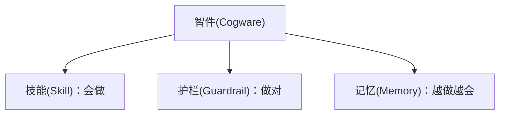
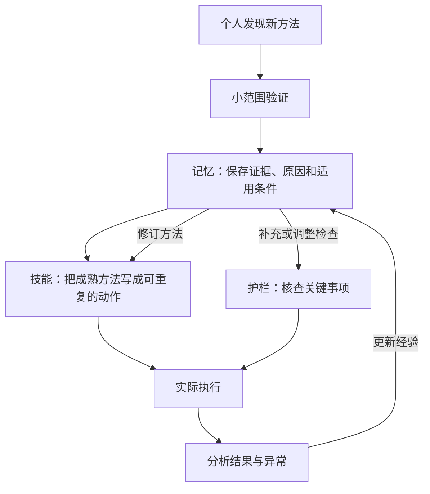

> 本文沿用原文的解释层次：先定义智件，再理解技能、护栏和记忆，随后解释三者如何形成闭环，最后联系组织经营、软件工程与 AI 协作。[^wan-cogware]
>
> 原文解读是主体。开发案例为本文假设；AI 延伸中的厂商案例依据官方材料，不代表本站团队的实践。外部资料用于校准概念与补充依据。术语在定义处采用“中文(English)”，部分英文为解释性译名。

## 一、组织为什么需要智件

团队里有聪明人、有责任心，也有规章制度，为什么工作仍然可能混乱？

原文给出的解释是：让大家愿意协作，与让大家知道如何把工作稳定做好，是两件需要分别解决的事。

**制度(Organizational Rules and Incentives)** 在本文语境中，是围绕权责利、激励和约束形成的组织安排。它说明谁负责、如何分配利益、哪些行为不能发生，帮助个人努力与组织目标保持一致。

但即使职责划分清楚，也仍然可能出现这些问题：新人不知道如何接手；同一件事每个人做法不同；跨部门交接时反复遗漏信息；一到关键节点，就必须找某个资深同学救火。

这些现象提示我们，组织还需要积累自己的做事能力。文章把承载这种能力的东西称为“智件”。

对经营者和组织负责人而言，问题可以具体化为：**一个人成功解决过的问题，怎样变成其他人也能处理的问题？一次付过代价的失误，怎样让后续工作少付一次同样的代价？**

## 二、先理解整体：什么是智件

### 2.1 智件的定义

**智件(Cogware)**，按照原文的用法，是沉淀在组织中的方法、标准和经验。它使组织能够保存、调用并改进做事的能力，让个人积累的聪明在人员变化后仍能继续发挥作用。

这里的关键在于“沉淀在组织中”：方法能够传递给其他人，标准能在实际工作中执行，经验能影响下一次行动。

一位工程师知道怎样发布服务，是个人能力；团队把发布方法教给其他人，在关键位置设置检查，并不断吸收发布成败的经验，才逐渐形成组织的智件。

“智件”是本文采用的组织管理概念。它可以由文档、模板、培训、代码和自动化工具承载，其价值体现在实际工作中。本文不把它视为某种必须采购的软件或统一技术标准。

### 2.2 智件由什么组成

整体概念明确之后，才能进一步区分三个组成部分：

| 组成部分 | 在智件中的定义 | 主要回答的问题 |
|---|---|---|
| **技能(Skill)** | 组织可重复使用的做事方法 | 事情来了，应该怎么做？ |
| **护栏(Guardrail)** | 保证质量、防止关键错误的标准与检查机制 | 怎样确认做对了？哪些地方必须防错？ |
| **记忆(Memory)** | 被保存下来、可供后续工作利用的经验 | 过去的成败，能让下一次学到什么？ |

这张图只表达组成关系。流程、清单、经验库各属于哪一部分，下面逐层说明。

## 三、第一部分：技能——把做事方法留下来

### 3.1 技能是什么

**技能(Skill)** 是组织在一类任务到来时，可以反复调用的方法。它把“想取得什么结果”转化为“由谁、按什么顺序、完成哪些动作”。

原文强调的重点是稳定：工作不必每次从零组织，也不必完全依靠某个人临场发挥。

进一步说，一项技能包含组织对因果关系的假设：在一定条件下，由这些角色按相应顺序、在必要检查点执行这些动作，能够取得预期结果。后续执行既是在使用方法，也是在检验这项假设。

文章还借用了**组织惯例(Organizational Routine)** 的概念，说明企业会通过重复使用的行动模式保存能力。这里的重复并不意味着永不改变；方法可以先稳定使用，再根据结果修订。

### 3.2 流程、SOP、Playbook：技能的不同表现形式

在技能这一层内部，原文列出了几种常见形式。它们都在说明“怎么做”，关注的范围不同。

| 形式 | 定义 | 关注重点 |
|---|---|---|
| **流程(Process)** | 规定一件事如何在部门或角色之间流转 | 谁接下一步，怎样完成交接 |
| **标准作业程序(Standard Operating Procedure, SOP)** | 规定某个岗位或具体任务怎样操作 | 一项工作具体如何完成 |
| **场景打法(Playbook)** | 面对一类场景时采用的策略与行动方法 | 遇到这种情况，怎样应对 |

例如，需求评审完成后如何进入开发、测试和发布，属于流程；如何完成一次数据库迁移演练，属于 SOP；遇到线上响应变慢时，如何选择排查方向，属于场景打法。

无需为了名称划出绝对边界。一份实际工作指南可能同时涉及协作、操作和应对策略。理解它帮助团队完成什么，比把文件归入哪个名称更重要。

### 3.3 原文案例：华为为什么要引入 IPD

原文用华为引入**集成产品开发(Integrated Product Development, IPD)** 的案例，解释规模扩大后为什么需要稳定的方法：产品从需求到交付，涉及多个角色，个人拼命很难持续填补所有协作缺口。

这一案例的重点，是将跨角色的产品开发活动组织成可以反复执行的方法。原文提到的“先僵化，后优化，再固化”，也应放在这一变革背景中理解：先认真掌握方法，再基于实践调整，把验证有效的做法保留下来。

### 3.4 开发案例：给旧接口增加分页

假设一个订单列表接口原来一次返回全部结果。团队准备增加可选参数 `page_size`，但旧客户端不会传这个参数。如果服务端改为默认只返回前 20 条，旧客户端仍可能把这些结果当成全部订单：请求成功了，业务含义却变了。

这是依据 Google AIP-180 的兼容原则构造的示例，不是 Google 的真实事故。它讨论的是旧接口的兼容迁移；新接口仍应从设计阶段考虑分页。[^compatibility]

技能要把这项工作组织清楚：先确认原有调用与默认行为，再确定迁移方案，随后修改实现、补齐测试并完成联调。接口规范解释兼容约定；操作指南说明如何验证旧调用和分页调用；流程明确谁确认行为、谁接手验证。

到这里，技能解决了“怎样推进”。进入发布前，关键事实是否已经得到验证，还需要护栏确认。

## 四、第二部分：护栏——在关键位置防止做错

### 4.1 护栏是什么

**护栏(Guardrail)** 回答两个问题：怎样判断工作符合要求，以及哪些错误必须在发生前拦住。

原文把清单、质量标准、验收条件、风险红线和评审门槛都放在这一部分。它们承担的作用有所不同：标准提供判断依据，验收条件说明交付何时可接受，红线划定边界，评审门槛规定进入下一阶段的条件。

原文特别强调，重要或不可逆的动作之前，需要先暂停，观察并确认事实。护栏应当放在可能发生关键错误的位置。

下面重点理解其中最容易与 SOP 混淆的清单。

### 4.2 清单是什么，为什么不等同于 SOP

**核查清单(Checklist)** 是帮助执行者确认关键事项没有遗漏的工具。它面向的是“本来知道怎么做，但仍可能忘记或误以为别人做过”的情况。

SOP 组织完整操作；清单集中核查那些容易遗漏、遗漏后果又比较重要的事项。

例如，部署指南说明如何构建和发布服务；发布清单确认本次测试通过的版本是否就是待发布版本、目标环境是否正确、出现异常时能否停止扩大影响。

原文强调，清单还承担团队同步的作用：关键参与者在同一个时点确认事实，减少“我以为你已经查过”的误解。

### 4.3 原文案例：手术团队为什么也需要清单

原文引用的 2009 年研究，对八家医院的非心脏手术患者进行实施前后比较，使用包含 19 项内容的手术安全清单。研究观察到，实施前后死亡率由 1.5% 下降至 0.8%，住院并发症发生率由 11% 下降至 7%。研究将这些变化表述为与清单实施相关联；它帮助说明，训练有素的团队也会受益于关键事项核查。[^surgery]

从**认知卸载(Cognitive Offloading)** 的角度，可以理解清单的一项作用：通过外部动作或环境改变任务的信息处理要求，降低内部认知负担。清单替人承担部分记忆和核查任务，让注意力可以更多用于专业判断。这是解释角度，不是上述手术研究直接验证的机制。[^offloading]

### 4.4 开发案例：怎样写一份有用的发布清单

继续前面的分页变更。以下核查项需要按团队实际风险调整：

- 旧客户端不传 `page_size` 时，是否仍得到约定的完整结果？测试数据是否超过 20 条，能够暴露截断？
- 新客户端的分页边界、后续页与空结果，是否有明确预期和验证结果？
- 待发布制品是否就是验证通过的版本，目标服务和环境是否正确？
- 发布观察哪些信号，何时停止扩大，异常时怎样处置？

这些问题都能核对事实。原文对好清单的要求可以保留为三个词：**短、硬、可确认**。先覆盖关键风险；能够可靠自动检查的内容交给工具，需要专业判断的事项则提供必要证据。

**金丝雀发布(Canary Release)** 先把新版本投放到部分流量，并与保留旧版本的对照组比较。观察信号应能区分版本，并事先约定停止或回退条件；只看整体成功率，可能掩盖新版本的问题。[^canary]

在本例中，即使 HTTP 状态正常，订单也可能不完整。兼容测试需要直接验证结果完整性；发布观察则补充与业务相关的信号。小流量本身不能证明行为正确。

## 五、第三部分：记忆——让经验能够继续发挥作用

### 5.1 记忆是什么

**记忆(Memory)** 在原文中指前人经验的积累。它帮助后来者理解过去为什么成功、为什么失败，以及在什么条件下可以借鉴。

技能偏向告诉我们怎样行动；记忆还保存方法背后的原因、前提和边界。具备这些信息，团队才能在环境变化后作出合理调整。

### 5.2 先看经验内容，再看经验怎样形成和保存

在记忆这一部分，也需要区分层次。

首先是经验内容。**最佳实践(Best Practice)** 是在特定情境下被验证有效的做法；失败案例记录失误发生的过程、条件和教训；实验记录保存尝试的方法、条件和结果。它们都是组织可以积累的经验。

其次是形成经验的活动。**复盘(Retrospective)** 是对已经发生的工作进行回顾、分析并提出改进的活动。在故障场景中，**事故复盘(Postmortem)** 通常会记录影响、处置、原因和后续措施。复盘活动产生记录，记录经过整理后才能成为后续工作可利用的记忆。[^postmortem]

最后是保存载体。**知识库(Knowledge Base)** 是组织和检索知识的载体；其中用于积累工作经验的部分，可以称为经验库。它可以承载记忆，但内容被保存下来之后，还需要在相应工作中被找到和使用。

### 5.3 为什么别人的最佳实践不能直接照搬

一个团队的有效方法，可能依赖它的客户类型、人员能力、技术条件和协作方式。把动作照搬过来，未必同时带来了这些条件。

原文引用的**内部黏性(Internal Stickiness)**，描述的是知识和实践在组织内部迁移时遇到的困难。相关研究指出，接收方吸收能力不足、成功原因不清楚，以及双方关系不畅等因素，会妨碍迁移。[^stickiness]

借鉴经验时，至少应理解三件事：它解决了什么问题、为什么有效、当前组织是否具备相应条件。原文主张迁移经验中的机制和前提，再根据本地条件调整具体做法。

例如，另一个团队能频繁发布，可能同时具备自动化验证、兼容策略、观测和恢复能力。只增加发布次数，还没有完整学到它的方法。

### 5.4 原文案例：让失败完成“归零”

原文用中国航天的**归零(Closed-Loop Problem Solving)** 说明，失败经验怎样推动系统更新。这里关注其中的技术归零五条：[^technical-closure]

1. **定位准确**：找到问题发生的位置。
2. **机理清楚**：解释问题为什么发生。
3. **问题复现**：验证对问题的理解。
4. **措施有效**：证明修正措施能够发挥作用。
5. **举一反三**：检查同类环节，将改进扩展出去。

ISO 18238:2015 的官方摘要确认，这项航天标准涉及产品质量问题的闭环处理，包括影响缓解、根因识别、问题控制和经验教训。上述五项的中文概括沿用原文。[^aerospace]

用于软件工程时，“问题复现”应按风险和条件理解：可以在隔离环境中重现；无法完整重现时，应保留不确定性，并寻找足够的证据验证原因，避免在生产环境重复制造故障。

### 5.5 开发案例：把一次漏单变成后续的检查

假设分页变更上线后，团队发现旧客户端漏掉了部分订单。排查确认：旧请求未传 `page_size`，新服务端默认截断结果，而测试数据不足 20 条，没有触发这个条件。

修复当次行为之后，记忆还应保留原因、受影响调用和适用边界。改进可以落在两个位置：回归测试加入超过一页的旧请求样例；接口变更指南要求检查新增参数被省略时的默认行为。类似接口也按风险排查。

下一次变更时，再确认这些样例确实运行、指南确实适用。**记录成为可用经验，要经过“解释原因—改变方法或检查—验证后续效果”。** 这是假设案例中的改进路径，不是某个团队已经完成的实践。

## 六、三部分讲清楚之后，再理解它们怎样形成闭环

技能、护栏和记忆各有职责，在使用过程中相互更新。

原文用一个销售方法说明这个过程：有人发现，面对某类客户时，先帮助客户算清收益，再演示产品，效果更好。这时组织应继续验证和沉淀，让方法有机会被更多人掌握。

这个过程可以分为五步：

1. **先实验**：换个人、换些客户试一试，分清方法效果和个人能力。
2. **写入记忆**：记录有效的原因、条件和边界。
3. **形成技能**：将反复有效的部分写成步骤、话术、模板和培训材料。最佳实践保存经过验证的经验，SOP 则将其中成熟的做法编码成可执行的动作。
4. **设置护栏**：针对执行中常见的重要错误，增加必要核查。
5. **根据结果回写**：用后续成败修订经验，再调整方法和检查。

原文由此把创新与流程放进同一个演化过程：新的尝试提供候选方法，实验帮助筛选，流程保存有效做法，现实结果继续推动修订。

原文还用科学方法作类比：可供他人复现的实验说明承载技能，同行评审提供护栏，学术期刊保存记忆。再与《天工开物》的知识传承作对照，强调经验除了保存，还需要被他人检验、传播和继续发展。

对开发团队来说，上一节的兼容性故障就走过了这样的闭环：失败得到解释，经验被保存，测试与变更指南得到修改，后续执行再验证改进是否有效。

**闭环的完成标志，是下一次行动已经受到这次经验的影响。**

## 七、回到组织：围绕业务运转，持续改进方法

### 7.1 为什么要沿着价值流建设智件

**价值流(Value Stream)** 是围绕客户价值形成的一连串活动。原文从客户进入、需求诊断、报价，一直讲到交付、验收、收款和续约，强调组织需要关注整条链如何运转。

经营者可以沿着这条链检查角色接口：上一步交付什么，下一步凭什么接手，结果怎样回到方法和标准的维护者。组织结构中的职责需要在实际业务流转中落到具体动作。

对开发团队，可以观察从需求到用户使用的一条路径：

这是一张简化示意图。它的用途，是帮助团队找到工作交接和反馈发生的位置。DORA 对软件交付的价值流分析，也强调观察从想法到生产的工作流动，识别等待、瓶颈和改进机会。[^value-stream]

沿着这条路径，逐步检查：重要工作有没有清楚的方法，关键动作前有没有必要核查，成败有没有进入下一次工作。

### 7.2 从人治组织走向学习型组织

原文提出了三种组织状态。

**人治组织(Person-Dependent Organization)** 的能力主要依附于老板和少数能人。事情依赖他们推动，经验也容易随他们离开。这里的英文是解释性译名。

**流程组织(Process-Based Organization)** 已经把方法和检查固定下来，工作更稳定、更容易复制。它面临的问题是：流程可能逐渐被当成最终答案，大家只求按规定完成，缺少改进。

**学习型组织(Learning Organization)** 把流程视为当前可用的版本。异常和例外会被看见、解释，再决定是否进入下一版方法；复盘产生的经验，能够持续改变技能和护栏。

这三种状态的区别，在于组织能否保存能力，以及保存下来的能力能否继续被现实修正。

### 7.3 人在系统中的价值

原文最后把人的作用放在判断例外、发现异常、处理价值冲突、更新经验以及为结果负责上。智件承担可重复、可传递的部分，人继续面对规则尚未覆盖的问题。这套系统需要人持续维护与输入，不会自动演化。

对团队而言，一个人的贡献既包括完成当次工作，也包括让后续同学能够更好地完成工作。

## 八、AI 延伸：把方法、检查和经验接入执行

本节是工程延伸，不改变智件的三部分定义。**AI 智能体(AI Agent)** 在这里指借助模型选择下一步行动、调用工具并根据结果继续任务的系统。它与按预定路径组织模型和工具的工作流有所区别。[^agents]

**智能体执行框架(Agent Harness)** 是本文采用的解释性译名，指围绕模型组织执行循环、工具调用、上下文管理和运行控制的工程机制。不同实现的边界有所差异；Anthropic 的 Managed Agents 将 Harness 描述为调用模型、分派工具调用的循环，并把会话记录和执行环境分别管理。[^harness-runtime]

沿用前面的分页案例：Harness 可以让智能体读取接口约定、修改代码、运行兼容测试、查看失败结果并继续修正。它为技能、护栏和记忆参与执行提供载体；不能仅凭使用了框架，就认定组织已经具备这些能力。

### 8.1 技能：让 AI 找到团队的方法

**智能体技能(Agent Skill)** 将任务指导及相关资源封装为智能体可使用的材料。Agent Skills 开放格式以 `SKILL.md` 保存说明与元信息，并可附带脚本、参考资料等。[^skills]

对分页变更，团队需要传递的是“先确认既有行为，再设计迁移和验证”的方法。它可以由项目文档、技能文件和测试脚本共同承载。组织技能是方法本身；智能体技能文件是其中一种载体。

> **案例｜OpenAI：用简短入口连接可维护的工程知识**
>
> **发生了什么：** 团队发现，把所有要求塞进一个庞大的 `AGENTS.md`，很难持续维护。
>
> **工程机制：** 简短的 `AGENTS.md` 引导智能体读取结构化项目文档；代码检查和结构测试落实部分约束，评审与缺陷再推动文档和工具规则更新。[^openai-harness]
>
> **可借鉴之处：** 入口帮助找到方法，可执行检查验证约束，反馈持续改进两者。具体目录应适合项目，不必照搬案例。

### 8.2 护栏：用运行结果核对交付

写下“必须测试”是在提供指导；把兼容测试接入交付前的检查，才建立了可执行的核查机制。对本例，应保留旧请求不传参数的样例，并验证超过一页时结果仍符合约定。测试命令、被测版本与实际结果都应能够查看。

> **案例｜Anthropic：函数存在，功能仍可能失效**
>
> **发生了什么：** 在一个图块编辑器任务中，代码已经包含矩形填充函数，但实际拖拽只在起点和终点放置图块，没有填满矩形。
>
> **工程机制：** 生成智能体与评估智能体在编码前协商可验证的完成标准；评估智能体借助 Playwright 操作运行中的应用，发现事件处理没有正确触发填充逻辑。[^anthropic-harness]
>
> **可借鉴之处：** 验证应覆盖用户真正执行的动作。代码中有函数、模型自称完成，都不能代替运行验证；模型评估也会遗漏问题，能确定性核查的条件仍应交给测试。

### 8.3 记忆：区分任务进度与组织经验

任务日志记录“改了哪个文件、哪些步骤未完成”，帮助下一次会话接续；组织经验还需要说明“为什么发生、什么条件适用、后续方法怎样改变”。两者用途不同。

在分页案例中，保存“已修复”不足以帮助下一次变更。更有用的是保留漏单原因、超过一页的旧请求样例，以及更新后的接口变更要求，并让智能体在相似任务开始时找到它们。

**上下文(Context)** 是模型本次执行可用的信息范围。这些经验进入上下文后，才有机会影响本次执行。保存外部经验与更新测试，不等于训练模型参数；仍须核对材料是否适合当前任务和版本。

### 8.4 闭环：检验更新是否真正改善下一次任务

**评估(Evaluation)** 用明确标准和代表性任务检查系统表现。可以把上述兼容问题保留为回归任务：更新文档、技能或 Harness 后，再检查智能体是否识别默认行为、运行必要测试并准确报告结果，同时观察其他能力是否退化。

Anthropic 的实践还提示：模型能力和任务条件变化后，应重新检验 Harness 的各个组成部分，逐项移除不再必要的部分，并观察影响。复杂度本身不是能力。[^anthropic-harness]

这里仍是同一条改进路径：真实执行暴露问题，解释原因，更新记忆、方法或检查，再用后续任务验证效果。

## 九、组织可以怎样开始

先选择一件经常发生、协作较多或容易出错的核心工作，例如客户交付、新产品开发，或工程团队的接口变更、数据库迁移与服务发布。

第一步，把已经在使用的方法说清楚。说明工作从哪里开始，由谁接手，怎样完成；用实际任务检查新人能否理解和执行。

第二步，在关键位置补上必要核查。从过去确实发生过、后果较大的遗漏入手，让检查项具体、简短、有证据。

第三步，整理最近一次有代表性的成败。保留原因、条件和边界，把结论落实到方法或检查的修改中。

第四步，在后续任务中验证修改。观察其他同学能否复用、同类问题是否减少，再继续调整。如果引入 AI，也让 AI 使用同一套经过维护的方法和经验，并按相应标准验证结果。

原文的核心价值，是提醒我们关注组织能力如何留下来：**技能保存做法，护栏守住关键，记忆积累经验，人的判断让整套系统继续成长。**

## 参考资料与用途

主要来源提供组织能力的论证；研究资料用于校准相关概念，工程资料支持明确标出的延伸。以下列出来源链接及用途。外部材料核验日期为 2026 年 10 月 15 日。

[^wan-cogware]: 主要来源。本文保留其整体、组成、闭环与组织应用的解释顺序；开发案例与 AI 工程案例为分别说明的延伸。
[^surgery]: 核对研究范围、实施前后数字与“相关联”的表述，不将其当作认知机制的因果证明。
[^offloading]: 校准认知卸载的定义，用于解释清单的一项可能作用。
[^stickiness]: 校准企业内部经验迁移的阻力与适用条件。
[^aerospace]: 核对航天质量问题闭环管理的范围，未转述标准全文要求。
[^technical-closure]: 区分技术归零与管理归零；正文只展开技术归零五条。
[^postmortem]: 事故记录、原因分析与预防行动。
[^canary]: 对照版本、分版本信号及发布停止条件。
[^compatibility]: 校准新增参数的默认行为与向后兼容原则；订单分页案例是本文假设。
[^value-stream]: 沿软件交付活动识别交接、瓶颈与改进机会。
[^agents]: 区分智能体与预定工作流。
[^skills]: 说明智能体技能的封装形式。
[^harness-runtime]: 校准 Harness、会话记录与执行环境的职责边界。
[^openai-harness]: 项目文档入口、可执行约束与工程反馈的厂商实践。
[^anthropic-harness]: 运行中的应用验证、评估局限与 Harness 持续简化的厂商实践。
