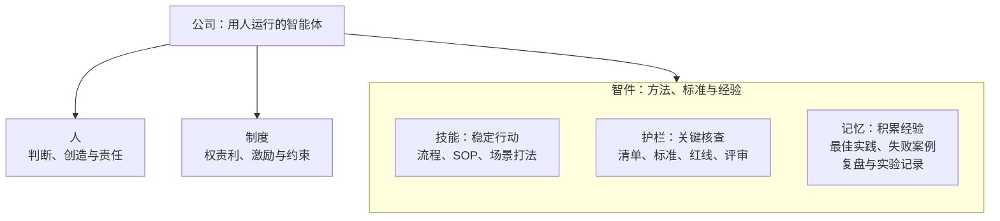
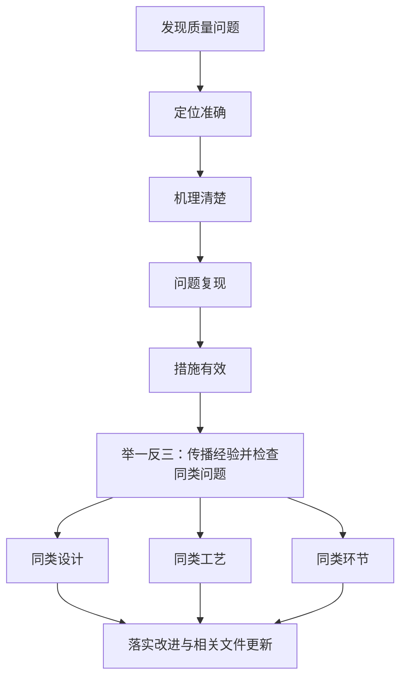
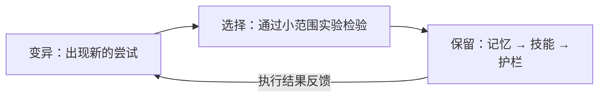
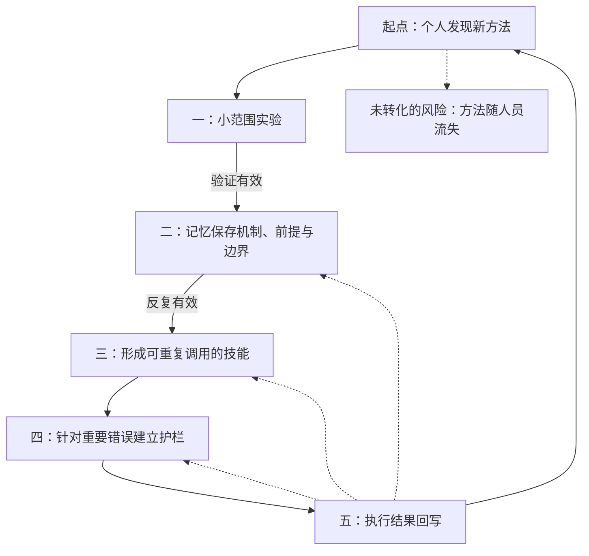
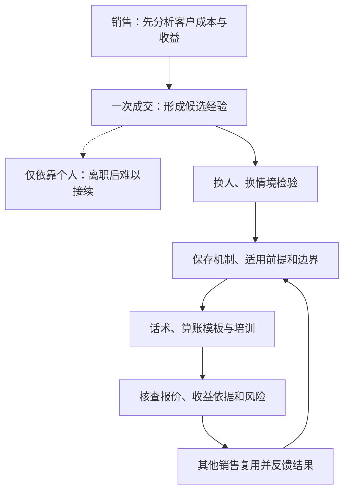
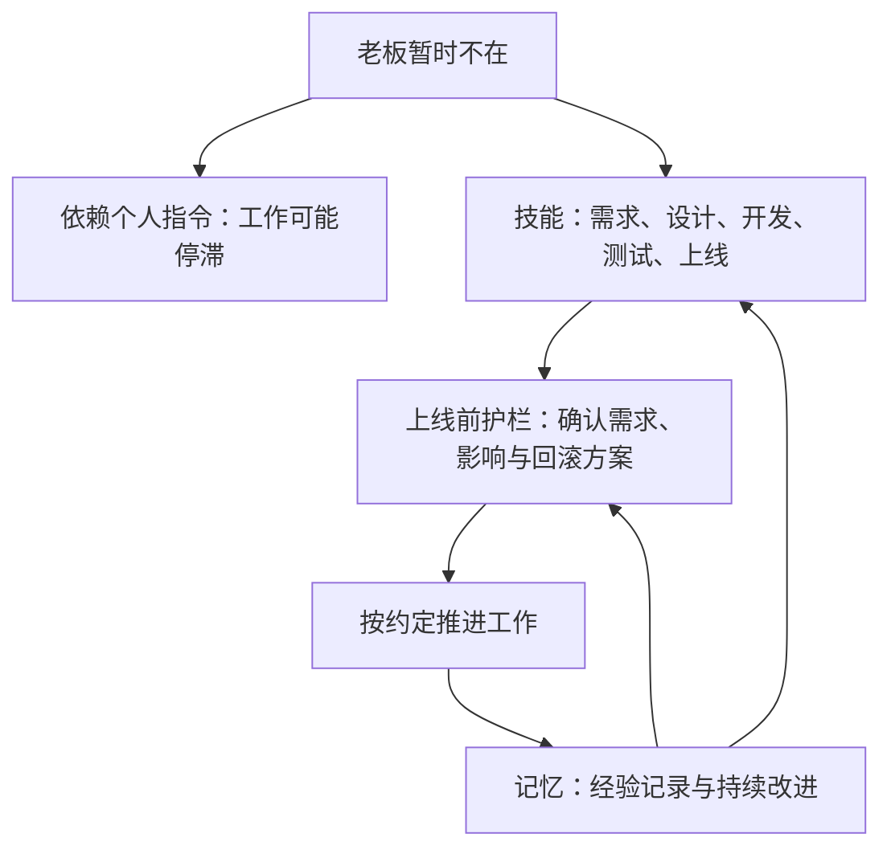
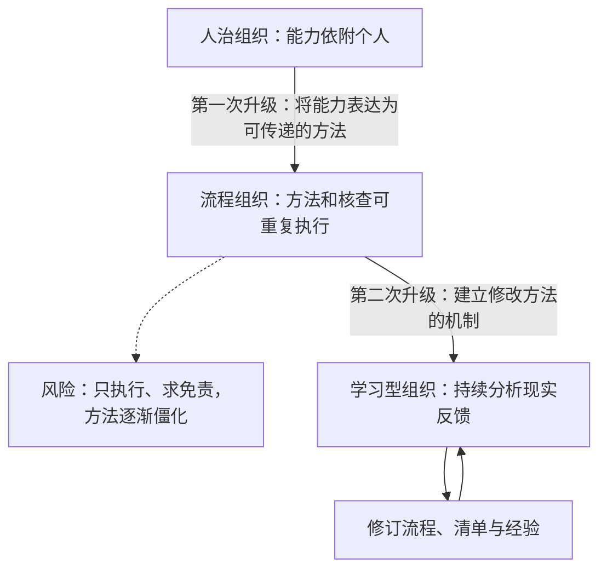
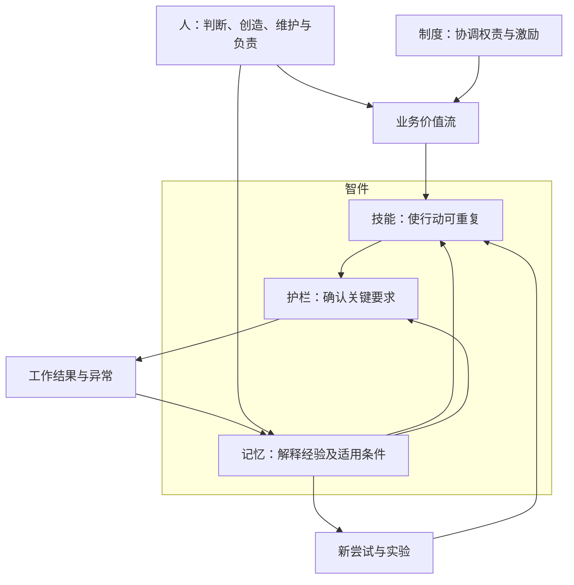

本文依据万维钢的课程文章整理。前八节依原文推进，保留整体类比、三个组成、案例、演化机制与经营应用；图示按原图所表达的关系重新绘制，两幅漫画改为场景关系图。第九节单独进行 AI 工程对照。[^wan-cogware]

## 一、整体：公司是一台用人运行的智能体

> 公司是一台用人运行的智能体。

原文承接领导者模块对制度建设的讨论，用这个类比把人的行动与组织能力联系起来。公司即使聚集了能干的人，也仍需回答两个问题：怎样组织协作意愿，以及怎样让工作持续产生可靠结果。

**制度(Organizational Rules and Incentives)** 在原文中处理权责利、激励和约束，协调个人努力与公司目标。**智件(Cogware)** 则是组织沉淀并使用的方法、标准和经验，承载组织如何做事、如何判断、如何学习。人、制度与智件共同进入公司整体的解释。

原文将智件分为三个组成：方法对应**技能(Skill)**，标准对应**护栏(Guardrail)**，经验对应**记忆(Memory)**。三者分别支持任务的稳定开展、关键错误的防范与经验的累积。先理解整体，才能进一步讨论各自的内部形式。

### 人、制度与智件的关系

据原文整体模型重绘。制度支持有序协作，智件支持做事能力；人的作用贯穿执行、维护和更新。人员更替时，组织需要继续保存和发展这些能力，而不是每次重新依赖少数人的临场发挥。

## 二、技能：把意图转化为稳定行动

### 2.1 定义、因果假设与组织惯例

技能是组织针对一类任务可重复调用的做事方法。它说明在什么条件下，由哪些角色按什么顺序完成动作、经过哪些检查点，预期取得什么结果。

原文特别强调稳定性：方法需要使任务不必每次重新组织。它同时包含一个因果假设——采用这样的安排，为什么有理由获得这样的结果。技能因此既需要被执行，也需要由执行结果检验；稳定使用与后续改进能够相互衔接。

**组织惯例(Organizational Routine)** 是企业重复使用的行动模式。原文借 Nelson 与 Winter 的研究，说明惯例如何承担能力的保存与延续：企业的行动并非每天从空白开始，既有方法会影响它能做什么、怎样应对变化。原文以基因作类比，讨论组织能力的保留与演化。[^routines]

### 2.2 流程、SOP 与 Playbook

| 技能形式 | 定义 | 主要组织什么 |
|---|---|---|
| 流程(Process) | 规定工作如何在部门或角色之间流转 | 接口、交接及活动顺序 |
| 标准作业程序(Standard Operating Procedure, SOP) | 规定某个岗位或任务的具体操作 | 执行步骤与操作方法 |
| 场景打法(Playbook) | 面向一类情境的应对方法 | 判断条件、策略与动作组合 |

这些形式的粒度不同，共同承担方法的表达。流程将多方行动衔接起来，SOP 细化操作，场景打法帮助处理具有条件差异的任务。一份工作指南可能同时覆盖几个层面。

### 2.3 原文案例：华为引入 IPD

原文以华为的规模化困境说明：员工能干且投入，并不意味着跨部门协作已经形成可重复的方法。它引用的比较包括：

| 比较项目 | 原文给出的华为数据 | 对照 |
|---|---|---|
| 1999 年订单准时交付率 | 约 50% | 同行约 94% |
| 年库存周转 | 约 3.6 次 | 同行约 9.4 次 |
| 研发投资回报 | 约为 IBM 的六分之一 | IBM |

这些是变革背景中的比较，不是引入方法后的效果数据。Wharton 的文章同时讨论**集成产品开发(Integrated Product Development, IPD)** 与**集成供应链(Integrated Supply Chain, ISC)**：研发问题与 IPD 相关，交付、库存问题属于供应链背景，不能都归入 IPD 的效果。[^huawei-data]

IPD 将从需求到产品交付的跨职能工作，组织成角色、步骤、模板和评审节点。Cambridge 出版的研究摘要也将跨职能团队、标准流程与模板列为核心机制。[^huawei-ipd]

原文转述任正非在变革中的要求：先严格掌握引入的方法，再依据实践优化，最后固定有效的改进。其“先僵化，后优化，再固化”的主张，应放在当时学习和实施 IPD 的背景中理解。原文还用不合脚的鞋作比喻，强调先改变执行习惯；这属于特定变革的管理主张，不能据此要求所有组织永久照搬外部方法。

这个案例解释了规模对协作的要求：小团队可能依靠默契，大组织还需要明确接口。老板反复催办、客户信息丢失、操作各行其是、部门交接推诿、新人找不到下一步负责人，都是原文列举的方法缺口。技能先解决行动如何持续推进，护栏进一步确认推进是否符合要求。

## 三、护栏：在关键节点确认做对

### 3.1 定义与内部形式

护栏是组织用于判断质量、限制风险和防止关键错误的标准与核查机制。它回答：结果怎样才算符合要求，哪些边界不能越过，哪些动作执行前必须确认。

| 护栏形式 | 作用 |
|---|---|
| 核查清单(Checklist) | 核对容易遗漏的关键事项 |
| 质量标准(Quality Standard) | 提供质量判断的依据 |
| 验收条件(Acceptance Criteria) | 明确何种结果可以接受 |
| 风险红线(Risk Boundary) | 指出不可接受的风险或行为 |
| 评审门槛(Review Gate) | 明确进入下一阶段前应满足的条件 |

SOP 的重点是完成操作的方法，清单的重点是确认重要事项没有遗漏。执行者即使熟悉全部步骤，也会因疲劳、打断、赶工或误以为他人已经核查而出错。

### 3.2 原文案例：手术清单与团队同步

原文引用 2009 年发表于《新英格兰医学杂志》的研究：八个国家的八家医院实施 19 项手术安全清单，实施前后观察到死亡率从 1.5% 变为 0.8%，住院并发症从 11% 变为 7%。研究采用前后比较，数字应理解为与实施相关联的变化，不能单独证明因果。[^surgery]

患者身份、手术部位、过敏史、纱布与器械的清点，都是专业人员原本知道需要确认的事情。案例的关键也包括共同核查：切皮前暂停，由主刀、麻醉师和护士一起确认，让各方对当前任务形成一致理解，减少相互假定对方已经检查的风险。

**认知卸载(Cognitive Offloading)** 指借助外部动作或环境，改变任务对内部信息处理的要求。清单能够承担部分记忆负担，让专业人员将注意力用于判断；这是解释清单作用的角度，不是上述临床研究直接证实的机制。[^offloading]

### 3.3 护栏放在哪里，怎样写

原文强调在合同签署、付款、上线、删除数据、对外发布信息等难以撤回的动作前，先安排必要核查。作者认为这种精简护栏不会增加很多运营成本，并以事后才发现合同缺项、上线未测试或离职人员权限未收回，说明缺少核查的后果；具体投入仍取决于工作情境。

有效核查项应当简洁、明确，并能观察和确认。例如，核对合同金额与报价依据是否一致，比笼统要求认真检查更容易执行。护栏只抓关键遗漏与风险，为执行者保留判断空间。团队共同确认也需要明确时点和参与者，不能只留下无人负责的勾选表。

## 四、记忆：让经验可以迁移并改进系统

### 4.1 定义与经验形式

这里的记忆以经验内容为对象：把前人经历提炼、保存和组织，供后续工作使用。它帮助组织理解方法为何有效、失误怎样发生，以及环境变化后应如何调整，区别于个人回想这一活动。

**最佳实践(Best Practice)** 是在特定情境中被验证有效的做法。失败案例保留问题与原因，复盘形成对成败的解释，实验记录保留条件、尝试和结果；经验库与知识库提供组织和查找这些内容的载体。阅读经验的目的也包括理解机制、推及其他情境，而非只重复表面动作。

### 4.2 原文案例：最佳实践为何难以迁移

原文以 OKR、站立会议等方法的模仿说明：相同动作置于不同团队、文化、客户和激励条件下，可能得到不同结果。作者用器官移植后的排异比喻这种条件失配。

**内部黏性(Internal Stickiness)** 描述最佳实践在企业内部迁移的困难。Szulanski 的研究指出，接收方吸收能力不足、因果关系不清楚以及双方关系不畅等因素，都可能阻碍迁移。[^stickiness]

因此，迁移方法需要同时理解三个问题：它为什么奏效，依赖什么条件，本地哪些机制应保留、哪些动作需要改写。仅模仿文档、会议或工具的形式，无法自动带来支撑它们的组织条件。

### 4.3 原文案例：航天失败怎样推动归零

原文特别重视失败经验对方法和标准的改写作用。它从 1992 年起的接连失利讲到 1996 年 2 月 15 日长征三号乙首飞失败：按原文叙述，起飞约两秒后失控，约 22 秒后坠毁，商业信誉遭受打击。航天科技集团的资料确认了这次首飞失利，并记述此后的大量试验与改进。原文借此说明，失败的价值在于让问题处理进入系统更新。[^aerospace-history]

**归零(Closed-Loop Problem Solving)** 要求质量问题得到分析、验证和纠正后再闭合。在原文案例中，任何质量问题都须归零后才能放行。原文展开的五项是技术归零要求；航天质量体系另有管理归零要求，本文不将两者混为一组。[^technical-closure]

| 技术归零要求 | 在问题处理中的作用 |
|---|---|
| 定位准确 | 确认问题发生的具体部位 |
| 机理清楚 | 弄清导致问题的原因和机制 |
| 问题复现 | 在受控条件下再现故障现象，以检验定位和机理解释 |
| 措施有效 | 以验证证明纠正措施解决了问题 |
| 举一反三 | 向相关设计、工艺、环节及单位反馈，检查类似问题并采取措施 |

前四项着重建立对当前问题及修正效果的可靠认识；第五项把经验扩展到可能具有相同问题模式的地方。因此，修好一次故障与完成组织学习之间，还有系统排查和方法更新的工作。

据原文归零模型重绘，保留当前问题处理与向同类问题扩展的不同层次。原文将归零同后续可靠性提升联系起来；ISO 18238:2015 的官方摘要确认了航天产品质量问题闭环管理的标准范围。标准存在可以核实，不能仅凭摘要推断完整实施要求或将所有发射成功归因于单一制度。[^aerospace]

反复出现同类错误，或者资深人员离开就带走全部经验，正是原文用来识别组织记忆不足的现象。

## 五、转化：一个好方法怎样成为组织能力

### 5.1 变异、选择与保留

三部分讲清之后，才能讨论它们如何相互回写。原文将新方法的出现、实验筛选和有效做法的保存，放进**变异—选择—保留(Variation–Selection–Retention)** 的演化框架。

据原文演化图重绘。创新提供候选方法，实验帮助组织选择，流程保存可重复的方法；后续结果继续推动修订。创新与流程分别承担这一过程中的不同作用。

### 5.2 原文销售案例与方法生命周期

原文构造了一个销售场景：面对大客户，先帮助客户估算旧系统的损失与新方案的收益，再演示产品，效果可能更好。它最初依赖个人。如果只留下成功传闻，人员离开时方法也容易失传。

组织要继续完成五项工作：

1. **实验**：换执行者、换客户条件，区分方法效果、个人能力和适用情境。
2. **进入记忆**：保存机制、前提和边界，避免只留下缺乏解释的诀窍。
3. **形成技能**：反复有效的部分进入话术、算账模板、SOP 和培训，使其他人能够学习。原文用新人一周掌握老销售八成功力作示意，强调经验编码后的传递价值，并非培训效果保证。
4. **建立护栏**：针对执行中出现的重要遗漏和错误，形成核查要求。
5. **结果回写**：分析每次成败，修订经验，再更新方法与核查。

最佳实践保存已经得到情境验证的经验，SOP 则将成熟经验中的做法编码成可以执行的操作。两者可以相互转化，作用仍有区别。

据原文生命周期图及正文重绘。图中共有最初发现和后续五步六个节点；虚线回写对应正文所说的经验、技能与护栏修订，不表示每次结果都应直接变成新规则。

### 5.3 原图场景：高手离开之后

原文漫画把上面的转化具体化：销售先算账，团队看到成交，随后面对高手离开的风险。组织通过试验检验方法，再留下算账依据、操作材料和核查要求，让后续销售能够接续。

据原文“高手走了以后”漫画重新组织。漫画中的年损失 300 万、可节省 120 万属于场景示意，不是企业绩效证据。原图还要求核对是否理解客户、损失计算是否有依据、关键信息是否留痕及下一步是否清楚；约束包括不得承诺未经证实的收益、不得越权报价，并先行评估风险。这些具体要求随场景保留。

## 六、积累：科学方法与知识传承的对照

原文将科学方法作为更大尺度的类比：实验写到别人能够复现，提供可继承的方法；同行评审承担核查；学术期刊保存研究记录。技能、护栏、记忆相互配合，使个人发现能够被其他人检验、使用和发展。这里是对组织作用的类比，不能据此宣称同行评审保证正确或三项已经穷尽科学方法。

原文再以宋应星的《天工开物》作对照：书中汇集三卷十八篇农工技术，但作者认为当时缺少持续刊刻、研读与更新的组织机制。原文具体提到未入《四库全书》、清代中期在国内传播衰落，以及日本 1771 年刊本与后续传承，并引用潘吉星的研究。这里保留的是作者借历史所作的知识传承对照；关于版本流传及“无人知晓”等绝对说法，本次没有独立核对所引专著，不能作为已经证实的完整历史结论。[^wan-cogware]

这段对照的论证作用是区分留下一份材料与形成持续积累机制：经验要能被找到、理解、检验和继续发展，才有机会影响后来者。

## 七、经营：围绕价值流组织日常工作

### 7.1 价值流与角色接口

**价值流(Value Stream)** 在本文指围绕客户价值形成的一连串业务活动。原文沿着客户进入、需求诊断、报价、交付、验收、收款和续约展开，要求经营者关注整条链，而不仅是各部门的局部工作。

原文以脊柱比喻价值流、肌肉比喻部门，强调跨部门的整体运转。这条链需要明确角色接口：谁接手，交付什么，如何确认，以及结果怎样反馈。沿核心工作建立方法，在关键节点安排核查，再将每次成败沉淀为经验，才将三个组成落实到经营活动中。负责人休假就停摆、反复事后补救、新人重踩旧坑，分别提示方法、核查或经验积累的缺口。

### 7.2 原图场景：老板不在的一天

原文第二幅漫画使用开发与上线的场景：老板离开后，工作若依赖临时指令就容易停滞；团队若有可用的方法、关键核查和经验记录，就有条件继续协作。图中的检查包括需求是否明确、影响是否评估，以及是否具备回滚方案。

据原文“老板不在的一天”漫画重绘。它说明方法与角色接口如何支持连续工作；并非只要写好文档，团队便不再需要人的判断、协调和责任。

## 八、演进：组织三重境界与人的责任

### 8.1 能力怎样被保存，又怎样被修正

原文给出三个组织状态。以下英文中前两项为解释性译名。

| 组织状态 | 能力主要保存在哪里 | 运行特点与主要问题 |
|---|---|---|
| 人治组织(Person-Dependent Organization) | 老板及少数资深人员身上 | 依赖指令、关系与手艺，人员变化容易带走能力 |
| 流程组织(Process-Based Organization) | 已经固定的方法与核查中 | 更稳定、可复制、可规模化；若只求合规免责，方法容易僵化 |
| 学习型组织(Learning Organization) | 能持续被现实修订的方法、核查与经验中 | 把异常与例外转为分析和改进的输入 |

据原文组织境界图重绘。作者认为许多组织首先需要完成从人治到流程化的转变。第一次升级使能力能被其他人接续；第二次升级使已经固定的能力仍可被修正。流程是当前可用的方法版本，清单持续反映风险，复盘产生具体更新。例外需要被看见和解释，再判断应修订规则、调整条件还是纠正执行。

### 8.2 人为什么仍是系统的维护者

原文最后明确，服务这套系统意味着承担它自身无法完成的工作：识别异常、判断例外、处理价值冲突、将教训写成可用经验，并对结果负责。组织不会因为拥有文档和工具就自行演化，持续输入、维护与检验仍由人组织。

### 8.3 原文关系总览

综合重绘原文结尾总览：整体包含人、制度与智件，智件在业务中发挥作用；三类组成通过使用和修订共同支持组织演进。前面的模型、两个场景以及科学方法类比，分别解释这张总览中的组成、转化与积累关系。

## 九、工程对照：AI Harness 怎样承载三类智件

本节是基于前述组织模型与官方工程资料的对照分析。原文的三个定义继续作为基准，工程概念按各自语境解释，具体实现作为参照。

### 9.1 先区分组织功能、工程概念与具体实现

**智能体执行框架(Agent Harness)** 在本文是解释性译名，指围绕模型组织任务执行、工具调用与反馈的运行机制。各实现的范围不同：Anthropic 的 Managed Agents 将调用循环、会话记录和执行环境分别管理。因此，不能用某一家产品的模块划分代表整个工程生态。[^harness-runtime]

| 概念 | 智件模型中的含义 | AI 工程中的含义与可用载体 |
|---|---|---|
| Skill | 组织在特定条件下可重复使用的方法，包含角色、动作、顺序与因果假设 | 智能体技能封装任务指导、专业知识、流程及相关资源；可由技能包、工作流、工具和脚本协同承载 |
| Guardrail | 判断质量、防止关键错误的标准、边界与核查机制 | 在输入、输出或执行节点进行检查与控制；可由校验器、测试门禁、调用拦截和人工确认实现 |
| Memory | 经过保存、解释并可供后续使用的组织经验 | 系统保留并使用先前信息的机制；可涉及会话状态、跨会话经验、事实与程序性知识，范围取决于实现 |

这三行按功能划分。工程中的名称、目录或存储方式，并不决定内容在组织模型中发挥什么作用。

### 9.2 Skill：方法能力与技能封装可以实质重合

**智能体技能(Agent Skill)** 的官方定义包括专业知识与工作流，格式允许指导说明、脚本、参考资料、模板等资源。它的目标包括传递领域知识、复用多步任务方法，并按任务需要加载材料。将它理解为一条提示词，会遗漏这种方法承载能力。[^skills]

智件中的技能着重定义组织采用什么方法、为何适用、角色如何配合、效果怎样得到检验；工程中的 Agent Skill 着重把相应方法表达为智能体能够发现、读取和使用的资源。二者可以指向同一套做法，定义和设计关注点仍须分别说明。

一个组织技能可能由多个技能包、工作流、工具及人的工作共同实现；一个技能包也可能同时包含方法、核查项和案例。`SKILL.md` 是格式入口，`scripts/`、`references/`、`assets/` 等可提供配套资源；这些目录本身并不等同于组织能力。[^skill-format]

是否真正承载了组织技能，要看执行者能否在适用条件下找到、理解和使用方法，跨角色协作是否衔接，以及后续结果能否推动修订。文件存在与能力有效，需要分别验证。

### 9.3 Guardrail：保留标准、核查与运行控制的完整关系

**工程护栏(Engineering Guardrail)** 在相关平台中可覆盖敏感信息、业务规则、输出质量和危险操作检查。LangChain 文档同时提供确定性规则、基于模型的检查以及人工确认，并允许在模型和工具调用前后介入。它并非只有内容过滤这一种用途。[^engineering-guardrails]

在组织模型中，标准和核查要求说明什么应当确认；工程实现进一步落实谁检查、检查什么证据、何时暂停或拒绝，以及失败后如何处理。在技能说明中列出发布要求可以传递指导，把检查连接到实际发布节点，则使它参与运行控制。

自动化检查、模型评估和人工判断各有覆盖范围。部署测试只能证明所验证条件下的结果；权限许可只能说明允许执行，不能同时证明业务结果正确。原文关于关键暂停、团队同步与保留判断的要求，在 AI 工程中仍需落实。

### 9.4 Memory：保存、检索、理解与改进共同发挥作用

**智能体记忆(Agent Memory)** 在工程中可能指会话范围的状态，也可能指跨会话的数据。LangChain 还区分事实、事件经验与程序性知识；其中程序性记忆涉及执行任务的规则，说明方法与记忆在具体实现中可以交叉。[^engineering-memory]

映射到智件时，需要说明保存的内容发挥什么作用。会话日志能够提供事件证据、支持任务接续；案例与复盘能够保留原因、条件和处理经验；检索与上下文装配让这些材料进入下一次任务。组织学习还需要判断经验是否适用，并将有效结论落实为方法或核查的更新。

因此，一个持久化服务不会自动完成组织学习，一次上下文加载也不等于经验已经被正确应用。反过来，经验进入技能文件、测试样例或工作指南后，仍可继续保留其记忆作用。它不必被限制在名为 Memory 的单一模块中。

### 9.5 沿用原图开发场景进行映射

以下是对第七节原图场景的工程映射，不是另一个实际团队案例。

| 工作环节 | 在 AI 工程中的表达 | 如何核对实际作用 |
|---|---|---|
| 技能组织开发与上线 | 技能包承载需求澄清、设计、实现、测试和发布方法；Agent 按指导行动，Harness 分派工具调用，并保留人工接手点 | 更换执行者后，是否仍能按约定推进；方法是否适合当前项目 |
| 护栏确认上线条件 | 测试、影响评估、待发布制品核对、恢复准备和必要人工确认接入发布节点 | 是否检查了相应证据；不满足条件时是否暂停或返回修正 |
| 记忆积累成败经验 | 将问题原因、条件与处理结果保存为可检索案例，关联被修改的方法和核查项 | 后续类似任务能否找到经验，并判断哪些结论适用 |
| 结果推动三者更新 | 执行暴露问题，分析后修订技能内容、检查或经验，再用后续任务验证 | 是否有改进效果及新的局限；必要时继续修订 |

这里仍是原文的组织问题：方法能否传递，关键风险能否核查，经验能否持续改善工作。Harness 与生态工具提供实现条件；人继续负责目标、例外判断、方法维护与结果责任。

## 来源与核验说明

原文正文及八张内容图是前八节的整理依据；第九节的定义对照为本文分析。原文注释 [1]—[8] 所涉及的惯例、华为、清单、认知卸载、内部黏性、航天历史和标准分别在下方对应；[3] 的任正非讲话与 [9] 的潘吉星专著见转引说明。工程资料核对日期为 2026 年 10 月 30 日。

[^wan-cogware]: 得到 · 万维钢·现代思维工具100讲，2026-07-09。已读取原文正文与全部九张图片，其中八张为内容图，一张为课程宣传。本文为忠实概述与关系重绘，不是逐字转载。原文注释 [3] 另列任正非 1999-11-16 的 IPD 第一阶段总结讲话；注释 [9] 为潘吉星《〈天工开物〉校注及研究》，巴蜀书社，1989。两项具体论述均按原文转引，未独立通读原始材料。
[^routines]: 对应原文注释 [1]：Richard R. Nelson、Sidney G. Winter，1982，Harvard University Press。链接为出版社 1985 年平装版书目；惯例的基因类比按原文转述，未核读全书。
[^huawei-data]: 对应原文注释 [2]，2009-04-20。网页同时讨论 IPD 和 ISC；库存数字在英文页面带百分号，本文按得到原文的周转次数口径保留比较，不据此进一步计算。
[^huawei-ipd]: 对应原文注释 [3] 的研究章节：Zihan Zhang、Johann Peter Murmann，2020，第 110—135 页。核读出版社摘要，支持跨职能团队、标准流程和模板的机制说明；没有声称通读付费章节。
[^surgery]: 对应原文注释 [4]：Alex B. Haynes 等，NEJM 360（2009）：491—499。八家医院的非心脏手术前后比较；保留原文数字，同时说明研究设计与关联性边界。
[^offloading]: 对应原文注释 [5]：Evan F. Risko、Sam J. Gilbert，Trends in Cognitive Sciences 20(9)（2016）：676—688。用于认知卸载的解释。
[^stickiness]: 对应原文注释 [6]：Gabriel Szulanski，Strategic Management Journal 17（1996）：27—43。解释最佳实践迁移的障碍，不将相关研究扩大为所有组织的必然结果。
[^aerospace-history]: 原文注释 [7] 为中国航天科技集团《挫折中走出质量升级路》，原专题链接本次返回 404。这里补充同一机构可检索的资料，核对 1996 年首飞失利、约 22 秒后坠毁及后续试验改进；起飞初期的具体失控时刻按得到原文转述。
[^technical-closure]: 补充官方术语说明，区分技术归零与管理归零；正文与图示只展开原文的技术五条。
[^aerospace]: 对应原文注释 [8]：ISO 18238:2015，2015-11 发布。只核对官方书目与摘要范围，未转述付费标准全文；原文另引《中国航天走上国际标准“大舞台”》，本文未独立核读该报道。
[^skills]: 工程概念参照：技能用于封装专业知识和工作流，按需发现、激活与执行；不将其范围限定为短提示词。
[^skill-format]: 工程格式参照：入口文件与可选脚本、参考材料和资源；文件格式符合规范不等于方法已经有效。
[^engineering-guardrails]: 工程概念参照：业务与质量检查、执行介入、规则和模型检查及人工确认。本文的组织模型映射是分析，不是平台官方对智件的定义。
[^engineering-memory]: 工程概念参照：短期、长期及事实、事件、程序性记忆；这些划分与原文的组织功能划分不是同一分类维度。
[^harness-runtime]: 2026-04-08。参照该实现对执行循环、会话与运行环境的分工，不将其视为统一的 Harness 标准。
