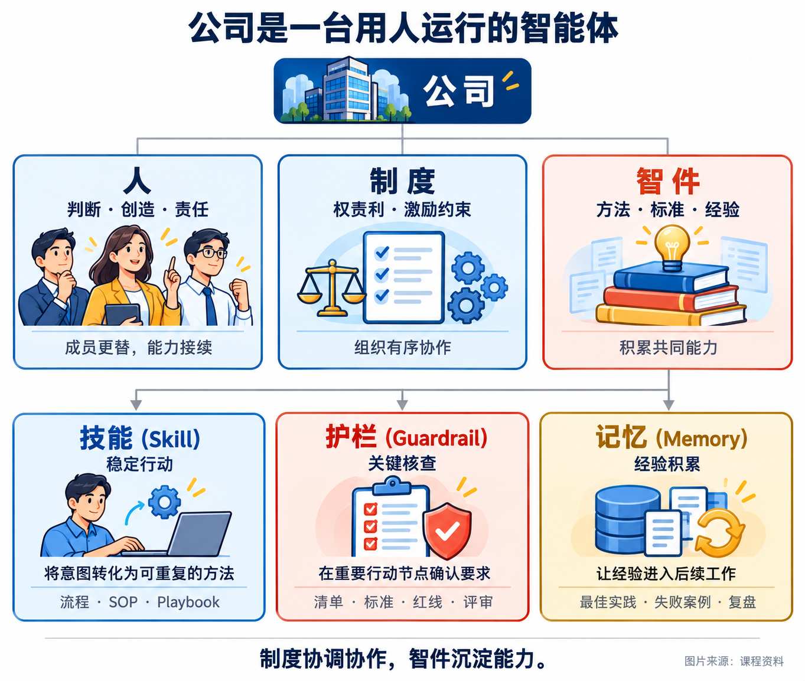
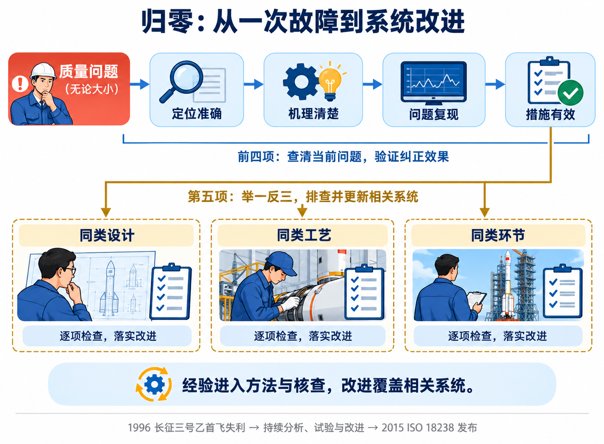
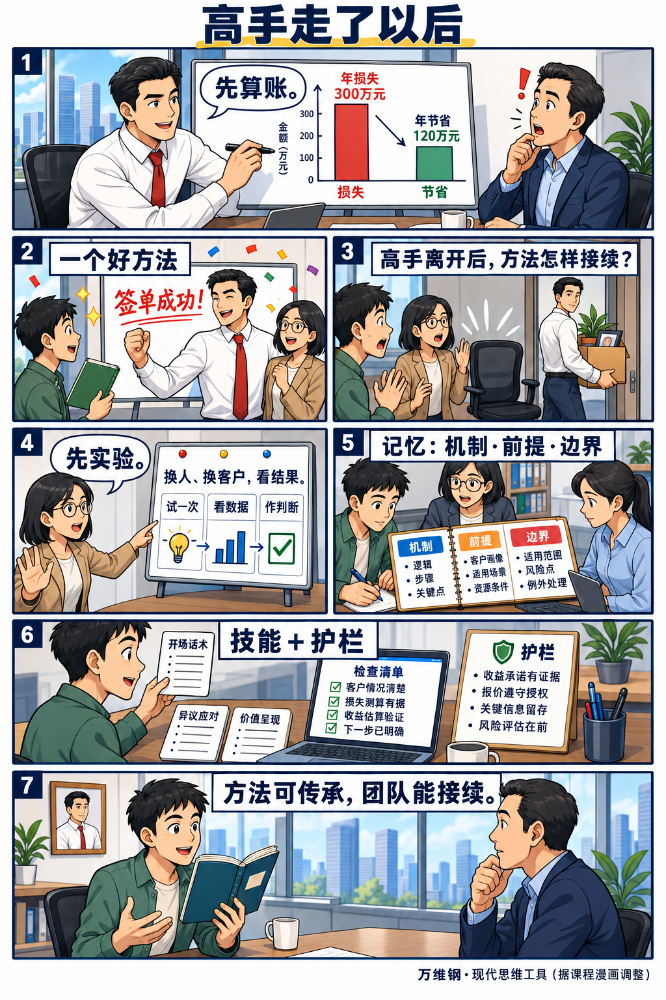
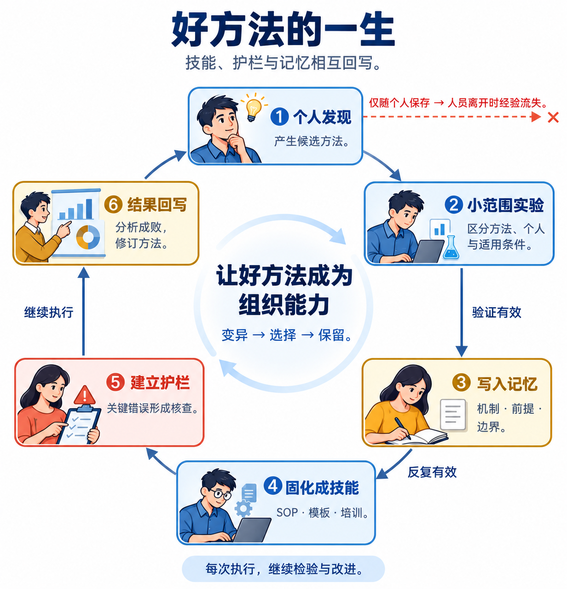
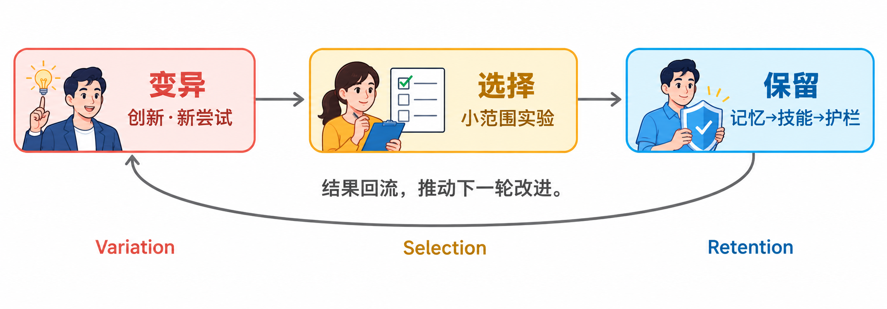
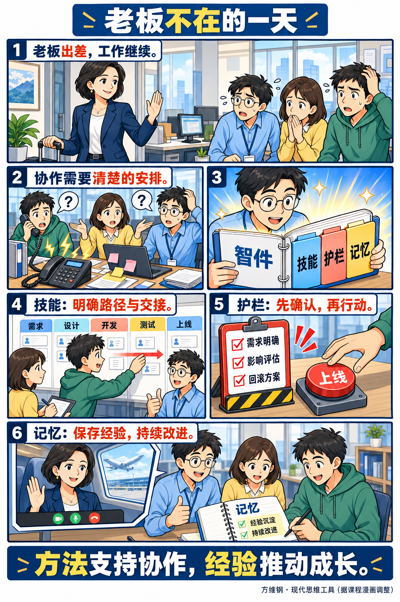
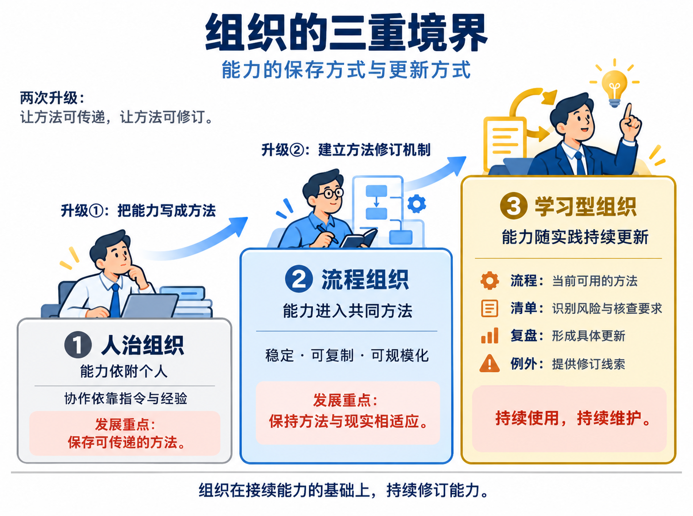
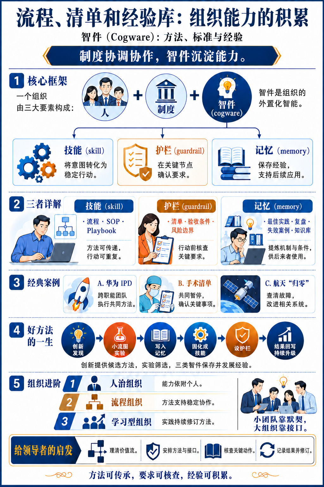

一家公司的成长，既取决于当下能完成多少工作，也取决于每次工作能为下一次留下什么。高手找到的好方法，可以成为整个团队的能力；一次失误暴露的风险，可以成为下一次行动的检查点；一个项目积累的经验，可以帮助后来者更快理解问题。

**智件(Cogware)** 就是组织积累并持续使用的方法、标准与经验。它由技能、护栏和记忆组成：技能组织行动，护栏核查关键要求，记忆保存经验并推动改进。理解这三个组成，以及它们如何相互转化，就能看清个人能力怎样进入组织、组织又怎样在实践中持续成长。[^wan-cogware]

## 一、智件：组织怎样拥有可以传承的能力

> 公司是一台用人运行的智能体。[^wan-cogware]

这个类比将公司看作一个能够协作、行动和学习的整体。人提供判断、创造与责任；**制度(Organizational Rules and Incentives)** 安排权责、利益、激励和约束，组织协作意愿；智件保存做事的方法、判断的标准和积累的经验，支持组织完成工作。

在这个整体中，智件包含三个组成，分别回答三个相互衔接的问题。

| 组成 | 定义 | 回答的问题 |
|---|---|---|
| **技能(Skill)** | 针对一类任务，可以重复调用的做事方法 | 事情来了，怎样稳定地完成？ |
| **护栏(Guardrail)** | 判断质量、控制风险的标准与核查机制 | 哪些要求需要在关键节点得到确认？ |
| **记忆(Memory)** | 经提炼、保存并可供后续使用的经验 | 过去的成败，怎样帮助下一次行动？ |

流程、清单和经验库，是三类智件的常见形式。它们将个人掌握的做法表达出来，使其他人能够接手、使用和改进。人员更替时，已经积累的方法与经验继续留在组织中；业务变化时，人再依据现实修订它们。组织能力由此获得连续性。

## 二、技能：把工作意图变成稳定行动

### 技能包含一套怎样的安排

技能把一类任务组织成可以重复执行的行动：在什么条件下，由哪些角色，按什么顺序，完成哪些动作，经过哪些检查点，取得什么结果。

这套安排包含一个**因果假设(Causal Hypothesis)**：采取这些行动，有理由获得预期结果。每次执行既完成当前任务，也为检验和修订方法提供依据。稳定性使方法能够复用，反馈使方法持续适应现实。

**组织惯例(Organizational Routine)** 是组织重复使用的行动模式。Nelson 与 Winter 以基因类比惯例，解释企业如何保存既有能力，并在变化中延续和演化这些能力。组织能够开展哪些工作、习惯怎样行动，部分就保存在这些可重复的方法中。[^routines]

### 流程、SOP 与场景打法

技能可以按不同粒度表达。

| 形式 | 定义 | 关注点 |
|---|---|---|
| **流程(Process)** | 规定一项工作如何在部门或角色之间流转 | 活动顺序、职责接口与交接 |
| **标准作业程序(Standard Operating Procedure, SOP)** | 规定某项任务或岗位操作的具体步骤 | 执行动作、操作条件与完成要求 |
| **场景打法(Playbook)** | 面向一类情境组织判断、策略和动作的方法 | 适用情境、应对选择与行动组合 |

它们可以配合使用：流程衔接多人协作，SOP 细化具体操作，场景打法组织条件变化下的应对。清楚的角色接口，让一项工作在交接后仍能继续推进。

### 华为 IPD：把协作写成可重复的方法

**集成产品开发(Integrated Product Development, IPD)** 将产品开发组织为跨职能协作过程，明确需求、立项、研发及交付中的角色、活动、材料和评审节点。

1999 年前后，华为的业务规模已经对协作提出更高要求。当时的比较数据呈现出几项差距：订单准时交付率约 50%，国际同行约 94%；年库存周转约 3.6 次，对照约 9.4 次；研发投资回报约为 IBM 的六分之一。这些指标描述的是变革背景，其中研发对应产品开发，交付和库存涉及供应链。[^huawei-data]

华为引入 IBM 的 IPD 方法，将依赖个人推动的产品开发，逐步转成跨职能团队共同执行的工作安排。需求进入后，各角色有明确的接手事项、共同材料和阶段评审；团队能够围绕同一套方法协作。研究将跨职能团队、标准流程与模板列为这项转变的重要机制。[^huawei-ipd]

任正非提出“先僵化，后优化，再固化”：先完整学习引入的方法，形成共同的执行基础；再根据实践调整；最后保存有效改进。这个顺序服务于当时学习和实施 IPD 的组织变革。[^wan-cogware]

当协作规模扩大，稳定的方法使客户信息有承接、部门交接有接口、新人入职有路径。个人的能力由此进入多人协作，组织能够在更多任务中反复使用它。

## 三、护栏：让关键要求得到确认

### 护栏怎样参与工作

护栏将质量、风险和接受条件落实为可检查的要求，并放到相应的行动节点。它既包括判断依据，也包括执行核查、团队确认和发现问题后的处理安排。

| 形式 | 定义与作用 |
|---|---|
| **核查清单(Checklist)** | 提醒并确认容易遗漏的关键事项 |
| **质量标准(Quality Standard)** | 提供判断结果质量的共同尺度 |
| **验收条件(Acceptance Criteria)** | 明确工作结果可以被接受的条件 |
| **风险红线(Risk Boundary)** | 确定行动必须遵守的风险边界 |
| **评审门槛(Review Gate)** | 确认工作进入下一阶段所需的条件 |

SOP 组织操作步骤，清单组织关键核查。专业人员熟悉一项工作后，清单仍能帮助他们应对疲劳、打断、赶工和多人协作中的遗漏。

### 手术清单：一次共同暂停的作用

手术前，确认患者身份、手术部位和过敏史；手术结束时，清点纱布和器械。这些核查将团队已经掌握的专业要求，落实为当次手术中共同确认的事实。

2009 年发表于《新英格兰医学杂志》的一项研究，在八个国家的八家医院观察了 19 项手术安全清单的实施。实施前后，死亡率由 1.5% 变为 0.8%，住院并发症由 11% 变为 7%。这项前后比较研究呈现了清单实施与临床结果改善之间的关联。[^surgery]

其中一个关键动作，是切皮前全体暂停，由主刀、麻醉师和护士共同核对。这个时点使各方对当前任务形成一致认识，也使核查责任和结果在团队中可见。

**认知卸载(Cognitive Offloading)** 是借助外部动作或环境承接部分信息处理负担。清单帮助团队记住必须确认的事项，为专业判断释放注意力；共同核对又把个人掌握的信息带入协作。[^offloading]

### 护栏的写法与位置

有效的核查项具有明确对象和确认依据。例如，“合同金额与报价单一致”给出了两个可以对照的对象，执行者能够据此作出判断。

合同签署、付款、上线、数据删除和对外发布，都适合在动作发生前设置必要的核查。团队在这些关键节点确认要求、处理异常，再继续执行。清单保持精简，聚焦重要遗漏和风险；具体情境中的判断由相应人员承担。

## 四、记忆：让经验成为后续行动的依据

### 记忆保存什么

组织记忆是从经历中提炼并保存下来的经验，供后续工作使用。它主要包括有效做法、失败案例、复盘结论和实验记录，保留发生过什么、原因是什么、依赖哪些条件，以及对后续工作有什么意义。提炼、保存、检索和应用，是形成与使用记忆的活动；经验库和知识库承担这些内容的组织与查找。

其中，**最佳实践(Best Practice)** 是在特定情境中经过验证的有效做法。SOP 将成熟做法编码成可执行步骤；最佳实践保留方法奏效的经验、机制和条件。这些内容帮助后来者理解方法，并判断它在新情境中如何使用。

### 经验怎样迁移

一个团队采用**目标与关键结果(Objectives and Key Results, OKR)**、站立会议或其他管理方法时，方法发挥作用的条件包括团队关系、文化、客户和激励结构。迁移经验，需要同时理解方法本身和支撑它的条件。

**内部黏性(Internal Stickiness)** 描述有效实践在组织内部迁移时遇到的困难。Szulanski 的研究指出，接收方能否理解和吸收方法、成功机制能否得到清楚解释、双方能否顺畅交流，都影响知识的迁移。[^stickiness]

器官移植提供了一个直观类比：移入的器官与接收它的身体需要适配。组织迁移方法时，也要提取机制和前提，再做本地调整：哪些因素支持效果，哪些条件需要补齐，哪些具体动作应当随环境变化。

### 航天归零：把故障处理扩展为系统改进

1992 年起的接连发射失利，为中国航天的质量管理留下了深刻经验。1996 年 2 月 15 日，长征三号乙首飞在起飞初期失控，约 22 秒后坠毁，商业发射信誉遭受重创。此后的问题分析、试验和改进，成为航天质量体系建设的重要背景。[^aerospace-history]

**归零(Closed-Loop Problem Solving)** 是对质量问题进行定位、分析、复现、纠正和验证，完成闭环处理的机制。质量问题经过归零，再进入放行判断。技术归零的五项要求构成了清楚的递进关系。[^technical-closure]

| 技术归零要求 | 需要建立的认识或结果 |
|---|---|
| 定位准确 | 确认问题发生的具体部位 |
| 机理清楚 | 解释问题产生的原因和机制 |
| 问题复现 | 在受控条件下再现故障，检验定位与机理解释 |
| 措施有效 | 验证纠正措施能够解决问题 |
| 举一反三 | 排查同类设计、工艺与环节，并落实相应改进 |

前四项建立对当前问题及修正效果的可靠认识，第五项将经验传播到相关系统。一次故障由此带来同类问题的排查、方法修订和核查要求更新。2015 年发布的 ISO 18238，为航天系统的闭环问题处理提供了国际标准。[^aerospace]

记忆的价值在这里变得具体：过去发生的事，能够改变下一次工作的条件和方法。

## 五、转化：一个好方法怎样进入组织

### 从销售经验到团队能力

设想一位销售接触大客户：先花时间估算客户现有系统的损失和新方案的收益，再演示产品。一次成功带来一个值得检验的候选方法。销售场景中的年损失 300 万、可节省 120 万，用于演示这种价值沟通方式。

团队接下来围绕三个问题做小范围实验：更换销售后效果如何，哪些客户适用，结果中有多少来自方法本身。验证有效后，把机制、前提和适用边界保存为记忆；反复有效的部分，再写入话术、算账模板和培训材料，形成可重复使用的技能。

执行中的核查随之具体化：客户情况已理解，损失测算有依据，收益估算经过验证，下一步行动清楚。报价在授权范围内，收益承诺有证据支持，关键信息留存，风险在承诺前完成评估。这些要求构成护栏。

每一单的结果再回到经验记录：成交原因、失单原因和客户条件，继续修订方法与核查。熟练者的经验因此能够被其他人学习和使用。新人通过培训较快掌握成熟做法，体现了经验编码的传递价值。[^wan-cogware]

这段过程形成一个完整循环：个人发现，进入实验；有效经验得到保存，成熟做法进入技能，重要风险进入护栏；新的执行结果继续推动三者更新。

这个过程可以读作**产生新方法 → 实验筛选 → 保存与复用**。演化框架将这三个环节称为**变异—选择—保留(Variation–Selection–Retention)**：这里的“变异”指产生新的尝试或做法，“选择”指通过实验检验适用性，“保留”指用记忆、技能与护栏保存经过验证的认识。创新提供候选方法，流程支持重复使用，它们共同参与组织能力的演进。

### 知识怎样跨越个人持续积累

科学研究提供了更大尺度的类比：足够清楚的实验描述让他人能够复现方法，同行评审提供检验环节，学术期刊保存研究记录。方法、核查和记录相互配合，使一人的发现能够进入后来者的工作。

《天工开物》提供了一个关于传承机制的历史对照。宋应星将农工技术汇集为三卷十八篇。万维钢据潘吉星的研究讨论这部书的流传：它在《四库全书》的收录范围之外，清代中期在中国的传播趋于衰落；日本于 1771 年刊行和刻本，持续刊刻、研读与传承，使这些技术记录得到接续。这个对照将一部书的内容价值，与承接和发展这些内容的组织机制联系起来。[^wan-cogware]

组织积累经验也遵循相同的要求：材料可以被找到，方法可以被理解，结果可以被检验，认识可以被后续工作继续发展。持续的使用和修订，让经验跨越个人的任期。

## 六、经营：让智件沿着业务持续运转

### 先看价值流，再安排协作

**价值流(Value Stream)** 是围绕客户价值形成的一连串业务活动。以一项客户业务为例：

**客户进入 → 需求诊断 → 报价 → 交付 → 验收 → 收款 → 续约。**

这条链像公司的脊柱，部门承担其中各环节的工作，像附着在脊柱上的肌肉。经营者沿整条链明确接口：谁接手，接收什么，交付什么，何时确认，结果怎样反馈。

技能组织日常行动，护栏进入关键节点，记忆承接每次成败。负责人休假时工作的连续性，可以观察技能是否充分；事前核查的有效性，可以观察护栏的作用；新人使用既有经验的情况，可以观察记忆是否进入了工作。

### 老板不在，团队怎样继续开发与上线

开发团队将工作安排为需求、设计、开发、测试和上线，各阶段有清楚的职责与交接。上线前，团队共同确认需求、影响评估和回滚方案；完成后，将问题与经验写入记录，继续改进方法和检查项。

团队能够接续工作，来自已经建立并持续维护的方法、标准与经验。人的判断和责任贯穿其中：有人识别异常，有人决定如何处理例外，有人依据结果修改下一版做法。

### 从保存能力到持续修订能力

智件的积累可以用三种组织状态来观察。

| 组织状态 | 能力保存在何处 | 主要运行方式 |
|---|---|---|
| 人治组织(Person-Dependent Organization) | 老板、资深人员的经验和关系中 | 围绕个人指令、手艺与判断协作 |
| 流程组织(Process-Based Organization) | 明确的方法、角色接口与核查中 | 依靠可重复行动支持稳定与规模化 |
| 学习型组织(Learning Organization) | 可以持续修订的方法、标准与经验中 | 依据现实反馈更新组织的做法 |

第一次升级，是将个人掌握的能力表达为其他人可以接续的方法。第二次升级，是建立修订机制，让这些方法持续接受现实检验。

在学习型组织中，流程保存当前可用的方法，清单体现已经识别的风险，复盘形成具体更新。例外和异常为修订提供线索，团队依据证据判断调整方法、补充条件或改善执行。

人的作用也由此清楚：判断例外，发现异常，处理价值冲突，提炼经验，维护系统，并为结果负责。组织的持续演进，依靠这些有意识的投入。

## 七、AI 工程：让三类智件进入智能体协作

### 组织作用怎样进入工程实现

**智能体(Agent)** 是围绕目标、根据反馈组织行动的系统。在 AI 工程中，模型参与判断和决策，工具将行动作用于环境。

**智能体执行框架(Agent Harness)** 是围绕模型组织任务执行、工具调用、状态与反馈的工程机制。具体平台会采用不同的边界和实现。Anthropic 的 Managed Agents 将执行循环、会话记录和执行环境分别管理，就是一种实现方式。[^harness-runtime]

智件模型关注组织需要什么能力，AI 工程关注这些能力怎样被表达、执行和维护。两者可以在同一套工作方法中衔接。

| 智件的组织作用 | AI 工程中的机制 | 可用载体 |
|---|---|---|
| 技能：传递并重复使用方法 | 组织任务指导、专业知识、步骤与配套资源，供 Agent 读取和执行 | 技能包、工作流、工具、脚本及人的协作 |
| 护栏：确认标准与风险要求 | 在相应节点检查证据，执行放行、暂停、修正或人工确认 | 校验器、测试门禁、调用拦截、人工评审 |
| 记忆：保存并使用经验 | 保留经历、提炼经验、检索相关材料，并用于后续任务 | 会话状态、案例库、经验文档及持久化存储 |

### Skill：组织的方法，智能体的技能

智件中的技能，定义一套方法的适用条件、角色安排、行动步骤和效果依据。**智能体技能(Agent Skill)** 则将专业知识、工作流和配套资源封装为 Agent 可以发现、读取和使用的材料。两者可以承载同一套实质方法：组织确定做法，技能包表达做法，Agent 按指导行动，Harness 组织执行。[^skills]

在 Agent Skills 格式中，`SKILL.md` 是入口，脚本、参考资料、模板和资源提供配套支持。一项组织技能可以跨多个技能包、工具与人员实现；一个技能包也可以同时携带操作方法、核查要求和经验案例。组织作用与工程包装，分别说明方法做什么，以及方法如何交付给执行者。[^skill-format]

### Guardrail：把标准接到行动节点

**工程护栏(Engineering Guardrail)** 将业务、质量和风险要求接入运行过程。标准说明应当满足什么，核查说明要看什么证据，执行机制决定何时放行、暂停、修正或请人判断。LangChain 的护栏机制包括确定性规则、基于模型的检查和人工确认，并可在 Agent 运行及模型、工具调用的相应节点介入。[^engineering-guardrails]

### Memory：让经验进入后续任务

**智能体记忆(Agent Memory)** 是系统保留并使用先前信息的机制。按使用范围，可以观察会话内的短期状态与跨会话的长期记忆；按内容，可以观察事实、经历与任务执行规则。这两个维度分别说明信息在多大范围内可用，以及保存了什么。[^engineering-memory]

组织学习进一步连接保存、提炼、检索和应用：会话记录保留事件，复盘解释原因与条件，相关经验进入后续任务，使用结果再推动方法和核查更新。经验可以保存在专门存储中，也可以进入技能材料、测试样例和工作指南，继续影响行动。

### 将开发与上线接成一个改进闭环

把前面的开发场景用于 AI 协作，可以形成以下工程安排。

| 环节 | 具体安排 | 结果怎样进入下一次工作 |
|---|---|---|
| 技能组织执行 | 技能包承载需求澄清、设计、实现、测试和发布方法；Agent 按指导行动，Harness 分派工具调用 | 以实际任务检验方法在当前项目中的适用性 |
| 护栏支持发布判断 | 测试结果、影响评估、制品核对、回滚准备和相应人工确认接入发布节点 | 将发现的遗漏和风险转成明确的核查要求 |
| 记忆推动改进 | 保存问题原因、适用条件、处理结果，关联改动的方法和检查项 | 后续任务检索并应用经验，再验证改进效果 |

组织把方法交给执行者，把标准接到行动节点，把经验带入后续任务。人持续负责目标、例外判断、方法维护和结果责任；AI 工程提供更便于发现、执行、核查与积累的载体。

## 参考资料

[^wan-cogware]: 万维钢，得到《现代思维工具100讲》，2026-07-09。公司类比、智件三部分、案例和演化模型据此整理；八张内容图含两幅漫画，据课程图重绘，AI 辅助制图。销售数字和培训效果属于教学示例。《天工开物》的史论细节转引该课程对潘吉星《〈天工开物〉校注及研究》（1989）的叙述。任正非的实施主张转引课程所列 1999-11-16 IPD 第一阶段总结讲话。
[^routines]: Richard R. Nelson、Sidney G. Winter，《An Evolutionary Theory of Economic Change》（1982）；链接为 Harvard University Press 平装版书目。惯例的基因类比转引万维钢的课程解释。
[^huawei-data]: Knowledge at Wharton，2009-04-20。交付与库存属于同时涉及集成供应链(Integrated Supply Chain, ISC)的变革背景。英文网页库存数据带百分号；这里按课程所引周转次数口径呈现。
[^huawei-ipd]: Zihan Zhang、Johann Peter Murmann（2020），《Transforming Product Development at Huawei: The IPD Initiative》，110—135 页。出版社摘要支持跨职能团队、标准流程与模板的机制说明。
[^surgery]: Haynes 等，NEJM 360（2009）：491—499。研究采用清单实施前后比较，结果适用于其医院样本和研究条件。
[^offloading]: Risko 与 Gilbert，Trends in Cognitive Sciences 20(9)（2016）：676—688。认知卸载用于解释借助外部动作和环境分担信息处理的机制。
[^stickiness]: Szulanski，Strategic Management Journal 17（1996）：27—43。研究对象为企业内部最佳实践的迁移。
[^aerospace-history]: 中国航天科技集团的质量管理资料，支持 1996 年首飞失利、约 22 秒后坠毁及后续试验改进。课程给出的起飞约两秒后失控，属于该事件起飞初期的细节叙述。
[^technical-closure]: 中国载人航天《质量问题归零“双五条”》，2022-12-23。这里展开技术归零五条；航天质量体系另设管理归零五条。
[^aerospace]: ISO 18238:2015，2015-11 发布；定义与范围依据 ISO 官方书目和摘要。
[^skills]: Agent Skills 概念说明：专业知识、工作流与配套资源的封装，按需发现、激活和执行。
[^skill-format]: Agent Skills 格式规范：`SKILL.md` 入口与可选脚本、参考资料及资源目录。
[^engineering-guardrails]: LangChain Guardrails 文档：业务规则、内容与质量检查，以及规则、模型和人工介入机制。
[^engineering-memory]: LangChain Memory overview：短期与长期记忆，以及事实、事件与程序性知识的区分。
[^harness-runtime]: Anthropic，2026-04-08。Managed Agents 提供执行循环、会话与运行环境分离的一种工程实践。工程资料截至 2026-10-30；组织模型与平台机制的映射为此处的分析。
