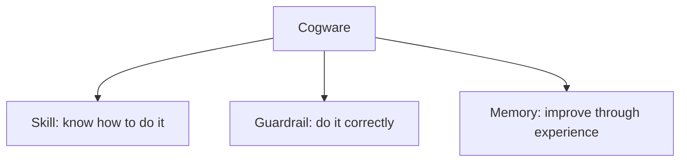
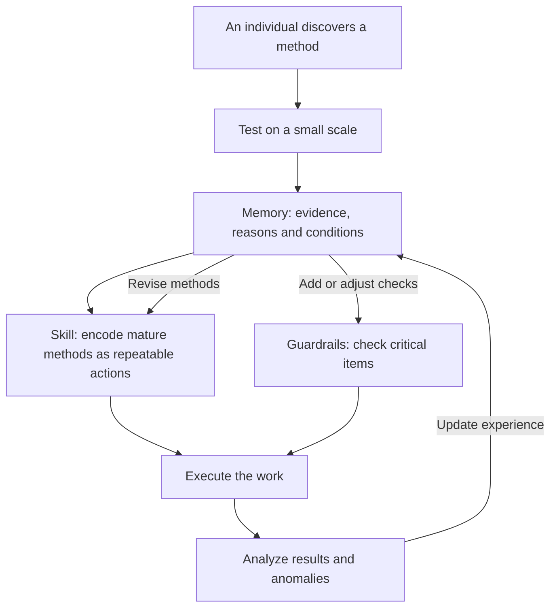
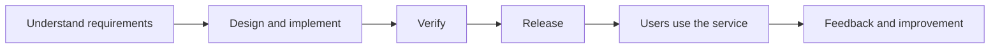

> This article follows the source's explanatory order: define Cogware as a whole, explain skills, guardrails and memory, examine their feedback loop, and then connect the model to business operations, software engineering and AI collaboration.
>
> Interpretation of the source is the main body. Development examples are hypothetical. Vendor cases in the AI extension follow official accounts and do not describe this site's own practice. External sources clarify concepts and provide supporting evidence. The Chinese edition introduces terms in Chinese(English) form; some English names are explanatory translations. This edition uses the corresponding English terms. [^wan-cogware]

## 1. Why Organizations Need Cogware

Why can work remain disorganized even when a team has intelligent, responsible people and established rules?

The source distinguishes two problems: making people willing to cooperate, and enabling them to do the work reliably.

**Organizational rules and incentives**, as used here, are arrangements concerning responsibilities, authority, benefits, incentives and constraints. They specify who is accountable, how benefits are distributed and which actions are prohibited, helping align individual effort with organizational goals.

Yet clear responsibilities do not prevent every operational difficulty. Newcomers may struggle to take over. Different people may handle the same task differently. Information may repeatedly disappear during handoffs. Critical stages may still depend on a senior colleague stepping in.

These patterns suggest that an organization also needs to accumulate its own capability for doing the work. The source calls what carries this capability “Cogware.”

For business owners and organizational leaders, the questions become concrete: **How can a problem solved successfully by one person become a problem others can also handle? How can the cost of one failure reduce the chance of paying that cost again?**

## 2. Start with the Whole: What Is Cogware?

### 2.1 Defining Cogware

**Cogware**, in the source's usage, consists of the methods, standards and experience retained within an organization. It allows the organization to preserve, use and improve its capability, so that individual intelligence continues to contribute even as personnel change.

“Retained within the organization” is essential: methods can be passed to others, standards can be applied in actual work, and experience can influence the next action.

An engineer knowing how to release a service is an individual capability. When the team teaches the method to others, places checks at critical points and incorporates experience from successful and failed releases, it gradually develops organizational Cogware.

Cogware is the organizational management concept used in this article. Documents, templates, training, code and automation can carry it; its value appears in actual work. It is not treated here as a particular software product that must be purchased or a unified technical standard.

### 2.2 What Cogware Contains

Once the overall concept is clear, its three components can be distinguished:

| Component | Definition within Cogware | Main question |
|---|---|---|
| **Skill** | A way of doing work that the organization can use repeatedly | When a task arrives, how should it be done? |
| **Guardrail** | Standards and checking mechanisms that support quality and prevent critical errors | How do we confirm it is right, and where must errors be prevented? |
| **Memory** | Retained experience available for subsequent work | What can the next attempt learn from past successes and failures? |

This diagram shows composition only. The following sections explain, level by level, where processes, checklists and experience repositories fit.

## 3. The First Component: Skills Preserve Methods

### 3.1 What Is a Skill?

A **skill** is a method the organization can repeatedly use for a class of tasks. It translates a desired result into who performs which actions, in what order.

The source emphasizes reliability: work need not be organized from scratch every time or depend entirely on one person's improvisation.

A skill also contains a causal hypothesis: under certain conditions, these roles, actions, sequences and checkpoints can produce the expected result. Later execution both uses the method and tests that hypothesis.

The source also draws on **organizational routines** to explain how firms retain capability through recurring patterns of action. Repetition does not mean permanent immutability. A method can first be used consistently and then revised in light of results.

### 3.2 Processes, SOPs and Playbooks: Forms of Skill

Within the skill component, the source identifies several common forms. Each describes how to act, at a different scope.

| Form | Definition | Main focus |
|---|---|---|
| **Process** | Specifies how work moves between departments or roles | Who takes the next step and how the handoff occurs |
| **Standard operating procedure (SOP)** | Specifies how a role or a particular task is performed | How a specific operation is completed |
| **Playbook** | Strategies and actions for a class of situations | How to respond when that situation arises |

For example, moving from requirements review into development, testing and release concerns a process. Rehearsing a database migration concerns an SOP. Choosing a troubleshooting approach when production responses slow down concerns a playbook.

These names need not have absolute boundaries. A practical guide may address coordination, operations and response strategies together. Understanding what it enables the team to accomplish matters more than assigning the document to a category.

### 3.3 Source Example: Why Huawei Introduced IPD

The source uses Huawei's introduction of **integrated product development (IPD)** to explain why growth creates a need for reliable methods. Moving a product from requirements to delivery involves multiple roles; individual effort cannot indefinitely fill every coordination gap.

The point is to organize work across roles into a method that can be executed repeatedly. The source's sequence—first follow the method closely, then optimize it, then stabilize what works—belongs in this organizational change context: learn the method seriously, adapt it through practice and retain validated approaches.

### 3.4 Development Example: Add Pagination to a Legacy API

Suppose an order-list API returns all results. The team adds an optional `page_size` parameter, which older clients do not send. If the server now defaults to the first 20 records, an older client may still treat them as the complete order list. The request succeeds, but its business meaning changes.

This hypothetical applies Google AIP-180's compatibility guidance; it is not a Google incident. It concerns migration of a legacy API. New APIs should consider pagination from the outset. [^compatibility]

A skill organizes the work: establish existing calls and default behavior, decide the migration approach, then implement, test and integrate it. The API specification explains compatibility requirements; operating guidance describes verification of legacy and paginated calls; the process identifies who confirms behavior and who takes over verification.

The skill explains how work proceeds. Guardrails must confirm the critical facts before release.

## 4. The Second Component: Guardrails Prevent Critical Errors

### 4.1 What Is a Guardrail?

A **guardrail** addresses two questions: how to determine whether work meets requirements, and which errors must be stopped before they occur.

The source includes checklists, quality standards, acceptance conditions, risk boundaries and review gates. Their roles differ: standards support judgment, acceptance conditions define when delivery is acceptable, boundaries specify limits, and review gates establish conditions for entering the next stage.

The source particularly emphasizes pausing to observe and confirm facts before important or irreversible actions. Guardrails belong at points where critical errors can occur.

The checklist deserves special attention because it is easily confused with an SOP.

### 4.2 What Is a Checklist, and How Does It Differ from an SOP?

A **checklist** helps people confirm that critical items have not been overlooked. It addresses situations where people know how to do something but may forget, or assume someone else has already checked it.

An SOP organizes the complete operation. A checklist concentrates on important items that are easy to miss and costly to omit.

A deployment guide, for example, explains how to build and release a service. A release checklist confirms that the version about to be released is the one that passed verification, that the target environment is correct, and that the team can stop the impact from expanding if something goes wrong.

The source also treats a checklist as a synchronization mechanism: key participants confirm facts at the same time, reducing misunderstandings such as “I thought you had checked that.”

### 4.3 Source Example: Why Surgical Teams Also Need Checklists

The 2009 study cited by the source introduced a 19-item surgical safety checklist in eight hospitals, involving patients undergoing noncardiac surgery. Before-and-after observations showed mortality declining from 1.5% to 0.8%, and inpatient complications from 11% to 7%. The study described these changes as associated with checklist implementation; it helps illustrate how even highly trained teams can benefit from checking critical items. [^surgery]

From the perspective of **cognitive offloading**, checklists can reduce internal cognitive demands by moving part of remembering and checking into the environment. This is an explanatory perspective, not a mechanism established by the surgical study. Cognitive offloading changes a task's information-processing demands through external actions or changes to the environment. [^offloading]

### 4.4 Development Example: Write a Useful Release Checklist

For the pagination change, adapt these checks to the team's actual risks:

- Without `page_size`, does an older client still receive the agreed complete result? Does the test contain more than 20 records so truncation would be visible?
- Do page boundaries, subsequent pages and empty results have explicit expectations and verification results?
- Is the release artifact the verified version, and are the target service and environment correct?
- Which signals will be observed, when will rollout stop, and how will anomalies be handled?

Each question concerns verifiable facts. The source's requirements for a good checklist remain **brief, firm and verifiable**. Cover critical risks first. Automate reliable checks and supply evidence for professional judgment.

A **canary release** introduces a new version to part of the traffic and compares it with a control group retaining the old version. Signals should distinguish versions, with stopping or rollback conditions agreed in advance. Aggregate success rates can conceal problems in the new version. [^canary]

Here, orders may be incomplete even when HTTP responses succeed. Compatibility tests must directly verify completeness; release observation adds relevant business signals. Small traffic alone cannot establish correct behavior.

## 5. The Third Component: Memory Keeps Experience Useful

### 5.1 What Is Memory?

In the source, **memory** means accumulated experience from earlier work. It helps later participants understand why something succeeded or failed, and under what conditions it can be applied elsewhere.

Skills primarily explain how to act. Memory also retains the reasons, assumptions and boundaries behind a method. This information allows a team to adapt reasonably when circumstances change.

### 5.2 Distinguish Experience, Its Formation and Its Storage

The memory component also requires distinct levels.

First is the content of experience. A **best practice** is an approach validated as effective in a particular context. Failure cases retain what happened, under what conditions and what was learned. Experiment records preserve methods, conditions and results. All are forms of experience an organization can accumulate.

Second are the activities that develop experience. A **retrospective** reviews completed work, analyzes it and proposes improvements. In an incident context, a **postmortem** typically records impact, response, causes and follow-up actions. Reviews produce records; those records must be organized to become memory that future work can use. [^postmortem]

Third is the storage medium. A **knowledge base** supports the organization and retrieval of knowledge. Its portion devoted to working experience can be called an experience repository. It can carry memory, but stored content still needs to be found and used when relevant work occurs.

### 5.3 Why Another Team's Best Practice Cannot Simply Be Copied

An effective method may depend on a team's customers, people's capabilities, technical conditions and ways of coordinating. Copying the actions does not necessarily reproduce those conditions.

The source cites **internal stickiness**, the difficulty of transferring knowledge and practices within an organization. Research identifies obstacles such as a lack of absorptive capacity among recipients, uncertainty about why a practice works and an arduous relationship between the parties. [^stickiness]

At least three questions matter when learning from experience: what problem did the practice solve, why did it work, and does the current organization have the relevant conditions? The source advocates transferring mechanisms and assumptions, then adapting concrete actions locally.

For example, a team that releases frequently may also have automated verification, compatibility strategies, observability and recovery capability. Increasing release frequency alone does not reproduce its method.

### 5.4 Source Example: Closing the Loop on Failure

The source uses the Chinese aerospace practice of **closed-loop problem solving**—an explanatory English rendering of the aerospace term used in the source—to show how failures can lead to system updates. The five requirements discussed here concern technical problem closure: [^technical-closure]

1. **Locate accurately:** identify where the problem occurred.
2. **Explain the mechanism:** establish why it happened.
3. **Reproduce the problem:** test the understanding of it.
4. **Verify the remedy:** demonstrate that the corrective measure works.
5. **Extend the lesson:** examine similar areas and apply the improvement more widely.

The official abstract for ISO 18238:2015 confirms that the aerospace standard concerns closed-loop management of product quality problems, including mitigation of effects, root-cause identification, containment and lessons learned. The five-part summary above follows the source article. [^aerospace]

In software engineering, reproduction must be interpreted in light of risk and feasibility. Use an isolated environment when possible. If complete reproduction is unavailable, retain the uncertainty and seek sufficient evidence to test the explanation, rather than causing another production failure.

### 5.5 Development Example: Turn Missing Orders into a Future Check

Suppose the pagination change reaches production and older clients miss orders. Investigation finds that legacy requests omit `page_size`, the new server truncates results by default, and test data contained fewer than 20 records, so the condition was never exercised.

After correcting the immediate behavior, memory should retain the cause, affected calls and limits of the lesson. Two changes follow: add a legacy-request regression fixture containing more than one page, and require the API change guide to examine defaults when new parameters are omitted. Check similar APIs according to risk.

During the next change, confirm that the fixture actually runs and the guidance applies. **Experience becomes usable through explaining the cause, changing methods or checks, and verifying subsequent effects.** This is a proposed improvement path in the hypothetical, not a report of a team's completed practice.

## 6. How the Three Components Form a Feedback Loop

Skills, guardrails and memory have distinct roles and update one another through use.

The source illustrates this with a sales method: someone discovers that, for a certain type of customer, calculating the benefits before demonstrating the product works better. The organization should continue testing and retaining the method so others can learn it.

The process has five steps:

1. **Experiment first:** try different people and customers to distinguish the method's contribution from individual ability.
2. **Retain memory:** record why it works, the conditions and its limits.
3. **Develop skill:** encode repeatedly effective elements as steps, scripts, templates and training material. Best practices preserve validated experience; SOPs turn mature practices into executable actions.
4. **Add guardrails:** introduce necessary checks for important, recurring execution errors.
5. **Feed results back:** revise experience using later successes and failures, then adjust methods and checks.

The source places innovation and process in the same evolutionary cycle: new attempts supply candidate methods, experiments help select them, processes retain effective practices and real-world results drive further revision.

The source also uses the scientific method as an analogy: reproducible experimental descriptions carry skills, peer review provides guardrails, and journals retain memory. Its contrast with the transmission of knowledge through *Tiangong Kaiwu* emphasizes that experience needs preservation, testing by others, communication and further development.

The compatibility failure in the development example follows this pattern. The failure is explained, experience retained, tests and change guidance updated, and subsequent execution checks whether the improvement works.

**The loop is closed when the experience has changed the next action.**

## 7. Organize Around Business Activity and Improve Continuously

### 7.1 Why Build Cogware Along the Value Stream?

A **value stream** is a sequence of activities that creates customer value. The source follows the chain from customer acquisition, needs diagnosis and quotations through delivery, acceptance, payment and renewal, emphasizing how the whole chain operates.

Business leaders can examine role interfaces along this chain: what the preceding stage delivers, what allows the next stage to take over, and how results return to those maintaining methods and standards. Responsibilities in an organizational chart need to become concrete actions in the actual flow of business.

A development team can examine a path from requirements to user activity:

This is a simplified illustration for identifying handoffs and feedback points. DORA's analysis of software delivery value streams likewise emphasizes observing work from idea to production and identifying delays, bottlenecks and opportunities for improvement. [^value-stream]

Along the path, ask whether important work has a clear method, whether critical actions have necessary checks, and whether successes and failures influence the next task.

### 7.2 From Dependence on Individuals to a Learning Organization

The source distinguishes three organizational states.

A **person-dependent organization** relies mainly on the owner and a few highly capable people. Work depends on them to move forward, and experience can leave with them. This English name is an explanatory translation.

A **process-based organization** has established methods and checks, making work more reliable and repeatable. Its difficulty is that processes can come to be treated as final answers: people seek compliance rather than improvement.

A **learning organization** treats a process as the currently usable version. Anomalies and exceptions are noticed and explained, and a decision is made about incorporating them into the next version. Experience from reviews can continually change skills and guardrails.

The difference is whether the organization can retain capability, and whether retained capability can continue to be revised by reality.

### 7.3 The Human Contribution Within the System

The source concludes by locating the human contribution in judging exceptions, detecting anomalies, handling value conflicts, updating experience and accepting responsibility for results. Cogware carries the repeatable and transferable parts; people continue to address problems not yet covered by rules. This system requires continuing human maintenance and input; it does not evolve automatically.

For a team, an individual's contribution includes both completing the current task and enabling subsequent colleagues to perform the work better.

## 8. AI Extension: Connect Methods, Checks and Experience to Execution

This engineering extension retains Cogware's three components. Here, an **AI agent** uses a model to choose actions, invoke tools and continue based on results, differing from a workflow that organizes models and tools along predefined paths. [^agents]

An **agent harness** is the engineering mechanism around a model that organizes the execution loop, tool calls, context management and runtime control. Implementations draw the boundary differently. Anthropic's Managed Agents describes its harness as the loop calling the model and dispatching tool calls, with session records and the execution environment managed separately. [^harness-runtime]

In the pagination example, a harness can let the agent read API requirements, edit code, run compatibility tests, inspect failures and continue correcting them. It provides a way for skills, guardrails and memory to participate in execution; adopting a framework alone does not establish those organizational capabilities.

### 8.1 Skills: Help AI Find the Team's Methods

An **agent skill** packages task guidance and related resources. The Agent Skills open format stores instructions and metadata in `SKILL.md`, with optional scripts and reference material. [^skills]

For pagination, the method is to establish existing behavior before designing migration and verification. Project documentation, skill files and test scripts can carry it together. The organizational skill is the method; an agent skill file is one possible carrier.

> **Case | OpenAI: A Short Entry Point into Maintainable Engineering Knowledge**
>
> **What happened:** The team found a large `AGENTS.md` containing every requirement difficult to maintain.
>
> **Engineering mechanism:** A short `AGENTS.md` directs agents to structured project documentation. Linters and structural tests enforce some constraints, while reviews and bugs feed improvements into documentation and tooling rules. [^openai-harness]
>
> **Takeaway:** The entry point makes methods discoverable, executable checks verify constraints, and feedback improves both. Choose a structure appropriate to the project.

### 8.2 Guardrails: Verify Delivery Through Running Behavior

Writing “must test” provides guidance. Incorporating compatibility tests into checks before delivery establishes an executable verification mechanism. Here, retain a legacy request omitting the parameter and verify the agreed behavior with more than one page of results. Commands, tested versions and actual results should be inspectable.

> **Case | Anthropic: An Existing Function Can Still Leave a Feature Broken**
>
> **What happened:** In a tile-editor task, a rectangle-fill function existed, but dragging placed tiles only at the start and end instead of filling the rectangle.
>
> **Engineering mechanism:** Before coding, the generator agent and evaluator agent agreed on verifiable completion criteria. The evaluator agent used Playwright on the running application and discovered that event handling did not correctly trigger the fill logic. [^anthropic-harness]
>
> **Takeaway:** Verify the actions users actually perform. A function's presence or a model's completion claim cannot substitute for running verification. Model evaluation can also miss problems; use deterministic tests where feasible.

### 8.3 Memory: Distinguish Task Progress from Organizational Experience

A progress log records changed files and unfinished steps, enabling a later session to continue. Organizational experience also explains why an event occurred, when its lesson applies and how later methods changed. These serve different purposes.

For pagination, “fixed” is insufficient. Retain the cause of missing orders, a legacy-request fixture spanning more than one page, and the revised API change requirements. Make them discoverable when agents start similar tasks.

**Context** is the information available to the model for the current task. Retained experience can influence execution when it enters that context. Maintaining external experience and tests does not train model parameters. The material still needs to apply to the current task and version.

### 8.4 Close the Loop: Test Whether Updates Improve the Next Task

An **evaluation** uses explicit criteria and representative tasks to assess system behavior. Retain the compatibility problem as a regression task: after updating documentation, skills or the harness, check whether the agent recognizes default behavior, runs necessary tests and reports results accurately, while watching for regressions elsewhere.

Anthropic's experience also suggests re-examining harness components as models and tasks change. Remove components that are no longer necessary one at a time and observe the effect. Complexity itself is not capability. [^anthropic-harness]

The improvement path is unchanged: execution exposes a problem, its cause is explained, memory, methods or checks are revised, and subsequent tasks verify the effect.

## 9. How an Organization Can Begin

Choose one core activity that recurs, involves substantial coordination or is prone to errors—for example customer delivery, new product development, or an engineering team's API changes, database migrations or service releases.

First, explain the method already in use: where the work begins, who takes over and how it is completed. Use actual tasks to check whether newcomers can understand and execute it.

Second, add necessary checks at critical points. Start with omissions that have actually occurred and had significant consequences. Keep checks specific, brief and evidence-based.

Third, organize a recent, representative success or failure. Preserve reasons, conditions and boundaries, then turn the conclusions into changes to methods or checks.

Fourth, verify those changes in subsequent tasks. Observe whether others can reuse the method and whether similar problems decrease, then continue adapting. If AI is introduced, give it the same maintained methods and experience, and verify results against the relevant standards.

The source's central value is to focus attention on how organizational capability is retained: **skills preserve methods, guardrails protect critical points, memory accumulates experience, and human judgment keeps the system developing.**

## References and Their Uses

The primary source supplies the organizational argument; research clarifies its concepts, and engineering sources support the explicitly identified extensions. Source links and their uses are listed below. External materials were checked on October 15, 2026.

[^wan-cogware]: Primary source. The article preserves its sequence of whole, components, feedback loop and organizational application. Development and AI cases are identified extensions.
[^surgery]: Checks study scope, before-and-after figures and association-based wording; it does not establish the cognitive mechanism of the intervention.
[^offloading]: Clarifies cognitive offloading as one possible way to explain a checklist's role.
[^stickiness]: Clarifies obstacles and conditions for transferring experience within firms.
[^aerospace]: Checks the scope of aerospace quality problem closure; the full standard is not reproduced.
[^technical-closure]: Distinguishes technical from management closure; only the five technical criteria are expanded here.
[^postmortem]: Incident records, causal analysis and preventive actions.
[^canary]: Control versions, version-specific signals and rollout stopping conditions.
[^compatibility]: Default behavior and backwards compatibility; the order-pagination scenario is hypothetical.
[^value-stream]: Identifies handoffs, bottlenecks and improvement opportunities in software delivery.
[^agents]: Distinguishes agents from predefined workflows.
[^skills]: Explains how agent skills are packaged.
[^harness-runtime]: Clarifies the boundaries between a harness, session records and execution environment.
[^openai-harness]: Vendor practice connecting documentation entry points, executable constraints and engineering feedback.
[^anthropic-harness]: Vendor practice in running-application verification, evaluation limitations and harness simplification.
