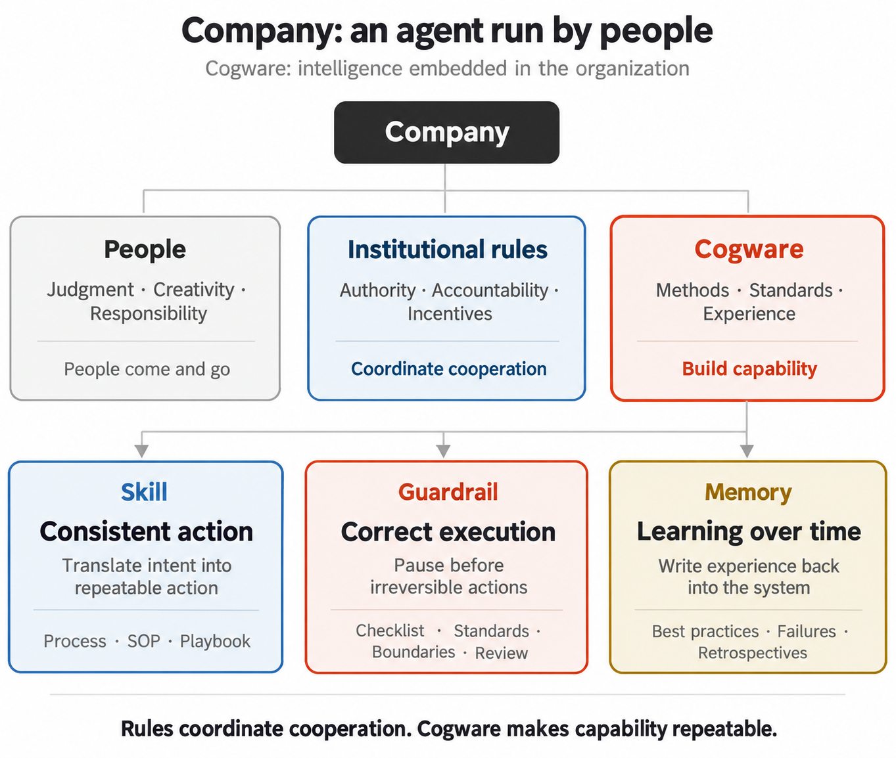
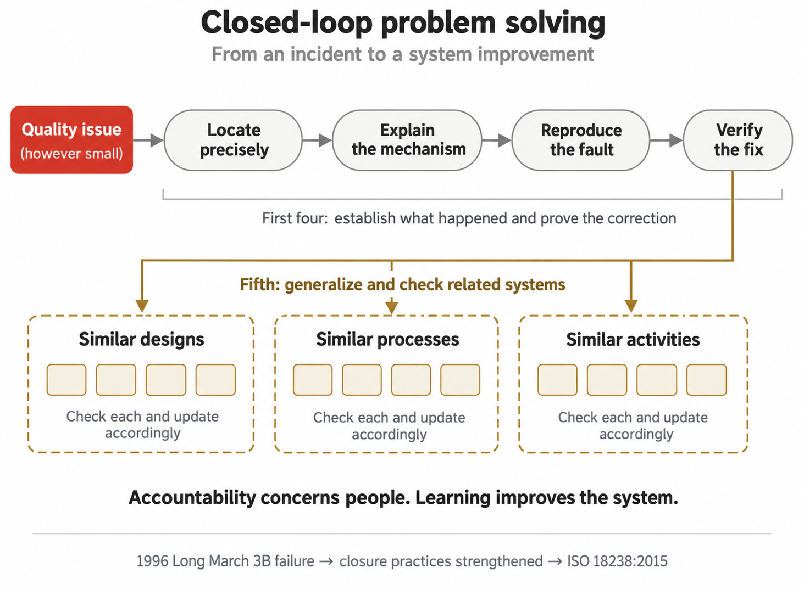
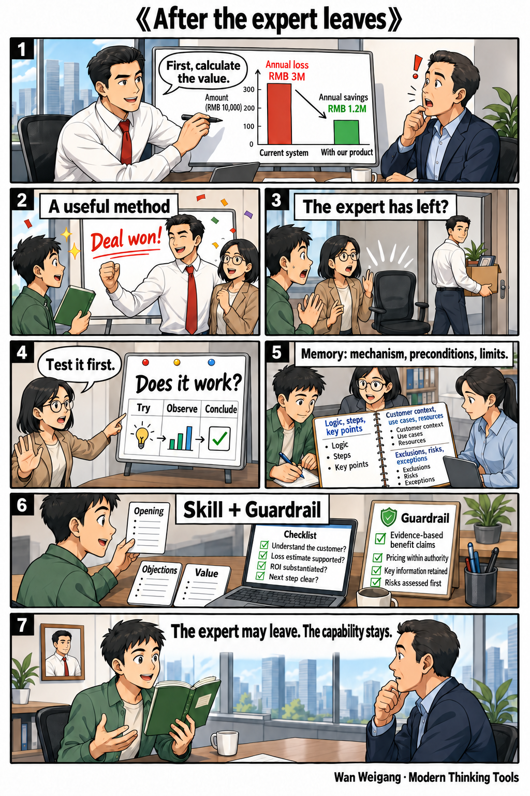
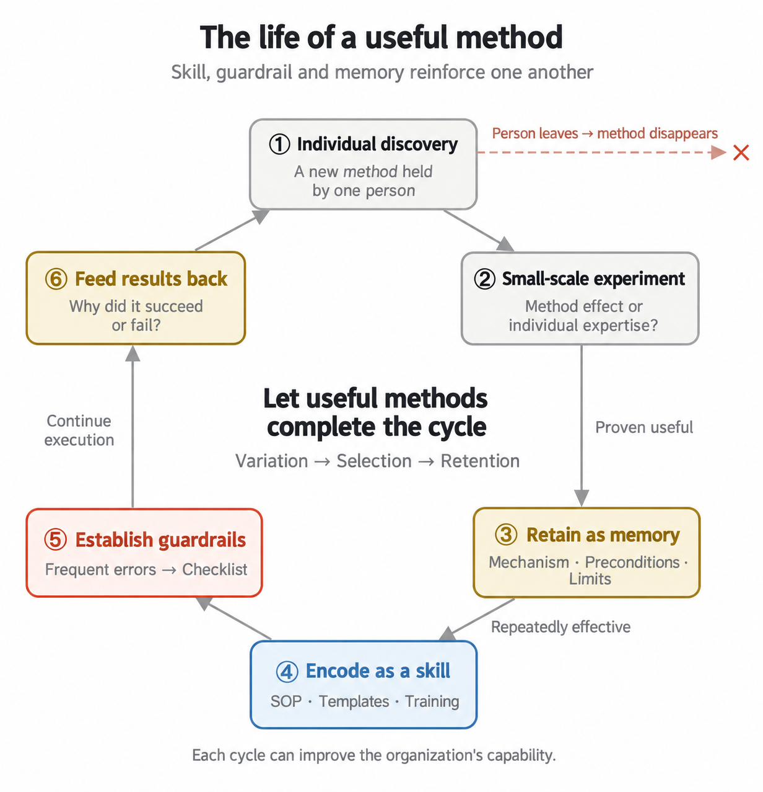
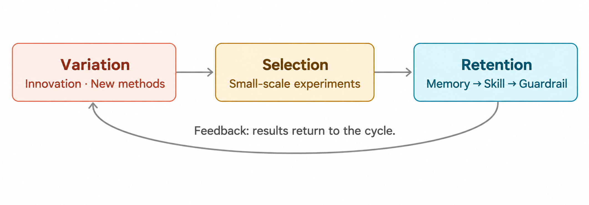
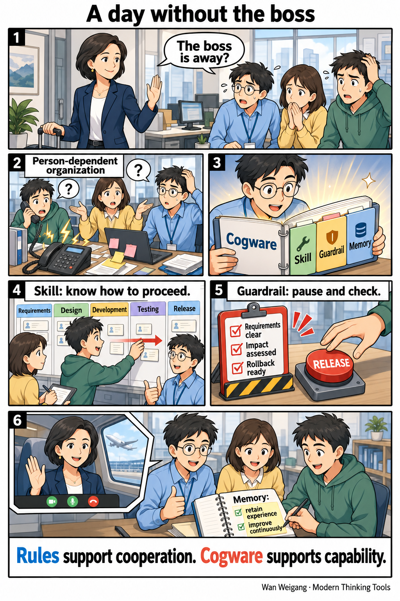
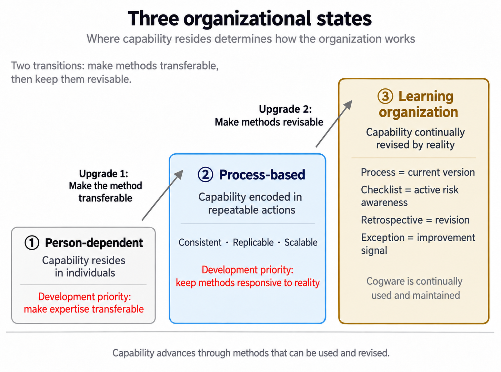
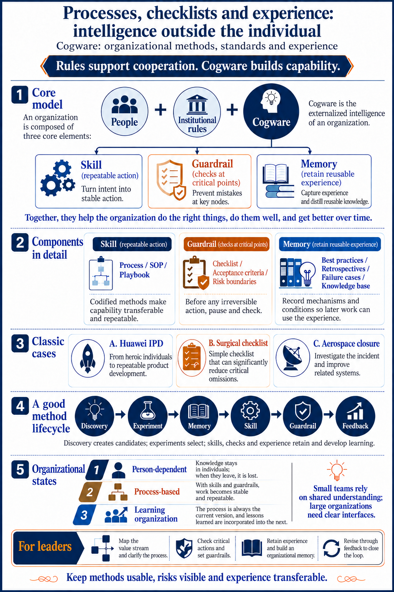

A company's growth depends both on the work it completes today and on what that work makes possible tomorrow. A method developed by an expert can become a capability shared by the team. A failure can reveal a checkpoint for the next decision. Experience from one project can help the next team understand its task sooner.

**Cogware** is the collection of methods, standards and experience that an organization accumulates and continually uses. Its three components are skill, guardrail and memory: skills organize action, guardrails verify critical requirements, and memory retains experience and supports improvement. Together, they explain how individual expertise becomes organizational capability and how that capability develops through practice.[^wan-cogware]

## 1. Cogware: capability that an organization can pass on

> A company is an agent run by people.[^wan-cogware]

This analogy treats the company as a whole capable of coordinated action and learning. People contribute judgment, creativity and responsibility. **Institutional rules and incentives** arrange authority, accountability, interests and constraints, supporting people's willingness to cooperate. Cogware retains methods for working, standards for judging results and experience for learning.

Within this whole, cogware has three components, each answering a connected question.

| Component | Definition | Question it answers |
|---|---|---|
| **Skill** | A repeatable method for carrying out a class of tasks | How can the task be completed consistently? |
| **Guardrail** | Standards and checking mechanisms for quality and risk | Which requirements should be verified at critical points? |
| **Memory** | Experience distilled, retained and made available for later use | How can past outcomes inform the next action? |

Processes, checklists and experience repositories are common forms of these components. They express what individuals have learned so that others can take over, apply it and improve it. Methods and experience remain available as people change roles; people revise them as the business changes. This gives organizational capability continuity.

## 2. Skill: translating intent into consistent action

### What a skill organizes

A skill organizes a class of tasks into repeatable action: under which conditions, which roles perform which actions, in what sequence, through which checkpoints, toward what result.

That arrangement contains a **causal hypothesis**: these actions are expected to produce the intended outcome. Each execution completes the current task and provides evidence for testing and revising the method. Consistency enables reuse; feedback helps the method adapt to reality.

An **organizational routine** is a recurring pattern of action. Nelson and Winter compared routines to genes to explain how firms retain capabilities and carry them forward as conditions change. Part of what a company can do, and how it habitually does it, resides in these repeatable methods.[^routines]

### Processes, SOPs and playbooks

Skills can be expressed at different levels of detail.

| Form | Definition | Focus |
|---|---|---|
| **Process** | The way work moves among departments or roles | Activity sequence, interfaces and handovers |
| **Standard operating procedure (SOP)** | Specific steps for a task or role | Actions, operating conditions and completion requirements |
| **Playbook** | A method combining judgment, strategy and action for a class of situations | Applicable conditions, choices and action patterns |

These forms can work together. A process connects participants, an SOP details an operation, and a playbook organizes responses to differing conditions. Clear interfaces help work continue after a handover.

### Huawei IPD: making collaboration repeatable

**Integrated product development (IPD)** organizes product development as a cross-functional process. It specifies roles, activities, working materials and review points across requirements, project initiation, development and delivery.

Around 1999, Huawei's scale was placing greater demands on coordination. Comparisons from that period showed on-time order delivery of about 50%, against approximately 94% for international peers; annual inventory turnover of about 3.6 times, against 9.4; and R&D investment returns at about one-sixth of IBM's. These indicators describe the context for change. R&D concerns product development, while delivery and inventory also concern the supply chain.[^huawei-data]

Huawei brought in IBM's IPD methods and gradually organized product development around work arrangements shared by cross-functional teams. As a requirement moved forward, participants had defined responsibilities, common materials and stage reviews. Research identifies cross-functional teams, standard processes and templates as important mechanisms in this change.[^huawei-ipd]

Ren Zhengfei advocated a sequence of initial adherence, subsequent optimization and consolidation: first learn the introduced method thoroughly and establish a shared basis for execution; then adapt it through practice; finally retain effective improvements. The sequence served Huawei's circumstances as it learned and implemented IPD.[^wan-cogware]

As collaboration grows, stable methods give customer information an owner, departmental handovers an interface and new employees a path into the work. Individual expertise becomes usable across more participants and tasks.

## 3. Guardrail: verifying critical requirements

### How guardrails participate in work

Guardrails turn quality, risk and acceptance conditions into checkable requirements at the relevant points of action. They encompass criteria, checks, shared confirmation and arrangements for responding to an issue.

| Form | Definition and role |
|---|---|
| **Checklist** | Prompts and verifies critical items that are easy to overlook |
| **Quality standard** | Provides a shared basis for judging quality |
| **Acceptance criteria** | Specifies conditions under which a result can be accepted |
| **Risk boundary** | Establishes the risk limits that action must observe |
| **Review gate** | Confirms the conditions for moving to the next stage |

An SOP organizes operating steps; a checklist organizes critical verification. For experienced professionals, checklists help address omissions associated with fatigue, interruption, time pressure and coordination among participants.

### The surgical checklist: a shared pause

Before surgery, the team confirms the patient's identity, surgical site and allergies. At completion, it counts sponges and instruments. These checks turn familiar professional requirements into facts explicitly confirmed for the current operation.

A study published in the New England Journal of Medicine in 2009 observed implementation of a 19-item surgical safety checklist at eight hospitals in eight countries. Mortality changed from 1.5% to 0.8%, and inpatient complications from 11% to 7%. The before-and-after study showed an association between checklist implementation and improved clinical outcomes.[^surgery]

A key action was the pause before incision, when the surgeon, anesthetist and nursing staff checked together. This gave participants a shared understanding of the task and made responsibility for checks, and their results, visible to the team.

**Cognitive offloading** uses external actions or the environment to carry part of an information-processing burden. A checklist helps the team remember what must be confirmed, freeing attention for professional judgment. Joint verification also brings individually held information into the collaboration.[^offloading]

### Writing and placing a guardrail

A useful check identifies its object and the evidence for confirmation. “The contract amount matches the quotation,” for example, supplies two items that the person checking can compare.

Contract signing, payment, release, data deletion and public communication are appropriate places for checks before action. The team confirms requirements, resolves exceptions and proceeds. A concise checklist concentrates on important omissions and risks, with the responsible people exercising judgment in context.

## 4. Memory: experience that informs later action

### What memory retains

Organizational memory is experience distilled from events and retained for later use. It includes effective practices, failure cases, retrospective findings and experiment records, preserving what happened, why it happened, which conditions mattered and what it means for later work. Distillation, retention, retrieval and application are activities that form and use memory; experience repositories and knowledge bases organize the content for discovery.

A **best practice** is an approach shown to work in a particular context. An SOP encodes a mature approach as executable steps; a best practice preserves the experience, mechanism and conditions behind its effectiveness. These help later users understand the method and judge its application in a new setting.

### How experience transfers

When a team adopts **objectives and key results (OKR)**, stand-up meetings or another management practice, the conditions supporting its effects include relationships, culture, customers and incentives. Transferring experience requires understanding both the method and its supporting conditions.

**Internal stickiness** describes difficulties in transferring effective practices within an organization. Szulanski's research highlights whether recipients can understand and absorb the method, whether its mechanism can be clearly explained and whether participants can communicate effectively as influences on knowledge transfer.[^stickiness]

An organ transplant offers an intuitive analogy: the organ and its receiving body need to be compatible. Transferring an organizational method likewise involves extracting its mechanism and prerequisites, then adapting it locally: identifying what supports the result, which conditions need to be established and which actions should change with the environment.

### Aerospace problem closure: extending a fix across the system

A succession of launch failures beginning in 1992 provided important experience for Chinese aerospace quality management. On February 15, 1996, the first Long March 3B launch lost control shortly after liftoff and crashed about 22 seconds into flight, severely damaging its commercial-launch reputation. The subsequent analysis, testing and improvements formed an important context for quality-system development.[^aerospace-history]

**Closed-loop problem solving** addresses a quality issue through localization, analysis, reproduction, correction and verification. Closure precedes the release decision. The five technical closure requirements form a progression.[^technical-closure]

| Technical requirement | Understanding or result to establish |
|---|---|
| Locate precisely | Identify the specific location of the problem |
| Explain the mechanism | Establish its cause and mechanism |
| Reproduce the fault | Recreate the fault under controlled conditions to test the explanation |
| Verify the corrective action | Demonstrate that the correction addresses the problem |
| Generalize and check related systems | Inspect similar designs, processes and activities, and implement corresponding improvements |

The first four requirements establish a reliable account of the current problem and its correction. The fifth spreads the learning to related systems. An individual fault can then lead to broader inspection, revised methods and updated checks. Published in 2015, ISO 18238 provides an international standard for closed-loop problem-solving management in space systems.[^aerospace]

Here memory has a concrete effect: what happened before changes the conditions and methods of the next task.

## 5. Conversion: how a useful method enters the organization

### From a salesperson's experience to team capability

Consider a salesperson meeting a large customer. The salesperson first estimates losses associated with the customer's current system and the benefits of the proposed solution, then demonstrates the product. A successful sale produces a candidate method worth testing. The scenario's annual loss of RMB 3 million and potential annual savings of RMB 1.2 million illustrate this approach to discussing value.

The team runs small-scale experiments around three questions: how the approach performs with another salesperson, which customers it suits and how much of the result comes from the method itself. After verification, the mechanism, prerequisites and limits enter memory. Repeatedly effective elements then become scripts, calculation templates and training materials—a reusable skill.

Checks become specific: the customer's situation is understood, loss estimates have supporting evidence, benefit estimates have been validated and the next action is clear. Pricing stays within delegated authority, benefit claims have evidence, key information is retained and risks are assessed before commitments. These requirements provide guardrails.

Each sale's results return to the experience record. Reasons for winning or losing, together with customer conditions, inform revisions to methods and checks. Other people can then learn and apply the expert's approach. Faster onboarding into a mature method illustrates the value of encoding experience.[^wan-cogware]

This forms a complete cycle: an individual discovery enters experimentation; useful experience is retained; mature practices become skills; important risks become guardrails; and further results revise all three.

The process can be read as **generate new methods → test and select → retain and reuse**. The evolutionary framework calls these stages **variation–selection–retention**: variation produces new attempts or approaches, selection tests their applicability, and retention preserves what has been learned through memory, skills and guardrails. Innovation supplies candidate methods; processes support repeated use. Both contribute to the evolution of organizational capability.

### How knowledge accumulates across individuals

Scientific research provides a larger-scale analogy. Sufficiently clear experimental descriptions allow others to reproduce a method; peer review provides scrutiny; and journals retain research records. Methods, checks and records work together so that one person's discovery can enter another person's work.

Tiangong Kaiwu offers a historical comparison about transmission mechanisms. Song Yingxing collected agricultural and artisanal techniques in three volumes and eighteen chapters. Drawing on Pan Jixing's research, Wan Weigang discusses the book's circulation: it remained outside the imperial Siku Quanshu collection, its circulation in China declined by the middle Qing period, and a Japanese edition published in 1771 helped carry the technical records forward through continued printing and study. This comparison connects the value of a book's contents with the organizational mechanisms that preserve and develop them.[^wan-cogware]

Organizational experience accumulates through similar conditions: material can be found, methods can be understood, results can be tested and later work can develop the findings. Continued use and revision allow experience to outlast an individual's tenure.

## 6. Business operations: putting cogware to work

### Start with the value stream

A **value stream** is a sequence of business activities that creates value for a customer. A customer engagement may run through:

**Customer acquisition → Needs diagnosis → Quotation → Delivery → Acceptance → Payment collection → Renewal.**

This chain functions like the company's spine. Departments carry out work along it, like muscles attached to that spine. Leaders define interfaces across the whole chain: who takes over, what they receive, what they deliver, when confirmation happens and how results return.

Skills organize daily action, guardrails enter critical decision points and memory retains outcomes. Continuity during a leader's absence helps reveal how usable the skills are; the effectiveness of checks before action reveals how guardrails work; and newcomers' use of earlier experience reveals how memory participates in the work.

### Development and release while the boss is away

A development team organizes work into requirements, design, implementation, testing and release, with clear responsibilities and handovers. Before release, it jointly confirms requirements, impact assessment and rollback preparation. Afterward, it records issues and experience to improve methods and checks.

The team's continuity comes from established and maintained methods, standards and experience. Human judgment and responsibility remain active throughout: someone recognizes an anomaly, someone decides how to handle an exception and someone uses results to revise the next version of the method.

### From retaining capability to continually revising it

Three organizational states help describe this development.

| Organizational state | Where capability resides | How work proceeds |
|---|---|---|
| Person-dependent organization | The experience and relationships of leaders and experts | People coordinate through personal direction, craft and judgment |
| Process-based organization | Explicit methods, role interfaces and checks | Repeatable action supports consistency and scale |
| Learning organization | Methods, standards and experience that can be continually revised | Feedback from reality updates how the organization works |

The first transition expresses individual expertise as a method others can use. The second establishes a revision mechanism so that these methods continue to be tested against reality.

In a learning organization, a process retains the current usable method, a checklist expresses recognized risks and a retrospective produces concrete updates. Exceptions and anomalies provide clues for revision. The team uses evidence to decide whether to adjust the method, establish further conditions or improve execution.

People's contribution is clear: judge exceptions, recognize anomalies, resolve value conflicts, distill experience, maintain the system and take responsibility for outcomes. Organizational evolution depends on these deliberate contributions.

## 7. AI engineering: bringing cogware into agent collaboration

### Connecting organizational roles to engineering mechanisms

An **agent** is a system that organizes action around a goal and responds to feedback. In AI engineering, a model participates in judgment and decisions, while tools act on the environment.

An **agent harness** is the engineering mechanism around a model that organizes task execution, tool calls, state and feedback. Implementations draw their boundaries differently. Anthropic's Managed Agents, for example, manages the execution loop, session records and execution environment separately.[^harness-runtime]

Cogware describes the capability an organization needs. AI engineering addresses how that capability is expressed, executed and maintained. Both perspectives can connect within the same working method.

| Organizational role | AI engineering mechanism | Possible implementation |
|---|---|---|
| Skill: transfer and reuse a method | Organize task guidance, expertise, steps and supporting resources for an agent to read and act on | Skill packages, workflows, tools, scripts and human collaboration |
| Guardrail: verify standards and risk requirements | Check evidence at appropriate points and approve, pause, correct or seek human confirmation | Validators, test gates, call interception and human review |
| Memory: retain and use experience | Preserve events, distill findings, retrieve relevant material and use it in later tasks | Session state, case repositories, experience documents and persistent stores |

### Skill: the organization's method and the agent's package

In cogware, a skill defines a method's conditions, roles, actions and evidence of effectiveness. An **agent skill** packages expertise, workflows and resources into material an agent can discover, read and use. Both can carry the same substantive method: the organization establishes it, a skill package expresses it, the agent acts on the guidance and the harness organizes execution.[^skills]

In the Agent Skills format, `SKILL.md` is the entry point, supported by scripts, references, templates and other resources. One organizational skill may span several packages, tools and people. One package may also carry operating guidance, checks and experience cases. The organizational role describes what the method does; the engineering package describes how it reaches its executor.[^skill-format]

### Guardrail: connecting standards to action points

An **engineering guardrail** connects business, quality and risk requirements to runtime behavior. Criteria describe what must hold; checks identify the evidence to inspect; and execution mechanisms determine when to approve, pause, correct or request judgment. LangChain supports deterministic rules, model-based checks and human confirmation at relevant points in agent execution and model or tool calls.[^engineering-guardrails]

### Memory: bringing experience into later tasks

**Agent memory** is the mechanism by which a system retains and uses previous information. By scope, it may support short-term state within a conversation or long-term information across conversations. By content, it may retain facts, experiences or task-execution rules. These dimensions describe where information remains available and what information is retained.[^engineering-memory]

Organizational learning connects retention, interpretation, retrieval and application. Session records preserve events; retrospectives explain causes and conditions; relevant experience enters later tasks; and results inform updates to methods and checks. Experience can reside in dedicated stores, skill resources, test cases or working guides and continue to influence action.

### A development and release improvement loop

Applying the development scenario to AI collaboration gives the following engineering arrangement.

| Stage | Arrangement | How it informs later work |
|---|---|---|
| Skills organize execution | Packages carry methods for requirements clarification, design, implementation, testing and release; the agent acts on the guidance and the harness dispatches tool calls | Real tasks test the method's suitability for the current project |
| Guardrails support the release decision | Test results, impact assessment, artifact checks, rollback preparation and appropriate human confirmation enter the release point | Identified omissions and risks become explicit checks |
| Memory supports improvement | Retain causes, conditions and outcomes, linked to the methods and checks that change | Later tasks retrieve and apply the experience, then test the improvement |

An organization gives its methods to executors, places standards at action points and brings experience into later tasks. People remain responsible for goals, exceptions, method maintenance and outcomes. AI engineering supplies means to make methods easier to discover, execute, check and develop.

## References

[^wan-cogware]: Wan Weigang, Modern Thinking Tools 100, Dedao, July 9, 2026. Source for the company analogy, three components, cases and evolutionary models. Eight content figures, including two comics, are redrawn from the course figures with AI-assisted illustration. Sales figures and training outcomes are teaching examples. Details of Tiangong Kaiwu's transmission are cited indirectly through the course's account of Pan Jixing's study (1989). Ren's implementation approach is quoted indirectly from the course's citation of his November 16, 1999 IPD first-stage review speech.
[^routines]: Richard R. Nelson and Sidney G. Winter, An Evolutionary Theory of Economic Change (1982). The link is the Harvard University Press paperback listing. The gene analogy follows Wan's explanation of routines.
[^huawei-data]: Knowledge at Wharton, April 20, 2009. Delivery and inventory form part of a transformation context that also includes integrated supply chain (ISC). The English page prints percentage signs beside the inventory figures; this account follows the turnover-frequency units cited in the course.
[^huawei-ipd]: Zihan Zhang and Johann Peter Murmann (2020), Transforming Product Development at Huawei: The IPD Initiative, pp. 110–135. The publisher's abstract supports the account of cross-functional teams, standard processes and templates.
[^surgery]: Haynes et al., NEJM 360 (2009): 491–499. The study compares periods before and after checklist implementation; results concern its hospital sample and study conditions.
[^offloading]: Risko and Gilbert, Trends in Cognitive Sciences 20(9) (2016): 676–688. Cognitive offloading describes how external actions and the environment can share information-processing demands.
[^stickiness]: Szulanski, Strategic Management Journal 17 (1996): 27–43. The research concerns transfer of best practice within firms.
[^aerospace-history]: China Aerospace Science and Technology Corporation's quality-management account supports the 1996 first-launch failure, impact at approximately 22 seconds and subsequent testing and improvements. The course places the onset of lost control at approximately two seconds after liftoff.
[^technical-closure]: China Manned Space Agency, December 23, 2022. The five requirements discussed here concern technical closure; the aerospace system also specifies five managerial closure requirements.
[^aerospace]: ISO 18238:2015, published November 2015. Definition and scope follow the official ISO listing and abstract.
[^skills]: Agent Skills overview: packaging expertise, workflows and supporting resources for discovery, activation and execution.
[^skill-format]: Agent Skills specification: the SKILL.md entry point and optional scripts, references and assets.
[^engineering-guardrails]: LangChain Guardrails documentation: business rules, content and quality checks, and deterministic, model-based and human intervention mechanisms.
[^engineering-memory]: LangChain Memory overview: short-term and long-term scope, and factual, episodic and procedural content.
[^harness-runtime]: Anthropic, April 8, 2026. Managed Agents is one implementation separating execution loops, sessions and runtime environments. Engineering sources are current to October 30, 2026; their mapping to organizational cogware is the analysis developed here.
