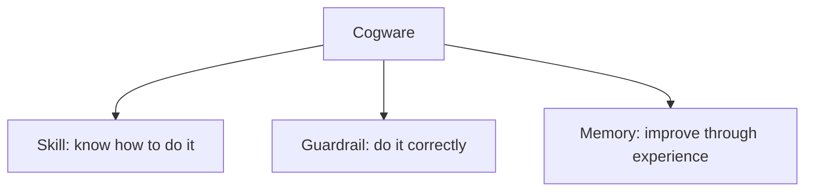
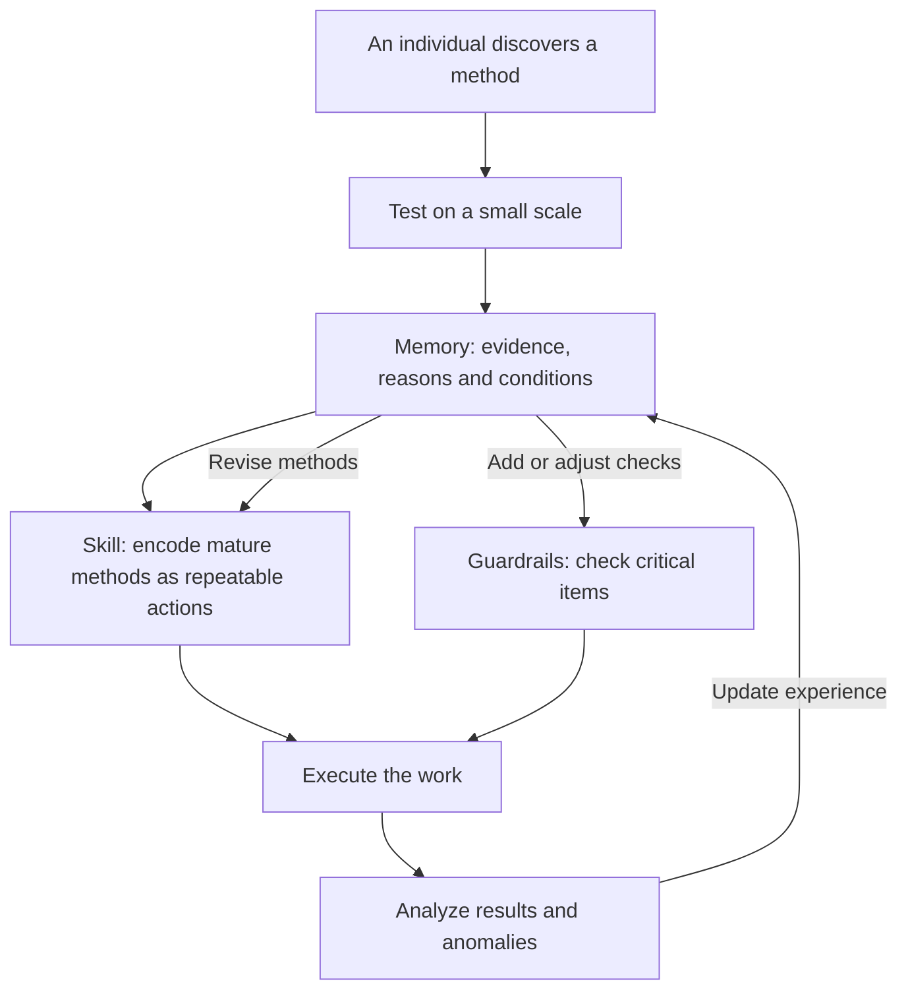
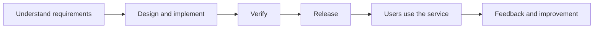

> This article follows the source's explanatory order: define Cogware as a whole, explain skills, guardrails and memory, examine their feedback loop, and then connect the model to business operations, software engineering and AI collaboration.
>
> Interpretation of the source is the main body. Sections marked “Development example” and “AI extension” are application examples, not accounts of an actual team's experience. External sources clarify concepts and provide supporting evidence. The Chinese edition introduces terms in Chinese(English) form; some English names are explanatory translations. This edition uses the corresponding English terms.

## 1. Why Organizations Need Cogware

Why can work remain disorganized even when a team has intelligent, responsible people and established rules?

The source distinguishes two problems: making people willing to cooperate, and enabling them to do the work reliably.

**Organizational rules and incentives**, as used here, are arrangements concerning responsibilities, authority, benefits, incentives and constraints. They specify who is accountable, how benefits are distributed and which actions are prohibited, helping align individual effort with organizational goals.

Yet clear responsibilities do not prevent every operational difficulty. Newcomers may struggle to take over. Different people may handle the same task differently. Information may repeatedly disappear during handoffs. Critical stages may still depend on a senior colleague stepping in.

These patterns suggest that an organization also needs to accumulate its own capability for doing the work. The source calls what carries this capability “Cogware.”

For business owners and organizational leaders, the questions become concrete: **How can a problem solved successfully by one person become a problem others can also handle? How can the cost of one failure reduce the chance of paying that cost again?**

## 2. Start with the Whole: What Is Cogware?

### 2.1 Defining Cogware

**Cogware**, in the source's usage, consists of the methods, standards and experience retained within an organization. It allows the organization to preserve, use and improve its capability, so that individual intelligence continues to contribute even as personnel change.

“Retained within the organization” is essential: methods can be passed to others, standards can be applied in actual work, and experience can influence the next action.

An engineer knowing how to release a service is an individual capability. When the team teaches the method to others, places checks at critical points and incorporates experience from successful and failed releases, it gradually develops organizational Cogware.

Cogware is the organizational management concept used in this article. Documents, templates, training, code and automation can carry it; its value appears in actual work. It is not treated here as a particular software product that must be purchased or a unified technical standard.

### 2.2 What Cogware Contains

Once the overall concept is clear, its three components can be distinguished:

| Component | Definition within Cogware | Main question |
|---|---|---|
| **Skill** | A way of doing work that the organization can use repeatedly | When a task arrives, how should it be done? |
| **Guardrail** | Standards and checking mechanisms that support quality and prevent critical errors | How do we confirm it is right, and where must errors be prevented? |
| **Memory** | Retained experience available for subsequent work | What can the next attempt learn from past successes and failures? |

This diagram shows composition only. The following sections explain, level by level, where processes, checklists and experience repositories fit.

## 3. The First Component: Skills Preserve Methods

### 3.1 What Is a Skill?

A **skill** is a method the organization can repeatedly use for a class of tasks. It translates a desired result into who performs which actions, in what order.

The source emphasizes reliability: work need not be organized from scratch every time or depend entirely on one person's improvisation.

A skill also contains a causal hypothesis: under certain conditions, these roles, actions, sequences and checkpoints can produce the expected result. Later execution both uses the method and tests that hypothesis.

The source also draws on **organizational routines** to explain how firms retain capability through recurring patterns of action. Repetition does not mean permanent immutability. A method can first be used consistently and then revised in light of results.

### 3.2 Processes, SOPs and Playbooks: Forms of Skill

Within the skill component, the source identifies several common forms. Each describes how to act, at a different scope.

| Form | Definition | Main focus |
|---|---|---|
| **Process** | Specifies how work moves between departments or roles | Who takes the next step and how the handoff occurs |
| **Standard operating procedure (SOP)** | Specifies how a role or a particular task is performed | How a specific operation is completed |
| **Playbook** | Strategies and actions for a class of situations | How to respond when that situation arises |

For example, moving from requirements review into development, testing and release concerns a process. Rehearsing a database migration concerns an SOP. Choosing a troubleshooting approach when production responses slow down concerns a playbook.

These names need not have absolute boundaries. A practical guide may address coordination, operations and response strategies together. Understanding what it enables the team to accomplish matters more than assigning the document to a category.

### 3.3 Source Example: Why Huawei Introduced IPD

The source uses Huawei's introduction of **integrated product development (IPD)** to explain why growth creates a need for reliable methods. Moving a product from requirements to delivery involves multiple roles; individual effort cannot indefinitely fill every coordination gap.

The point is to organize work across roles into a method that can be executed repeatedly. The source's sequence—first follow the method closely, then optimize it, then stabilize what works—belongs in this organizational change context: learn the method seriously, adapt it through practice and retain validated approaches.

### 3.4 Development Example: Adding a Field to an Order API

Suppose a team needs to add an optional field to an order API. Saying “finish development and hand it to testing” still leaves much of the work implicit in individual experience.

Making the skill explicit can start with a simple path: confirm the field's meaning and compatibility requirements, change the interface and implementation, add relevant tests, complete integration testing and proceed to release.

The process explains handoffs among product, development and testing. Operational guidance explains how to update API documentation, generate clients or run tests. A playbook can address compatibility issues affecting particular customers.

This establishes how work progresses. Guardrails are needed to confirm that the conditions for the next step have actually been met.

## 4. The Second Component: Guardrails Prevent Critical Errors

### 4.1 What Is a Guardrail?

A **guardrail** addresses two questions: how to determine whether work meets requirements, and which errors must be stopped before they occur.

The source includes checklists, quality standards, acceptance conditions, risk boundaries and review gates. Their roles differ: standards support judgment, acceptance conditions define when delivery is acceptable, boundaries specify limits, and review gates establish conditions for entering the next stage.

The source particularly emphasizes pausing to observe and confirm facts before important or irreversible actions. Guardrails belong at points where critical errors can occur.

The checklist deserves special attention because it is easily confused with an SOP.

### 4.2 What Is a Checklist, and How Does It Differ from an SOP?

A **checklist** helps people confirm that critical items have not been overlooked. It addresses situations where people know how to do something but may forget, or assume someone else has already checked it.

An SOP organizes the complete operation. A checklist concentrates on important items that are easy to miss and costly to omit.

A deployment guide, for example, explains how to build and release a service. A release checklist confirms that the version about to be released is the one that passed verification, that the target environment is correct, and that the team can stop the impact from expanding if something goes wrong.

The source also treats a checklist as a synchronization mechanism: key participants confirm facts at the same time, reducing misunderstandings such as “I thought you had checked that.”

### 4.3 Source Example: Why Surgical Teams Also Need Checklists

The 2009 study cited by the source introduced a 19-item surgical safety checklist in eight hospitals. Before-and-after observations showed mortality declining from 1.5% to 0.8%, and inpatient complications from 11% to 7%. The study described these changes as associated with checklist implementation; it helps illustrate how even highly trained teams can benefit from checking critical items. [Original study abstract](https://pubmed.ncbi.nlm.nih.gov/19144931/)

One explanatory concept is **cognitive offloading**: using external actions or changes in the environment to alter a task's information-processing demands and reduce internal cognitive load. A checklist carries part of the remembering and checking work, leaving more attention available for professional judgment. [Risko and Gilbert's review](https://pubmed.ncbi.nlm.nih.gov/27542527/)

### 4.4 Development Example: Writing a Useful Release Checklist

For the API change described earlier, possible checks include the following. They must be adapted to the team's actual risks:

- Is the commit or artifact being released the version that passed verification?
- Has the field change been checked against the behavior of older clients?
- Is the release target confirmed as the intended service and environment?
- Are there explicit stopping conditions and a response plan if anomalies appear?

Each question points to verifiable facts, rather than a general claim that someone “checked carefully.”

The source's criteria for a good checklist can be expressed as **brief, firm and verifiable**. Cover critical risks first. Checks that can be reliably automated can be delegated to tools. Where professional judgment is needed, provide the evidence required to exercise it.

A **canary release** is an engineering example: expose a new version to a small share of traffic, observe it and then decide whether to expand. Google SRE uses this approach to manage release risk; the indicators and stopping conditions still need to be designed for the service. [Google SRE: Canarying releases](https://sre.google/workbook/canarying-releases/)

## 5. The Third Component: Memory Keeps Experience Useful

### 5.1 What Is Memory?

In the source, **memory** means accumulated experience from earlier work. It helps later participants understand why something succeeded or failed, and under what conditions it can be applied elsewhere.

Skills primarily explain how to act. Memory also retains the reasons, assumptions and boundaries behind a method. This information allows a team to adapt reasonably when circumstances change.

### 5.2 Distinguish Experience, Its Formation and Its Storage

The memory component also requires distinct levels.

First is the content of experience. A **best practice** is an approach validated as effective in a particular context. Failure cases retain what happened, under what conditions and what was learned. Experiment records preserve methods, conditions and results. All are forms of experience an organization can accumulate.

Second are the activities that develop experience. A **retrospective** reviews completed work, analyzes it and proposes improvements. In an incident context, a **postmortem** typically records impact, response, causes and follow-up actions. Reviews produce records; those records must be organized to become memory that future work can use. [Google SRE: Postmortem culture](https://sre.google/sre-book/postmortem-culture/)

Third is the storage medium. A **knowledge base** supports the organization and retrieval of knowledge. Its portion devoted to working experience can be called an experience repository. It can carry memory, but stored content still needs to be found and used when relevant work occurs.

### 5.3 Why Another Team's Best Practice Cannot Simply Be Copied

An effective method may depend on a team's customers, people's capabilities, technical conditions and ways of coordinating. Copying the actions does not necessarily reproduce those conditions.

The source cites **internal stickiness**, the difficulty of transferring knowledge and practices within an organization. Research identifies obstacles such as recipients' absorptive capacity, uncertainty about why a practice works and the relationship between the parties. [Szulanski: Transfer of best practices within firms](https://onlinelibrary.wiley.com/doi/10.1002/smj.4250171105)

At least three questions matter when learning from experience: what problem did the practice solve, why did it work, and does the current organization have the relevant conditions? The source advocates transferring mechanisms and assumptions, then adapting concrete actions locally.

For example, a team that releases frequently may also have automated verification, compatibility strategies, observability and recovery capability. Increasing release frequency alone does not reproduce its method.

### 5.4 Source Example: Closing the Loop on Failure

The source uses the Chinese aerospace practice of **closed-loop problem solving**—an explanatory English rendering of the aerospace term used in the source—to show how failures can lead to system updates. It summarizes five requirements:

1. **Locate accurately:** identify where the problem occurred.
2. **Explain the mechanism:** establish why it happened.
3. **Reproduce the problem:** test the understanding of it.
4. **Verify the remedy:** demonstrate that the corrective measure works.
5. **Extend the lesson:** examine similar areas and apply the improvement more widely.

The official abstract for ISO 18238:2015 confirms that the aerospace standard concerns closed-loop management of product quality problems, including mitigation of effects, root-cause identification, containment and lessons learned. The five-part summary above follows the source article. [ISO 18238:2015 official description](https://www.iso.org/standard/61847.html)

In software engineering, reproduction must be interpreted in light of risk and feasibility. Use an isolated environment when possible. If complete reproduction is unavailable, retain the uncertainty and seek sufficient evidence to test the explanation, rather than causing another production failure.

### 5.5 Development Example: Why Older Clients Were Affected Again

Suppose an older client develops a parsing error after the API field change goes live. Fixing the code addresses the immediate issue. Mentioning it in a weekly report merely records the event.

Useful memory also explains the affected client's characteristics, why existing tests missed the issue, and where compatibility requirements were lost in a handoff. Relevant cases can then be added to tests, requirements incorporated into the API change guide, and similar interfaces examined.

During the next comparable change, that experience participates through tests, guidance and checks. A past failure thereby becomes part of organizational capability.

## 6. How the Three Components Form a Feedback Loop

Skills, guardrails and memory have distinct roles and update one another through use.

The source illustrates this with a sales method: someone discovers that, for a certain type of customer, calculating the benefits before demonstrating the product works better. The organization should continue testing and retaining the method so others can learn it.

The process has five steps:

1. **Experiment first:** try different people and customers to distinguish the method's contribution from individual ability.
2. **Retain memory:** record why it works, the conditions and its limits.
3. **Develop skill:** encode repeatedly effective elements as steps, scripts, templates and training material. Best practices preserve validated experience; SOPs turn mature practices into executable actions.
4. **Add guardrails:** introduce necessary checks for important, recurring execution errors.
5. **Feed results back:** revise experience using later successes and failures, then adjust methods and checks.

The source places innovation and process in the same evolutionary cycle: new attempts supply candidate methods, experiments help select them, processes retain effective practices and real-world results drive further revision.

The compatibility failure in the development example follows this pattern. The failure is explained, experience retained, tests and change guidance updated, and subsequent execution checks whether the improvement works.

**The loop is closed when the experience has changed the next action.**

## 7. Organize Around Business Activity and Improve Continuously

### 7.1 Why Build Cogware Along the Value Stream?

A **value stream** is a sequence of activities that creates customer value. The source follows the chain from customer acquisition, needs diagnosis and quotations through delivery, acceptance, payment and renewal, emphasizing how the whole chain operates.

Business leaders can examine role interfaces along this chain: what the preceding stage delivers, what allows the next stage to take over, and how results return to those maintaining methods and standards. Responsibilities in an organizational chart need to become concrete actions in the actual flow of business.

A development team can examine a path from requirements to user activity:

This is a simplified illustration for identifying handoffs and feedback points. DORA's analysis of software delivery value streams likewise emphasizes observing work from idea to production and identifying delays, bottlenecks and opportunities for improvement. [DORA: Value stream management](https://dora.dev/guides/value-stream-management/)

Along the path, ask whether important work has a clear method, whether critical actions have necessary checks, and whether successes and failures influence the next task.

### 7.2 From Dependence on Individuals to a Learning Organization

The source distinguishes three organizational states.

A **person-dependent organization** relies mainly on the owner and a few highly capable people. Work depends on them to move forward, and experience can leave with them. This English name is an explanatory translation.

A **process-based organization** has established methods and checks, making work more reliable and repeatable. Its difficulty is that processes can come to be treated as final answers: people seek compliance rather than improvement.

A **learning organization** treats a process as the currently usable version. Anomalies and exceptions are noticed and explained, and a decision is made about incorporating them into the next version. Experience from reviews can continually change skills and guardrails.

The difference is whether the organization can retain capability, and whether retained capability can continue to be revised by reality.

### 7.3 The Human Contribution Within the System

The source concludes by locating the human contribution in judging exceptions, detecting anomalies, handling value conflicts, updating experience and accepting responsibility for results. Cogware carries the repeatable and transferable parts; people continue to address problems not yet covered by rules.

It also contrasts the scientific method with the transmission of knowledge through *Tiangong Kaiwu*, highlighting mechanisms needed for continuing accumulation: experience must be preserved, tested, communicated and developed further.

For a team, an individual's contribution includes both completing the current task and enabling subsequent colleagues to perform the work better.

## 8. AI Extension: Apply the Same Reasoning to AI Coding

This section is an engineering extension. Introducing AI does not change the definitions of the three components. They provide a way to examine AI's participation in real work.

In the engineering sense used here, an **AI agent** uses a model to choose the next action, invoke tools and continue a task based on results. Implementations vary. Anthropic distinguishes this dynamic, model-directed approach from workflows that organize models and tools along predefined paths. [Anthropic: Building effective agents](https://www.anthropic.com/engineering/building-effective-agents)

The example remains adding an optional field to an order API.

### 8.1 Skills: Give AI Access to the Team's Methods

AI can generate code from general knowledge, but it also needs to know how this project structures interfaces, maintains compatibility, verifies work and reports results.

A **tool** is a concrete function an agent can invoke, such as searching code, reading a file or running a test. Tools supply actions; the broader skill defined earlier explains how to organize those actions for a class of tasks.

An **agent skill** packages task-specific guidance and related resources for an agent. The Agent Skills open format stores instructions and metadata in `SKILL.md`, with optional scripts, references and templates. [Agent Skills overview](https://agentskills.io/home)

The team could package its API change method as a skill: inspect existing conventions, modify the implementation, add compatibility verification, and report the changes and results. Scripts can carry concrete testing commands.

The relationship is that “skill” in the source is the broader organizational method; an agent skill is one way to carry such a method within an AI toolchain. Writing the file is only a start: the team must verify that it helps work complete reliably across tasks.

### 8.2 Guardrails: Implement Requirements Through Checks and Permissions

In AI coding, guardrails still ask whether the action meets requirements and which errors must be prevented.

For the API field change, compatibility tests can check older clients, code review can compare implementation with requirements, and tool permissions can limit what the agent may modify or execute. Releases follow the team's established authorization and deployment requirements.

Asking AI to follow a rule provides guidance. Boundaries requiring reliable enforcement should also be carried by tests, permissions and runtime checks. OpenAI's documentation discusses input, output and tool-call checks alongside human approvals, emphasizing checks near the corresponding tool-execution boundary. [OpenAI: Guardrails and approvals](https://developers.openai.com/api/docs/guides/agents/guardrails-approvals)

When AI claims tests passed, the team should still be able to inspect the commands actually executed, the relevant version and their results. Guardrails check facts.

### 8.3 Memory: Let AI Use Experience the Team Has Retained

Suppose the team has already experienced an older-client compatibility incident. During the next similar change, AI should have an opportunity to find the record, understand its conditions and use the updated tests and methods.

Two concepts need to be distinguished.

**Context** is the information available to the model during its current reasoning, such as task instructions, code excerpts, tool results and relevant experience. It defines the current input scope. Organizational memory can persist externally and be selected into context when a task requires it. Choosing and maintaining that information is a concern of context engineering. [Anthropic: Effective context engineering](https://www.anthropic.com/engineering/effective-context-engineering-for-ai-agents)

**Retrieval-augmented generation (RAG)** combines generation with externally retrieved information. The original research combines a model's parametric knowledge with externally retrievable information. [Lewis et al.: Retrieval-augmented generation](https://arxiv.org/abs/2005.11401)

In a team, retrieval can help AI find incident history and interface conventions. Whether it found the right record, whether that record remains valid and whether it applies to the current version still require checking. Retrievability is one condition for reuse.

Writing experience into a knowledge base or skill file updates external information and execution guidance. It does not mean training the model's parameters. A team can first maintain its methods and experience, then choose how to make them usable.

### 8.4 Close the Loop: Verify That System Updates Help AI

An **evaluation** assesses system performance using explicit criteria and representative tasks. For this example, it can check whether AI preserves API compatibility, runs necessary tests and reports results accurately.

OpenAI's evaluation materials emphasize repeatable datasets and evaluation runs for comparing changes. A team can use selected, organized historical problems as evaluation cases, observing whether changes to skills, tools or context improve behavior while also checking for regressions. [OpenAI: Agent evaluations](https://developers.openai.com/api/docs/guides/agent-evals)

The same loop appears: real tasks expose problems, the team explains their causes, memory, skills or guardrails are updated, and subsequent verification determines whether the update helped.

## 9. How an Organization Can Begin

Choose one core activity that recurs, involves substantial coordination or is prone to errors—for example customer delivery, new product development, or an engineering team's API changes, database migrations or service releases.

First, explain the method already in use: where the work begins, who takes over and how it is completed. Use actual tasks to check whether newcomers can understand and execute it.

Second, add necessary checks at critical points. Start with omissions that have actually occurred and had significant consequences. Keep checks specific, brief and evidence-based.

Third, organize a recent, representative success or failure. Preserve reasons, conditions and boundaries, then turn the conclusions into changes to methods or checks.

Fourth, verify those changes in subsequent tasks. Observe whether others can reuse the method and whether similar problems decrease, then continue adapting. If AI is introduced, give it the same maintained methods and experience, and verify results against the relevant standards.

The source's central value is to focus attention on how organizational capability is retained: **skills preserve methods, guardrails protect critical points, memory accumulates experience, and human judgment keeps the system developing.**

## References and Their Uses

### Sources Clarifying Concepts in the Original Article

- [Haynes et al., 2009: Surgical safety checklist study](https://pubmed.ncbi.nlm.nih.gov/19144931/): checks the study's scope, figures and association-based wording.
- [Risko and Gilbert, 2016: Cognitive offloading](https://pubmed.ncbi.nlm.nih.gov/27542527/): clarifies the definition of cognitive offloading.
- [Szulanski, 1996: Transfer of best practices within firms](https://onlinelibrary.wiley.com/doi/10.1002/smj.4250171105): explains internal stickiness and conditions for transferring experience.
- [ISO 18238:2015 official description](https://www.iso.org/standard/61847.html): checks the scope of closed-loop management for aerospace quality problems. This article does not reproduce the standard's full requirements.

### Sources for the Software and AI Engineering Extensions

- [Google SRE: Postmortem culture](https://sre.google/sre-book/postmortem-culture/): incident records, causal analysis and preventive actions.
- [Google SRE: Canarying releases](https://sre.google/workbook/canarying-releases/): release risk management.
- [DORA: Value stream management](https://dora.dev/guides/value-stream-management/): identifying improvement opportunities across the flow of work.
- [Anthropic: Building effective agents](https://www.anthropic.com/engineering/building-effective-agents): the distinction between agents and predefined workflows, and the role of tools.
- [Agent Skills overview](https://agentskills.io/home): how agent skills are packaged and used.
- [OpenAI: Guardrails and approvals](https://developers.openai.com/api/docs/guides/agents/guardrails-approvals): where checks and approvals belong in agent execution.
- [Anthropic: Effective context engineering](https://www.anthropic.com/engineering/effective-context-engineering-for-ai-agents): current context and information selection.
- [Lewis et al., 2020: Retrieval-augmented generation](https://arxiv.org/abs/2005.11401): combining externally retrieved information with model generation.
- [OpenAI: Agent evaluations](https://developers.openai.com/api/docs/guides/agent-evals): repeatable evaluations for examining changes.

External sources were consulted on October 15, 2026. AI concepts explain general engineering approaches and do not depend on a particular product version.
