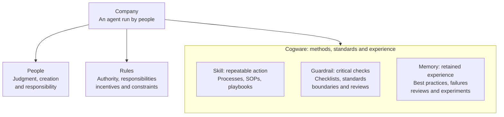
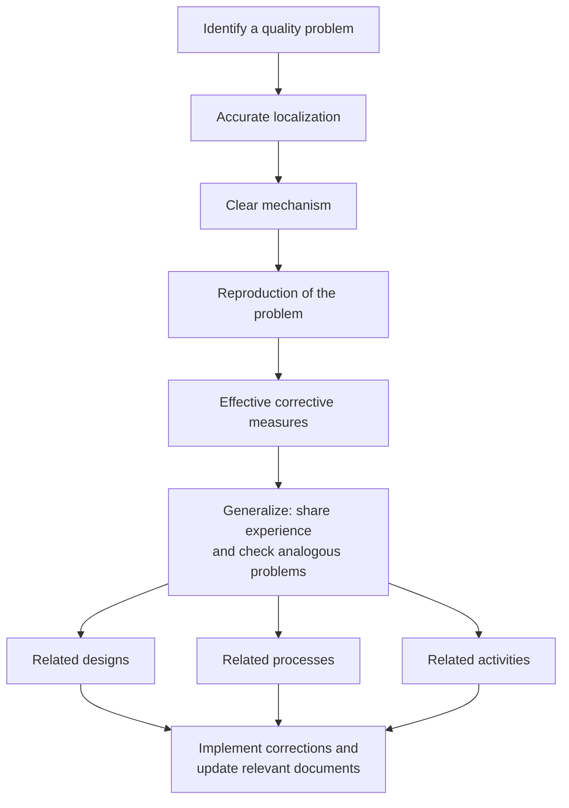
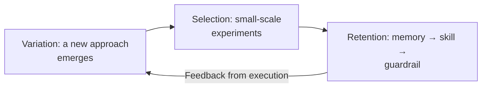
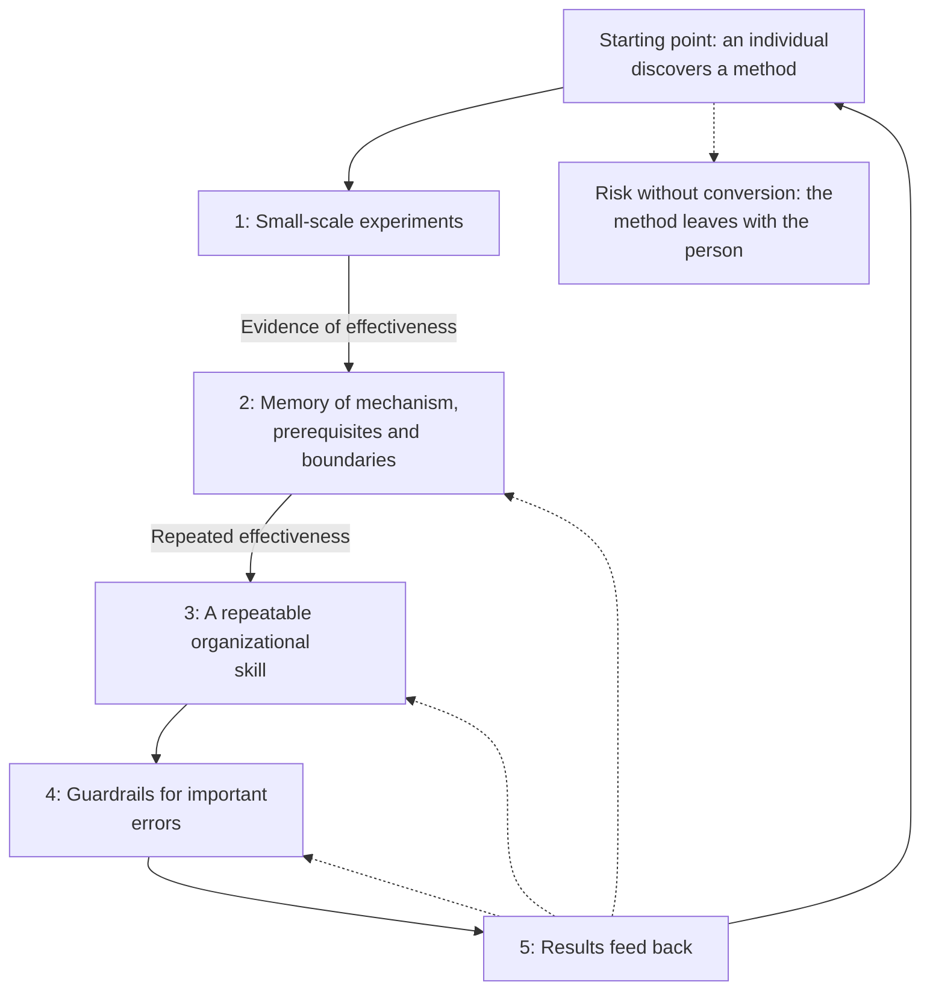
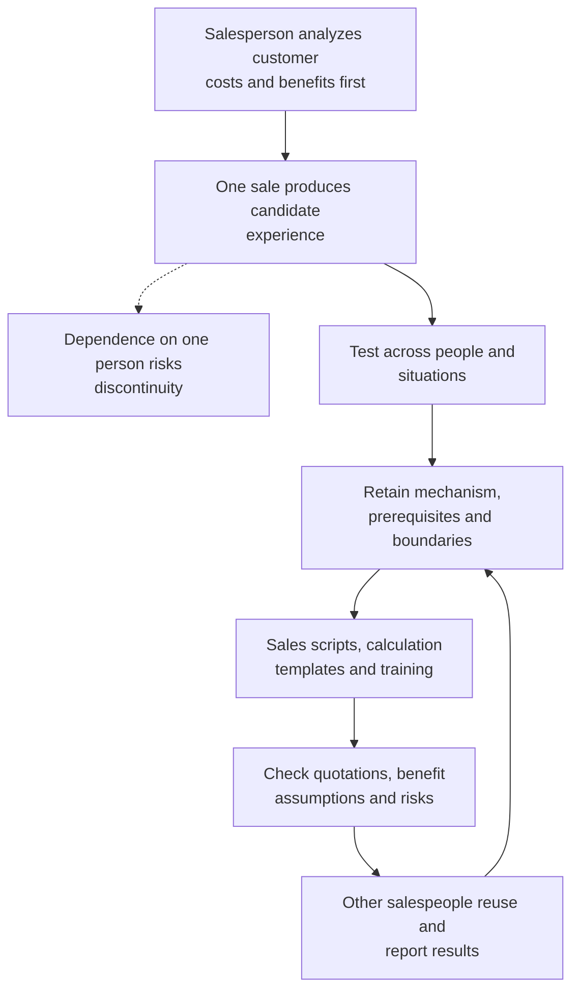
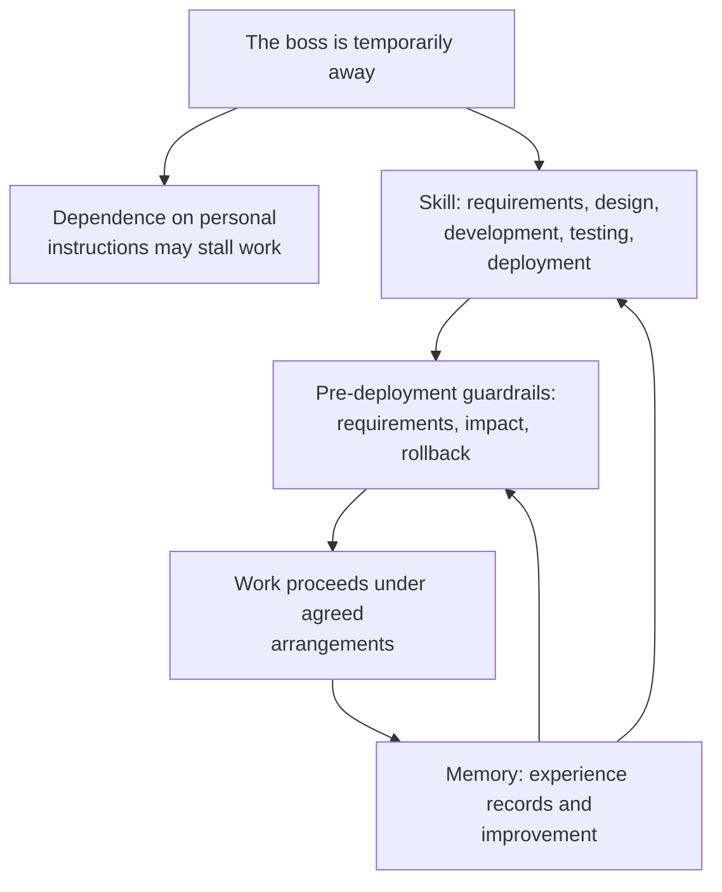
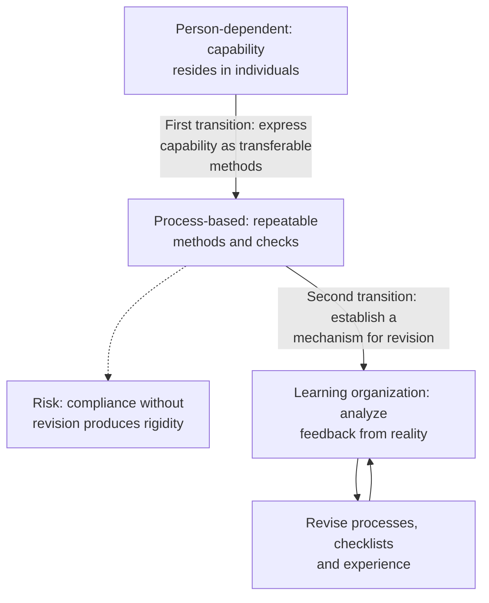
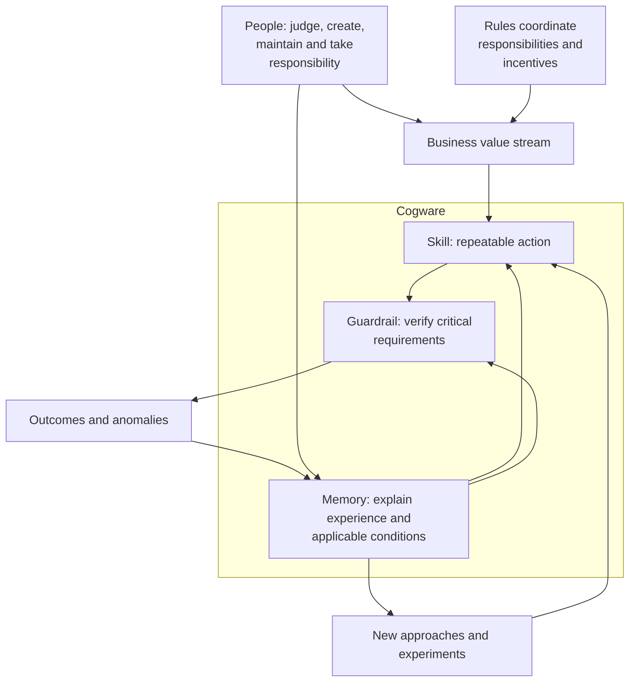

This article follows Wan Weigang's course article. Sections 1–8 retain its overall analogy, three components, cases, evolutionary mechanisms and business applications. The diagrams redraw the relationships in the original figures; the two comics become scenario diagrams. Section 9 provides a separate AI engineering comparison.[^wan-cogware]

## 1. The whole: a company is an agent run by people

> A company is an agent run by people.

The original follows the leadership module's discussion of institutional arrangements, using this analogy to connect people's actions with organizational capability. Even a company full of capable people must address two questions: how to organize their willingness to cooperate, and how to make work produce reliable results over time.

**Organizational rules and incentives**, in the original article's context, address authority, responsibility, benefits, incentives and constraints. They align individual efforts with company goals. **Cogware** comprises the methods, standards and experience an organization retains and uses: how it acts, judges and learns. People, rules and cogware all belong in the explanation of the company as a whole.

The original divides cogware into three components: methods correspond to **skills**, standards to **guardrails**, and experience to **memory**. They support consistent action, prevention of critical errors and accumulation of experience. This overall relationship comes before the internal forms of each component.

### People, rules and cogware

Redrawn from the original overall model. Rules support orderly cooperation; cogware supports the ability to do the work. People execute, maintain and revise the system. When personnel change, the organization needs to retain and develop these capabilities rather than repeatedly depend on a few individuals improvising solutions.

## 2. Skill: translating intent into consistent action

### 2.1 Definition, causal hypotheses and organizational routines

A skill is a repeatable method an organization can call upon for a class of tasks. It specifies the conditions, participating roles, sequence of actions, checkpoints and expected result.

The original emphasizes consistency: a method makes it unnecessary to organize the task from scratch every time. It also contains a causal hypothesis—why this arrangement should produce this result. A skill therefore needs both execution and examination against the results it produces. Consistent use and subsequent improvement can reinforce each other.

An **organizational routine** is a recurring pattern of action within a firm. Drawing on Nelson and Winter, the original explains how routines retain and transmit capabilities. A firm does not begin each day with no accumulated way of working: existing methods shape what it can do and how it responds to change. The original uses genes as an analogy for this retention and evolution.[^routines]

### 2.2 Processes, SOPs and playbooks

| Form of skill | Definition | What it primarily organizes |
|---|---|---|
| Process | How work moves between departments or roles | Interfaces, handoffs and activity sequence |
| Standard operating procedure (SOP) | How a role or task is carried out in detail | Operating steps and methods |
| Playbook | An approach to a class of situations | Conditions, strategies and combinations of actions |

These forms express methods at different levels of granularity. Processes connect participants' actions, SOPs detail operations, and playbooks support tasks whose conditions vary. A practical guide may cover several of these levels together.

### 2.3 Original case: Huawei introduces IPD

The original uses Huawei's scaling difficulties to explain why capable, committed employees do not by themselves create repeatable cross-functional cooperation. Its comparisons include:

| Measure | Huawei figure reported in the original | Comparison |
|---|---|---|
| On-time order delivery in 1999 | Approximately 50% | Approximately 94% for competitors |
| Annual inventory turnover | Approximately 3.6 turns | Approximately 9.4 for competitors |
| Return on R&D investment | Approximately one-sixth of IBM's | IBM |

These figures describe the background to transformation, not the results of introducing a method. The Wharton article discusses both **integrated product development (IPD)** and **integrated supply chain (ISC)**. R&D problems relate to IPD; delivery and inventory describe supply-chain problems. They should not all be presented as effects of IPD.[^huawei-data]

IPD organizes cross-functional work from requirements through delivery into roles, steps, templates and review points. The Cambridge research summary likewise identifies cross-functional teams, standard processes and templates as central mechanisms.[^huawei-ipd]

The original recounts Ren Zhengfei's transformation approach: first master the imported method through disciplined implementation, then optimize it through practice, and finally consolidate effective changes. The sequence of initially rigid adoption, optimization and consolidation belongs to that IPD transformation context. The original's ill-fitting-shoe analogy stresses changing execution habits first; this is a particular management position, not a universal instruction to copy outside methods indefinitely.

The case explains what scale demands of cooperation. Small teams may rely on mutual understanding, while larger organizations also need explicit interfaces. The original's symptoms of missing methods include constant chasing by the boss, lost customer information, inconsistent individual approaches, disputed handoffs and newcomers unable to identify the next responsible person. Skills organize continued action; guardrails then check whether that action meets requirements.

## 3. Guardrail: checking correctness at critical points

### 3.1 Definition and forms

Guardrails are the standards and checking mechanisms an organization uses to judge quality, limit risk and prevent critical errors. They specify what constitutes an acceptable result, which boundaries must be respected and what must be confirmed before acting.

| Form of guardrail | Purpose |
|---|---|
| Checklist | Verify critical items that are easily missed |
| Quality standard | Supply a basis for judging quality |
| Acceptance criteria | State which results are acceptable |
| Risk boundary | Identify unacceptable risks or actions |
| Review gate | Specify conditions for entering the next stage |

An SOP primarily explains how to complete an operation. A checklist verifies that important matters have not been overlooked. Even someone familiar with every step can make mistakes through fatigue, interruption, time pressure or the assumption that somebody else has checked.

### 3.2 Original case: surgical checklists and team synchronization

The original cites a 2009 New England Journal of Medicine study: eight hospitals in eight countries implemented a 19-item surgical safety checklist. Before and after implementation, observed mortality changed from 1.5% to 0.8%, and inpatient complications from 11% to 7%. These are changes associated with implementation in a before-and-after study; the figures alone do not establish causation.[^surgery]

Patient identity, surgical site, allergies, and counts of sponges and instruments are matters professionals already know they must confirm. Joint verification is another central part of the case. Pausing before incision allows the surgeon, anesthetist and nurses to establish a shared understanding of the current task, reducing the risk of each assuming another person has checked.

**Cognitive offloading** uses external action or the environment to change a task's internal information-processing requirements. A checklist can carry part of the memory burden, leaving more attention available for professional judgment. This is an explanatory perspective on checklist use, not a mechanism directly established by that clinical study.[^offloading]

### 3.3 Where to place guardrails and how to write them

The original calls for checks before hard-to-reverse actions such as signing contracts, making payments, deploying software, deleting data and issuing public statements. The author argues that concise guardrails need not add much operating cost, contrasting them with contract omissions discovered after signing, missing tests after deployment and unrecovered access after an employee leaves. Actual effort still depends on the work context.

A useful item is concise, explicit, observable and confirmable. Checking that a contract amount matches the quotation basis is more actionable than a general instruction to be careful. Guardrails focus on critical omissions and risks while preserving room for judgment. Joint confirmation also needs an identified moment and participants; an unowned sheet of tick boxes is insufficient.

## 4. Memory: transferring experience and improving the system

### 4.1 Definition and forms of experience

Memory here concerns retained experience: distilling, preserving and organizing prior experience for later work. It helps the organization understand why a method worked, how a failure occurred and what should change when circumstances differ, as distinct from the personal act of recollection.

A **best practice** is an approach shown to work in a particular situation. Failure cases preserve problems and causes; reviews develop explanations of outcomes; experiment records retain conditions, attempts and results. Experience repositories and knowledge bases help organize and locate this material. Learning from experience also involves understanding mechanisms and adapting them to other situations, beyond repeating visible actions.

### 4.2 Original case: why best practices resist transfer

The original uses imitation of OKRs and stand-up meetings to illustrate how the same actions can produce different outcomes across teams, cultures, customers and incentive structures. The author compares this mismatch to the rejection of a transplanted organ.

**Internal stickiness** describes difficulties in transferring best practices within a firm. Szulanski's research identifies obstacles including a recipient's lack of absorptive capacity, causal ambiguity and an arduous relationship between the parties.[^stickiness]

Transferring a method therefore requires three connected judgments: why it works, which conditions it depends on, and which mechanisms to retain or actions to adapt locally. Copying the appearance of documents, meetings or tools does not automatically transfer the organizational conditions supporting them.

### 4.3 Original case: aerospace failures and problem closure

The original particularly values failure experience for revising methods and standards. It describes repeated setbacks from 1992 onward and the failed first flight of Long March 3B on February 15, 1996: in its account, control was lost about two seconds after liftoff, with impact approximately 22 seconds into flight and damage to commercial confidence. CASC material confirms the maiden-flight failure and describes the extensive testing and improvements that followed. The original uses this history to explain how failure can lead to system revision.[^aerospace-history]

**Closed-loop problem solving** requires analysis, verification and corrective action before a quality problem is closed. In the original case, release requires closure of every quality problem. The original's five requirements concern technical closure. Aerospace quality management also has separate management-closure requirements; the two sets should not be conflated.[^technical-closure]

| Technical-closure requirement | Role in resolving the problem |
|---|---|
| Accurate localization | Establish the precise location of the problem |
| Clear mechanism | Explain the causes and mechanism producing it |
| Reproduction of the problem | Reproduce the failure under controlled conditions to examine localization and explanation |
| Effective corrective measures | Verify that the correction resolves the problem |
| Generalization to related problems | Feed information to relevant designs, processes, activities and units; check for and address analogous problems |

The first four establish reliable understanding of the current problem and the correction. The fifth extends experience to places that may share the same failure pattern. Fixing one fault therefore leaves further work in system-wide checks and method updates before organizational learning is complete.

Redrawn from the original closure model, retaining the distinction between resolving the current problem and extending action to related problems. The original connects closure with later reliability improvements. The official abstract for ISO 18238:2015 confirms the scope of closed-loop quality-problem management for space products. The standard's existence is verifiable; its abstract alone cannot establish all implementation requirements or attribute every successful launch to one management practice.[^aerospace]

Repeatedly making similar mistakes, or losing accumulated experience whenever a veteran leaves, are the original's indicators of inadequate organizational memory.

## 5. Conversion: how a good method becomes organizational capability

### 5.1 Variation, selection and retention

Once the three components are clear, their reciprocal updates can be explained. The original places new approaches, experimental selection and preservation of effective practices within a **variation–selection–retention** framework.

Redrawn from the original evolutionary diagram. Innovation supplies candidate methods, experiments support selection, and processes retain repeatable approaches. Later results continue to prompt revision. Innovation and process serve different functions within the same evolutionary cycle.

### 5.2 The original sales case and method lifecycle

The original presents a sales scenario: with a large customer, estimating losses from the old system and benefits from a proposed solution before demonstrating the product may work better. Initially the method depends on an individual. If all that remains is a success story, the method can disappear when that person leaves.

The organization has five further tasks:

1. **Experiment:** change practitioners and customer conditions to distinguish the method's effect, individual ability and scope of applicability.
2. **Retain in memory:** record the mechanism, prerequisites and boundaries rather than leave an unexplained trick.
3. **Develop a skill:** put repeatedly effective elements into scripts, calculation templates, SOPs and training that others can learn. The original illustrates transfer by imagining a newcomer acquiring 80% of a veteran's effectiveness in a week; this is not a guarantee of training performance.
4. **Establish guardrails:** turn important omissions and errors encountered in execution into checking requirements.
5. **Feed results back:** analyze subsequent wins and losses, revise experience, then update methods and checks.

A best practice preserves experience tested in context. An SOP encodes mature elements of that experience into operations people can carry out. The two can be transformed into each other while serving distinguishable purposes.

Redrawn from the original lifecycle figure and text. There are six nodes: the initial discovery and five subsequent steps. Dashed feedback links reflect the text's revisions to experience, skills and guardrails; they do not imply that every outcome should immediately become a new rule.

### 5.3 Original illustrated scenario: after the expert leaves

The first comic makes that conversion concrete. A salesperson leads with an economic calculation; the team observes a sale and then confronts the risk of losing the expert. The organization tests the method and retains calculation assumptions, operating materials and checking requirements so later salespeople can continue the work.

Reconstructed from the original comic about an expert's departure. Its annual-loss figure of 3 million and possible savings of 1.2 million are illustrative figures, not evidence of company performance. The original also checks customer understanding, the basis of loss calculations, retention of important information and clarity of the next step. Constraints include avoiding unsupported benefit promises, respecting quotation authority and assessing risks first. These concrete requirements are retained with the scenario.

## 6. Accumulation: scientific method and knowledge transmission

The original extends the analogy to scientific method. Describing experiments so others can reproduce them provides inheritable methods; peer review performs checking; journals retain research records. Skill, guardrail and memory work together so others can examine, use and develop an individual's discovery. This is an analogy about organizational functions, not a claim that peer review guarantees correctness or that these three items exhaust scientific method.

It then contrasts Song Yingxing's Tiangong Kaiwu. The work compiled agricultural and craft techniques in three volumes and eighteen chapters, but the author argues that its setting lacked mechanisms for sustained republication, study and revision. The original specifically discusses its omission from the Siku Quanshu, declining circulation in China by the middle Qing period, and a 1771 Japanese edition and later transmission, citing Pan Jixing's research. This preserves the author's historical comparison about knowledge transmission. The cited monograph has not been independently checked for this revision; absolute claims such as nobody knowing the work should not be treated as an established, comprehensive historical account.[^wan-cogware]

The comparison distinguishes leaving a document behind from establishing a continuing mechanism of accumulation. Experience must be findable, understandable, examinable and open to development if it is to influence those who follow.

## 7. Business operation: organize work around the value stream

### 7.1 The value stream and role interfaces

A **value stream** here means the connected business activities through which customer value is created. The original moves from customer entry to needs diagnosis, quotation, delivery, acceptance, payment and renewal. It asks the business leader to attend to the whole chain as well as individual departments.

The original compares the value stream to a backbone and departments to muscles, emphasizing connected operation across departments. The chain needs explicit role interfaces: who takes over, what is handed over, how it is confirmed and how outcomes return as feedback. Methods for core work, checks at critical points and experience from outcomes place the three components within business activity. Work stalling when a leader takes leave, repeated after-the-fact repairs and newcomers repeating old mistakes respectively signal gaps in methods, checks or accumulated experience.

### 7.2 Original illustrated scenario: a day without the boss

The second comic uses software development and deployment. If work depends on immediate instructions, the boss's absence can bring it to a halt. Usable methods, critical checks and experience records give the team a basis for continued cooperation. Its checks include clear requirements, impact assessment and a rollback plan.

Redrawn from the original comic about a day without the boss. It shows how methods and role interfaces support continuity. Documents alone do not eliminate the need for human judgment, coordination or responsibility.

## 8. Evolution: three organizational states and human responsibility

### 8.1 Retaining capability and keeping it revisable

The original distinguishes three organizational states. The first two English labels below are explanatory translations.

| Organizational state | Where capability primarily resides | Characteristics and main problem |
|---|---|---|
| Person-dependent organization | The boss and a few experienced individuals | Relies on instructions, relationships and craft; departures can remove capability |
| Process-based organization | Established methods and checks | More consistent, replicable and scalable; methods can become rigid if compliance mainly serves to avoid blame |
| Learning organization | Methods, checks and experience that reality can continually revise | Anomalies and exceptions become inputs for analysis and improvement |

Redrawn from the original three-state diagram. The author argues that many organizations first need to move from personal dependence to established processes. The first transition lets others carry the capability forward; the second keeps established capability open to correction. A process is the currently usable version of a method, a checklist tracks risks, and a review produces concrete updates. Exceptions need to be noticed and explained before deciding whether to revise a rule, change its conditions or correct its execution.

### 8.2 Why people remain the system's maintainers

The original concludes that serving the system means doing what it cannot do by itself: recognizing anomalies, judging exceptions, resolving value conflicts, turning lessons into usable experience and taking responsibility for results. Documents and tools do not make the organization evolve automatically. People must organize continuing input, maintenance and examination.

### 8.3 Overview of the original relationships

A reconstructed overview of the original closing summary. The whole includes people, rules and cogware; cogware operates within the business. Its three components support organizational evolution through use and revision. The earlier models, two scenarios and scientific-method analogy explain its composition, conversion and accumulation.

## 9. Engineering comparison: how AI harnesses can carry cogware

This section compares the organizational model with official engineering documentation. The original three definitions remain the baseline. Engineering concepts are explained in their own contexts, with implementations serving as references.

### 9.1 Organizational function, engineering concept and implementation

**Agent harness** is used here for the runtime mechanisms organizing task execution, tool calls and feedback around a model. Implementations draw their boundaries differently. Anthropic's Managed Agents, for example, manages the calling loop, session log and execution environment separately. One product's module boundaries therefore cannot stand for the entire engineering ecosystem.[^harness-runtime]

| Concept | Meaning in the cogware model | Engineering meaning and possible implementations |
|---|---|---|
| Skill | A repeatable organizational method under specified conditions, involving roles, actions, sequence and causal hypotheses | Agent skills package task guidance, expertise, workflows and resources; skill packages, workflows, tools and scripts can work together to carry the method |
| Guardrail | Standards, boundaries and checking mechanisms for quality and critical errors | Checks and controls at inputs, outputs or execution points, implemented through validators, test gates, tool-call interception and human approval |
| Memory | Retained, interpreted organizational experience available to later work | Mechanisms for retaining and using prior information, potentially including conversation state, cross-session experience, facts and procedural knowledge; scope depends on implementation |

These rows distinguish functions. An engineering name, directory or storage choice does not determine the organizational function of its contents.

### 9.2 Skill: organizational methods and agent packages can overlap substantively

Official **Agent Skills** documentation includes specialized knowledge and workflows, with instructions, scripts, references, templates and other resources. Its purposes include conveying domain expertise, reusing multistep procedures and loading material as needed. Treating a skill as one short prompt overlooks its capacity to carry methods.[^skills]

An organizational skill specifies the method, reasons and conditions for its use, coordination between roles and examination of results. An engineering Agent Skill focuses on expressing that method as resources an agent can discover, read and use. They can refer to the same way of working while retaining different definitions and design concerns.

One organizational skill may be implemented through several packages, workflows, tools and human activities. One package can contain methods, checks and cases together. `SKILL.md` is the format's entry point, while directories such as `scripts/`, `references/` and `assets/` can supply resources. The directories themselves are not equivalent to organizational capability.[^skill-format]

Whether a package actually carries an organizational skill depends on whether practitioners can find, understand and apply its method under appropriate conditions, whether role handoffs connect and whether results inform revisions. The existence of a file and the effectiveness of a capability need separate verification.

### 9.3 Guardrail: retain the full relationship between standards, checks and runtime control

**Engineering guardrails** can cover sensitive information, business rules, output quality and checks on hazardous operations. LangChain documents deterministic rules, model-based checks and human approval, with intervention around model and tool calls. Content filtering is only one use.[^engineering-guardrails]

In the organizational model, standards and checking requirements specify what must be confirmed. Engineering mechanisms additionally implement who checks, what evidence is examined, when execution pauses or is rejected and what happens after failure. Listing deployment requirements inside a skill conveys guidance; connecting checks to the actual release point makes them part of runtime control.

Automated tests, model evaluation and human judgment cover different things. Deployment tests establish outcomes under the conditions tested. Permission establishes that an action is allowed, not that its business result is correct. The original's critical pauses, team synchronization and preservation of judgment still need concrete expression in AI engineering.

### 9.4 Memory: retention, retrieval, interpretation and improvement work together

**Agent memory** can refer to conversation-scoped state or information retained across sessions. LangChain also distinguishes facts, episodic experience and procedural knowledge. Procedural memory includes rules for performing tasks, illustrating how methods and memory can overlap in implementation.[^engineering-memory]

Mapping memory to cogware requires identifying the role of retained content. Session logs can supply evidence and support task continuity. Cases and reviews can preserve causes, conditions and handling experience. Retrieval and context assembly bring that material into later tasks. Organizational learning additionally involves judging applicability and translating useful conclusions into revised methods or checks.

A persistence service does not by itself complete organizational learning, nor does loading context establish correct application of experience. Conversely, experience placed in skill files, test cases or operating guides can continue to serve a memory function. It need not be confined to one module called Memory.

### 9.5 Map the original development scenario into engineering

The following maps the illustrated scenario in Section 7 into engineering; it is not an account of another team's actual practice.

| Work element | Expression in AI engineering | How to examine its actual role |
|---|---|---|
| Skills organize development and deployment | A skill package carries methods for requirements, design, implementation, testing and release; the agent acts on that guidance, the harness dispatches tool calls, and human handoffs remain explicit | Can different practitioners proceed under the agreement, and does the method fit this project? |
| Guardrails confirm release conditions | Tests, impact assessment, artifact verification, recovery preparation and required human approval connect to the release point | Was the relevant evidence checked, and does a failed check cause a pause or return for correction? |
| Memory accumulates experience | Retain causes, conditions and outcomes as retrievable cases linked to revised methods and checks | Can later similar tasks find the experience and judge what applies? |
| Results update all three | Execution exposes a problem; analysis informs revisions to methods, checks or experience, followed by examination in later tasks | Is there evidence of improvement and new limitations requiring further revision? |

The organizational questions remain the same: can methods be transferred, critical risks checked and experience used to improve work? Harnesses and ecosystem tools provide implementation possibilities. People retain responsibility for goals, exceptions, method maintenance and outcomes.

## Sources and verification scope

The original text and eight content-bearing figures underpin Sections 1–8. Section 9's conceptual comparison is this article's analysis. The original's notes [1]–[8] on routines, Huawei, checklists, cognitive offloading, internal stickiness, aerospace history and standards are mapped below. The speech in [3] and Pan Jixing's monograph in [9] are identified as indirect citations. Engineering documentation was checked on October 30, 2026.

[^wan-cogware]: Dedao, Wan Weigang's Modern Thinking Tools: 100 Lectures, July 9, 2026. The full text and all nine images were read: eight content figures and one course promotion. This is a faithful synthesis and relational reconstruction, not a verbatim republication. Original note [3] additionally cites Ren Zhengfei's November 16, 1999 speech on the first IPD phase; [9] cites Pan Jixing's annotated study of Tiangong Kaiwu, Bashu Publishing House, 1989. Those specific discussions are relayed through the original; the underlying works have not been independently read in full.
[^routines]: Original note [1]: Richard R. Nelson and Sidney G. Winter, Harvard University Press, 1982. The link identifies the publisher's 1985 paperback edition. The gene analogy is relayed from the original; the full book was not examined.
[^huawei-data]: Original note [2], April 20, 2009. The webpage discusses both IPD and ISC. Its English inventory figures carry percent signs; this article retains the original Dedao article's turnover-in-turns interpretation for comparison and performs no further calculations from it.
[^huawei-ipd]: The research chapter in original note [3]: Zihan Zhang and Johann Peter Murmann, 2020, pp. 110–135. The publisher's summary supports the explanation of cross-functional teams, processes and templates; no claim is made to have read the paywalled chapter in full.
[^surgery]: Original note [4]: Alex B. Haynes et al., NEJM 360 (2009): 491–499. Before-and-after comparison of noncardiac surgery at eight hospitals; original figures retained with study-design and association boundaries.
[^offloading]: Original note [5]: Evan F. Risko and Sam J. Gilbert, Trends in Cognitive Sciences 20(9) (2016): 676–688. Supports the explanation of cognitive offloading.
[^stickiness]: Original note [6]: Gabriel Szulanski, Strategic Management Journal 17 (1996): 27–43. Explains obstacles to best-practice transfer without turning findings into an inevitable outcome for every organization.
[^aerospace-history]: Original note [7] cites a CASC article on quality improvement following setbacks; its old special-topic link returned 404 during this check. Additional searchable material from the same organization corroborates the 1996 first-flight failure, impact at about 22 seconds and subsequent testing and improvement. The precise onset of control loss is relayed from the Dedao article.
[^technical-closure]: Additional official terminology distinguishes technical closure from management closure. The text and diagram expand only the original's five technical requirements.
[^aerospace]: Original note [8]: ISO 18238:2015, published November 2015. Only official catalog information and abstract scope were checked, not the full paid standard. The original also names a CASC report on China's aerospace international standards; that report was not independently examined here.
[^skills]: Engineering concept reference: skills package expertise and workflows for discovery, activation and execution as needed; their scope is not confined to short prompts.
[^skill-format]: Engineering format reference: entry file, optional scripts, reference materials and resources. Format compliance does not establish method effectiveness.
[^engineering-guardrails]: Engineering reference for business and quality checks, runtime intervention, deterministic and model checks, and human approval. The cogware mapping is this article's analysis, not the platform's official definition of cogware.
[^engineering-memory]: Engineering reference for short-term, long-term, semantic, episodic and procedural memory. These classifications use different dimensions from the original's organizational functions.
[^harness-runtime]: April 8, 2026. Reference for this implementation's separation of calling loop, session and execution environment, not a universal harness standard.
